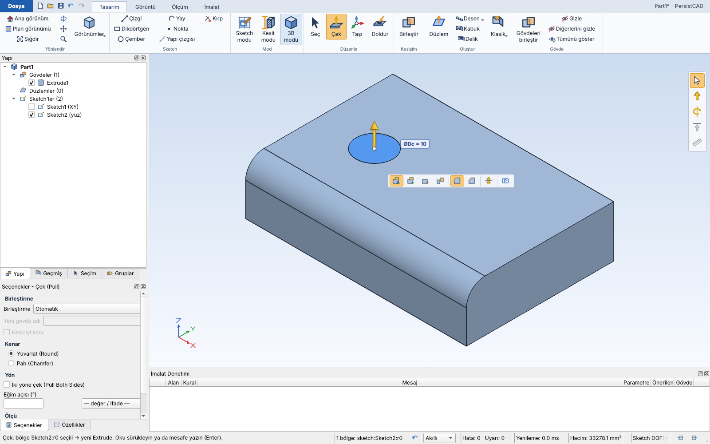
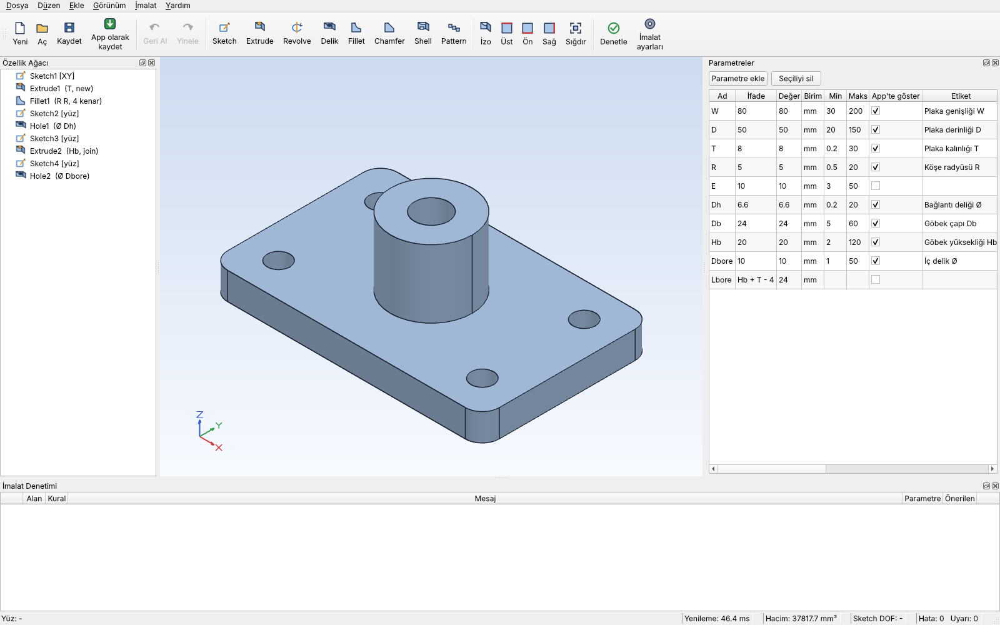
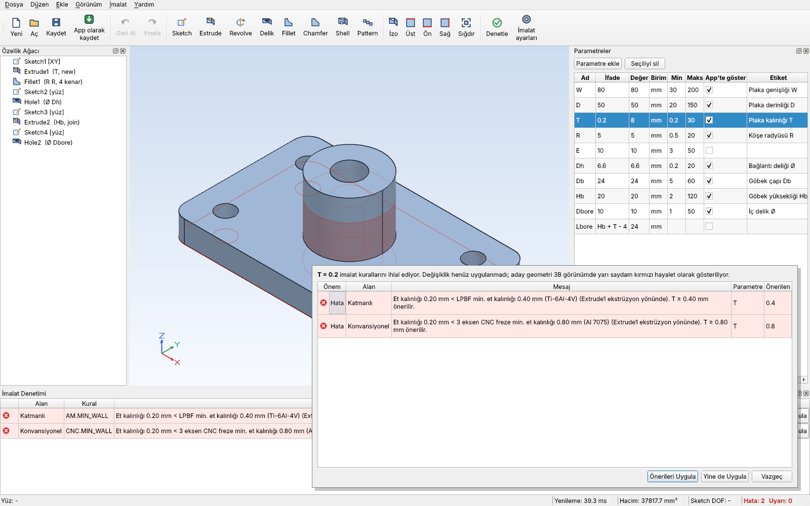
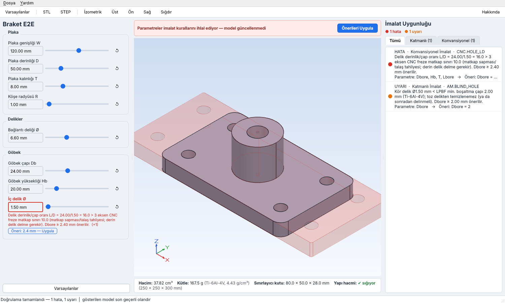
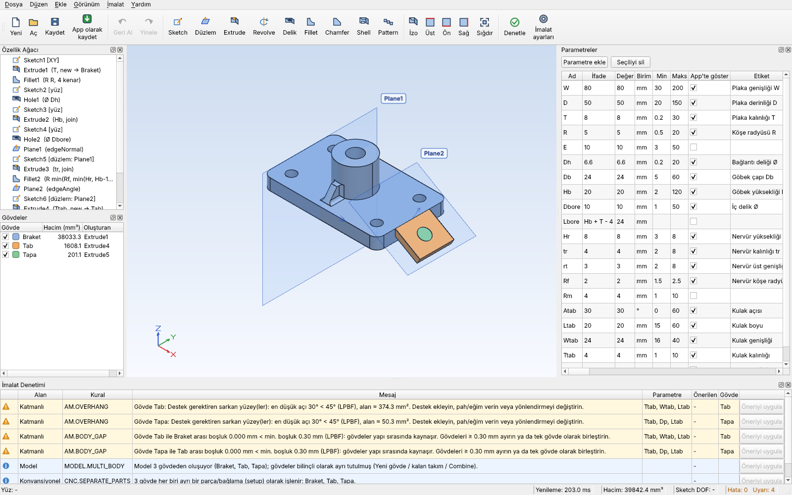
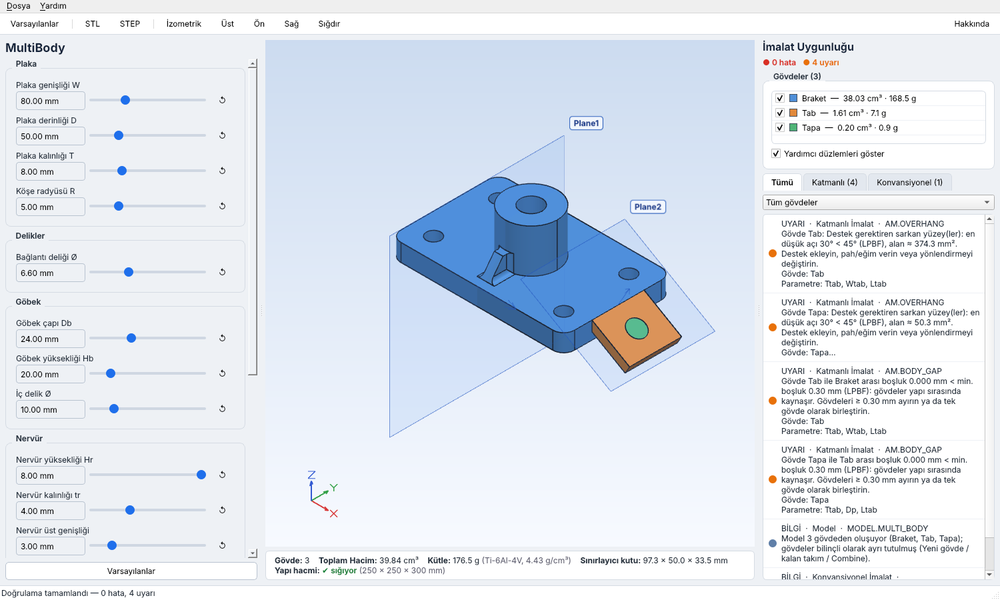
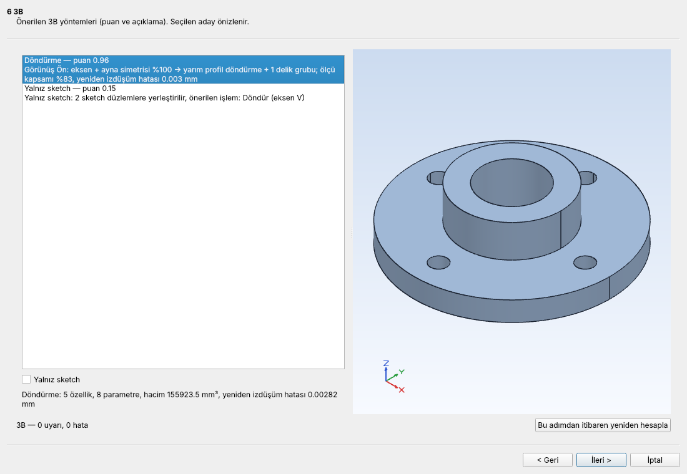
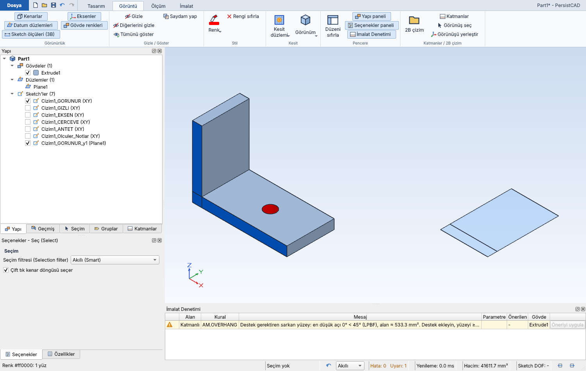

# PersistCAD

PersistCAD, SpaceClaim benzeri bir parametrik katı modelleyicidir (C++17, Qt 6, OpenCASCADE 7.6).
Ana çıktısı **"Uygulama Olarak Kaydet"** (Save as App) özelliğidir: parametrik bir parçayı, açık
parametrelerini ve imalat kurallarını birlikte bağımsız bir konfigüratör uygulamasına dönüştürür.
Bu uygulamada son kullanıcı bir parametreyi değiştirdiğinde önce katmanlı imalat (AM / DfAM) ve
konvansiyonel imalat (CNC / DfM) kontrolleri çalışır; ihlal eden parametreler için düzeltilmiş değer
önerilir.

CMake proje sürümü: 0.1.0.

## Öne çıkanlar

- **Parametrik özellik ağacı:** Sketch, Extrude, Revolve, Hole, Fillet, Chamfer, Shell ve Pattern.
  Özellikler ifadeler üzerinden tanımlanır; bir parametre değişince model baştan üretilir.
- **Datum düzlemleri (v2):** Bir kenardan dik veya açılı, iki kenardan ya da bir yüzden ofsetli düzlem
  tanımlanır. Sketch bu düzlemler üzerine çizilebilir ve düzlemler referans kenarları izler.
- **Çoklu gövde (v2):** Extrude, Revolve ve Pattern ayrı gövde oluşturabilir; birleştirme, çıkarma ve
  kesişim işlemleri hedef gövdeleri seçer. Combine özelliği gövdeler arasında boolean işlem yapar.
- **Kalıcı yüz ve kenar adları:** Yüzler, onları oluşturan özelliğe göre adlandırılır
  (ör. `Extrude1.end`, `Hole1.h0.wall`). Sonraki özellikler bu adlara referans verir.
- **2B sketch çözücü:** Kısıt çözücüsü 22 kısıt türünü destekler; serbestlik derecesi (DOF) ve
  çelişen kısıtlar raporlanır. Arayüzde bu türlerin bir kısmı araç olarak sunulur.
- **İmalat denetimi:** Her parametre değişikliğinden önce aralık, analitik ve B-Rep tabanlı kontroller
  çalışır. Toplam 40 kural kimliği vardır (katmanlı 11, konvansiyonel 16, diğer 13). Çok gövdeli
  parçalarda geometrik kontroller her gövde için ayrı çalışır.
- **Süreç ön ayarları:** Katmanlı için LPBF, EBM, DED, FDM, SLA ve SLS; konvansiyonel için 3 eksen
  freze, 5 eksen freze ve torna.
- **Uygulama paketleme:** Tek dosya çalıştırılabilir (model gömülü) veya `.pcapp` paketi. Paketler
  `persistcad_runner` ile çalışır. Çok gövdeli uygulamada gövde listesi, gövde renkleri ve gövde bazlı
  dışa aktarım vardır.
- **Dışa aktarım:** STEP ve STL.
- **Komut satırı:** `pc_mkapp` ile arayüz olmadan uygulama üretilir. `persistcad_runner --validate-only`
  ile imalat denetimi JSON ya da düz metin olarak alınır ve çıkış koduyla sonuç bildirilir.

## Modüller ve mimari

Bağımlılık sırası aşağıdaki gibidir. Public başlıklar `src/<modül>/pc/*.h` altındadır ve sözleşme
niteliğindedir. Ayrıntı için `docs/ARCHITECTURE.md` dosyasına bakın.

| Dizin | Çıktı | Görev | Bağımlılıklar |
|---|---|---|---|
| `src/core` | `pc_core` | Parametreler, ifadeler, sketch veri modeli, `.pcad` JSON, imalat ayarları | nlohmann_json |
| `src/sketch` | `pc_sketch` | 2B kısıt çözücü (LM), profil oluşturma | core, OCCT, Eigen3 |
| `src/model` | `pc_model` | Özellik ağacı üretimi, kalıcı isimlendirme, STEP/STL, kütle özellikleri | sketch, core, OCCT |
| `src/mfg` | `pc_mfg` | DfAM/DfM kuralları, öneri hesabı, değişiklik boru hattı | model, core |
| `src/apppkg` | `pc_apppkg`, `pc_mkapp` | `.pcapp` ve gömülü uygulama paketi, uygulama denetimi (lint) | mfg, model, core |
| `src/viewer` | `pc_viewer` | OpenGL 3B görünüm, tessellation, yüz ve kenar seçimi | Qt, OCCT |
| `src/appui` | `pc_appui` | "Uygulama Olarak Kaydet" iletişim kutusu | apppkg, Qt |
| `src/designer` | `persistcad` | Tasarım ortamı (ana GUI) | tüm modüller |
| `src/runner` | `persistcad_runner` | Uygulama çalıştırıcısı (konfigüratör) | apppkg, viewer, mfg, model, sketch |

Her parametre değişikliği şu hattan geçer: değerlendirme, aralık kontrolü, analitik kontrol (B-Rep
yok), model üretimi, geometrik kontrol ve sonuçların birleştirilmesi. Ayrıntı kılavuzun 8. bölümündedir.

## Derleme

### Ubuntu 24.04

Gerekli paketler:

```bash
sudo apt install -y cmake ninja-build qt6-base-dev libqt6opengl6-dev libgl1-mesa-dev \
  libocct-foundation-dev libocct-modeling-data-dev libocct-modeling-algorithms-dev \
  libocct-data-exchange-dev libocct-visualization-dev libocct-ocaf-dev occt-misc \
  nlohmann-json3-dev libgtest-dev libeigen3-dev libtbb-dev
```

Ubuntu 24.04 deposundaki OCCT paketleri 7.6.3 sürümündedir. Eigen3 sketch çözücü için zorunludur.
TBB doğrudan CMake dosyalarında geçmez; OCCT çalışma zamanı `libtbb` kütüphanesine bağlandığı için
paket listesinde yer alır.

Derleme ve testler:

```bash
cmake -S . -B build -G Ninja -DCMAKE_BUILD_TYPE=RelWithDebInfo
ninja -C build -j"$(nproc)"
ctest --test-dir build --output-on-failure
```

Paylaşılan makinelerde derlemeyi `-j1` ile yapın. GUI olmadan derlemek için `-DPC_BUILD_GUI=OFF`
kullanın; bu durumda `persistcad` ve `persistcad_runner` üretilmez ve standalone uygulama oluşturulamaz.
Derlenen ikililer `build/bin/` altına gelir: `persistcad`, `persistcad_runner`, `pc_mkapp` ve
`test_*` testleri.

### Windows

- Visual Studio 2022 (MSVC), CMake ve Ninja gerekir.
- Qt 6 (MSVC kiti; proje Qt 6.4 ile geliştirilmiştir) ve OCCT 7.6 veya üstü hazır derlemeden ya da
  vcpkg üzerinden sağlanabilir. nlohmann-json, Eigen3 ve GoogleTest da gerekir.
- Developer PowerShell içinde yapılandırma örneği:

```powershell
cmake -S . -B build -G Ninja -DCMAKE_BUILD_TYPE=Release `
  -DCMAKE_PREFIX_PATH="C:\Qt\6.x.x\msvc2022_64;C:\opencascade-7.6.x"
cmake --build build
```

OCCT bulunamazsa `-DOpenCASCADE_DIR=...` ile cmake klasörünü gösterin. vcpkg kullanıyorsanız
`-DCMAKE_TOOLCHAIN_FILE=<vcpkg>/scripts/buildsystems/vcpkg.cmake` ekleyin.

- **Runner dağıtımı:** `windeployqt --release build\bin\persistcad_runner.exe` komutu Qt DLL'lerini
  ve platform eklentilerini kopyalar.
- **OCCT DLL'leri:** `TK*.dll` dosyalarını ve OCCT'nin bağlı olduğu TBB DLL'ini standalone uygulamanın
  yanına kopyalayın.
- **Standalone uyarısı:** Model dosyanın içine gömülüdür, ancak Qt ve OCCT çalışma zamanı kütüphaneleri
  uygulamanın yanında ayrıca bulunmalıdır. Dağıtım klasörünü tek parça olarak düşünün.

## Hızlı başlangıç

1. Örnek parçayı tasarım ortamında açın:

   ```bash
   ./build/bin/persistcad samples/bracket.pcad
   ```

   Çok gövdeli (v2) örnek de aynı şekilde açılır. Parça üç gövdeden oluşur (Braket, Tab, Tapa); varsayılan
   değerlerde 0 hata ve 4 uyarı verir. Adım adım kurulumu kılavuzun 16. bölümündedir.

   ```bash
   ./build/bin/persistcad samples/v2_multibody.pcad
   ```

2. **Gruplar** sekmesindeki parametre tablosunda `T` değerini `0.4` yapın. `T = 0.4` değeri konvansiyonel imalat için çok ince
   bir duvar oluşturur (`CNC.MIN_WALL`). İnceleme penceresinde **"Önerileri Uygula"** düğmesi
   `T = 0.8` değerini uygular.

3. **Uygulama Olarak Kaydet** (Ctrl+Shift+A) ile uygulamayı kaydedin. Parametrelerin "Uygulamada göster"
   işaretlerini ve dışa aktarım seçeneklerini ayarlayın.

4. Uygulamayı çalıştırın. Tek dosya çıktısını doğrudan çalıştırabilirsiniz. `.pcapp` paketi için
   çalıştırıcıya dosya yolunu verin:

   ```bash
   ./build/bin/persistcad_runner out/flans.pcapp
   ```

Komut satırından da üretebilirsiniz:

```bash
mkdir -p out
./build/bin/pc_mkapp samples/bracket.pcad ./build/bin/persistcad_runner out/flans_app --name "Flanş Braketi"
./out/flans_app --validate-only --set T=0.4 --text   # çıkış kodu 2: uygun değil
```

## SpaceClaim kullanıcıları için

Tasarım ortamı SpaceClaim düzenini ve kısayollarını izler (ayrıntı: kılavuzun 2. ve 17. bölümleri,
tasarım: [`docs/spaceclaim_ux/SPEC.md`](docs/spaceclaim_ux/SPEC.md)).



**Düzen.** Üstte mavi **Dosya** düğmesi, hızlı erişim (Yeni, Aç, Kaydet, Geri Al, Yinele) ve
**Tasarım · Görüntü · Ölçüm · İmalat** sekmeli ribbon (menü çubuğu yok). Tasarım sekmesi: Yönlendir | Sketch |
Mod | Düzenle (Seç, Çek, Taşı, Doldur) | Kesişim | Oluştur | Gövde; sketch modunda Kısıtlar, Ölçüler ve
Sketch Oturumu grupları belirir. Solda **Yapı** paneli (Yapı · Geçmiş · Seçim · Gruplar sekmeleri), altında
**Seçenekler / Özellikler**, altta İmalat Denetimi. Görünümün sağ kenarında araç kılavuzları, son tıklamanın
yanında mini araç çubuğu. Gruplar = parametreler; "Uygulamada göster" işaretli olanlar Save-as-App girdisidir.

| Tuş | İşlev | Tuş | İşlev |
|---|---|---|---|
| S | Seç | K | Sketch modu (seçili yüz / datum; boş belgede XY; yoksa "Sketch düzlemi seç") |
| P | Çek (Pull) | D | 3B modu (sketch'i bitirir, kesiti kapatır) |
| M | Taşı (Move) | X | Kesit modu |
| F | Doldur (Fill) | V | Plan görünümü |
| I | Birleştir (Combine) | H | Ana görünüm (izometrik + sığdır) |
| L / R / C | Çizgi / Dikdörtgen / Çember | Z, Alt+Z | Sığdır |
| T | Kırp (sketch) | ← / → | Önceki / sonraki görünüm |
| Tab | Ölçü alanını kilitle → sonraki alan; kutu kapalıyken araç kılavuzları | Esc | kutu → çizim → araç → seçim (sketch'ten çıkmaz) |
| Ctrl+G | Grup oluştur: 3B'de seçili yüz/kenar/gövde → **adlandırılmış seçim** (adı yazıp Enter); yazılan/az önce çekilen değer veya sketch ölçüsü → parametre | Del | Sil (Gruplar'da: adlandırılmış seçimi sil) |
| F2 | Gruplar'da adlandırılmış seçimi yeniden adlandır | Sağ tık (yüz) | … > Adlandırılmış seçim oluştur |
| Ctrl+Z / Ctrl+Y | Geri al / Yinele | Ctrl+Shift+A | Uygulama olarak kaydet |
| Ctrl+H / Alt+H / Ctrl+Shift+H | Gizle (seçili yüz / gövde) / Diğerlerini gizle / Tümünü göster (kılavuz §3.7) | F5 | İmalat denetimi |

**U** = Kadar (Up To), Çek (P) içinde. PersistCAD'de olmayan SpaceClaim tuşları (B, Ctrl+C/V/X, E, O, …) durum çubuğunda açıklama verir.

**Fare.** Orta düğme sürükle = çevir, Shift+orta = kaydır, Ctrl+orta yukarı/aşağı = yakınlaştır, tekerlek =
imlece yakınlaştır. Sol sürükleme boşlukta modeli döndürmez (Yönlendir > Çevir/Kaydır/Yakınlaştır açıkken
yapar). Düz tık 6 piksel içindeki kenarı yüze tercih eder; Ctrl+tık ekler/çıkarır, çift tık kenar döngüsü,
üçlü tık gövde, Alt+tık sürücü (ör. dönme ekseni). Sağ tık bağlam menüsü (kenarda: düzlem, Yuvarlat/Pahla).
Sketch sırasında da orta düğmeyle döndürülebilir; çizim sketch düzlemine düşer.

**İlk 10 dakika:** Ctrl+N → K → R, orijine tıkla, `60` Tab `40` Enter → D → P, bölgeye tıkla, `8` Enter
(60×40×8 katı, tek geri alma adımı) → Ctrl+G ile `T` parametresi ("Uygulamada göster") → Gruplar'da T'yi
değiştir → kenara tıkla `3` Enter (Fillet) → üst yüz + K, Ø10 çember, D, P, Seçenekler'de Kes, `5` Enter →
X kesit → D → Ctrl+S → Ctrl+Shift+A. Bu akışın tamamı `tests/gui/gui_harness_sc_e2e.cpp` ile sınanır.

## Ekran görüntüleri

Tasarım ortamı:



İmalat denetimi incelemesi (T = 0.2 girildiğinde; ayrıntı için kılavuzun 8. bölümüne bakın):



Çalıştırıcı, ihlal durumu:



### v2: yardımcı düzlemler ve çoklu gövde





## Teknik resimden içe aktarma

**Dosya > Teknik resimden içe aktar…** (şeritte **Tasarım > İçe aktar > Teknik resim**) bir DXF, vektör PDF ya da
taranmış resimden sketch, parametre ve 3B model üretir. 7 adımlı sihirbaz (Kaynak, Sayfa düzeni, Geometri,
Ölçüler, Sketch, 3B, Özet) her adımda düzeltmeye izin verir; sonuç belgeye tek geri alma adımı olarak eklenir ve
ölçülerden gelen parametreler (`D1`, `L_top`, `Dh1`, `n_h1` …) Gruplar'da "Uygulamada göster" işaretli görünür.
Komut satırı: `pc_drawing_cli resim.dxf --out parca.pcad`. Ayrıntılar: kılavuz
[bölüm 18](docs/KULLANIM_KILAVUZU.md#18-teknik-resimden-içe-aktarma), tasarım: `docs/drawing_import/`.
PDF/tarama/OCR için qpdf, OpenCV, Tesseract (+ isteğe bağlı QtPdf) gerekir; yoksa derleme bu girdileri
devre dışı bırakır, DXF her zaman çalışır.



## 2B çizimden 3B'ye (SpaceClaim yöntemi)

SpaceClaim videosundaki el ile akış da vardır (kılavuz
[bölüm 19](docs/KULLANIM_KILAVUZU.md#19-2b-çizimden-3bye-spaceclaim-yöntemi)): **Dosya > İçe aktar > 2B çizim (eğri
olarak)** → **Katmanlar** sekmesinde ölçü / gizli / eksen katmanlarını gizle → Görüntü > **Görünüş seç** + **Görünüşü
yerleştir** (yan görünüş 90° katlanır) → eğriye tıkla, **F** Enter (Doldur) → **P**, **U** (Kadar), öbür görünüşün
köşesine tıkla, Enter → Görüntü > Stil > **Renk**. `gui_harness_video2d` bu akışı plate ve lbracket çizimlerinde
gerçek tıklamalarla sınar (hacim = `gt.json`, geri al/yinele, kaydet/aç).



## Belgeler

- [`docs/KULLANIM_KILAVUZU.md`](docs/KULLANIM_KILAVUZU.md): arayüz, parametreler, sketch, özellikler,
  imalat kuralları, uygulama paketleme, çalıştırıcı, komut satırı, dosya biçimleri ve eğitim.
- [`docs/ARCHITECTURE.md`](docs/ARCHITECTURE.md): modül sözleşmeleri ve geliştirme kuralları.

## Bilinen sınırlamalar

- Analitik model taslak (draft) açısını, pah (chamfer) ve yuvarlatma (fillet) malzeme etkisini ve
  kabukları (shell) malzeme sınıflandırıcısına almaz; bu durumlar geometrik kontrollerle yakalanır.
- Pattern kopyaları sabit kopya olarak alınır; geometriyi takip etmezler.
- Sketch editöründe marquee seçimi, trim, offset ve mirror yoktur.
- Çalıştırıcıda, uygulamada gösterilmeyen (türetilmiş) parametreler için öneri uygulanamaz.
- Windows derlemesi MSYS2/CLANG64 ile doğrulandı; MSVC (Visual Studio) derlemesi henüz denenmedi.
- Düzlem penceresinin canlı önizlemesi, pencere açıldıktan sonra tabloda yapılan parametre değişikliklerini
  yansıtmaz (Tamam'a basınca değişiklikler korunur, yalnızca önizleme eski kalır).
- Yüzden ofsetli düzlem için yüz bağlam menüsü yoktur; bu tür düzlem yalnızca Düzlem penceresinden oluşturulur.
- Datum düzlemindeki özellikler, Combine ve "Aracı koru" gövdeleri analitik olarak yalnızca model
  oluşturulduktan sonra (validateChange'in 2. analitik aşaması) denetlenir; modelsiz `checkAnalytic` bunları atlar.
- Gövdeler panelinden yeniden adlandırma yalnızca Extrude, Revolve veya Pattern ile oluşan gövdelerde yapılır.
- `persistcad_runner --help` çalıştırmak için görüntü sunucusu gerekir; GUI olmayan ortamlarda
  `QT_QPA_PLATFORM=offscreen` ekleyin. `--validate-only` ise pencere açmadan çalışır.

Tam liste kılavuzun 14. bölümündedir.

## Windows (yerel) derleme — doğrulandı

`scripts/windows/` içindeki betikler yönetici yetkisi gerektirmeden MSYS2'yi `%USERPROFILE%\msys64` altına kurar
ve projeyi **CLANG64** (Clang 23, Qt 6.12, OpenCASCADE 7.9.3) ile derler. Gezgin'de çift tıklamak yeterlidir:

| Betik | İş |
|---|---|
| `0_hepsini_calistir.bat` | 1→2→4→3 sırayla: kurulum, derleme, paketleme, test |
| `1_kurulum.bat` | MSYS2 + paketler (ilk sefer ~10 dk, ~1 GB indirme) |
| `2_derle.bat` | `build-clang64/` içine Release derleme |
| `4_paketle.bat` | `dist/`: exe + DLL + Qt eklentileri + örnek uygulamalar (MSYS2 olmadan çalışır) |
| `3_test.bat` | 165 test (GUI testleri kısa süre pencere açar) |
| `5_tasarimci_ac.bat` | `dist\persistcad.exe`'yi v2 örneğiyle açar |
| `6_derle_ve_test.bat` / `7_basarisizlari_tekrar.bat` | değişiklik sonrası derle+test / başarısızları seri tekrar |

Loglar `logs/` klasörüne yazılır. Windows 11'de 165/165 test geçti (14.11.2026).

**Neden UCRT64 değil CLANG64:** MSYS2'nin GCC 16 ile derlenmiş `mingw-w64-ucrt-x86_64-opencascade 7.9.3-3`
paketi, koni içeren katılarda `BRepClass3d_SolidClassifier` içinde çöküyor (`scripts/windows/occt_test.cpp` ile
bağımsız olarak doğrulandı). Aynı sürümün Clang derlemesi sorunsuz. UCRT64'ü yine denemek için `set PC_ENV=ucrt64`.

Notlar: Windows'ta hesaplamalar Linux'a göre ~1,5 kat yavaş ölçüldü (hız testlerinde eşikler Windows için 2×).
Standalone uygulama `.exe` olarak yazılır ve çalıştırıcının DLL'leri ile Qt eklenti klasörleri yanına kopyalanır.

## Test durumu

`ctest` 353/353 geçer (3 devre dışı araç testi hariç; Xvfb; GUI düzenekleri `QT_FONT_DPI=72` ile de). 2B çizimden
3B'ye video akışı: `gui_harness_video2d` + `gui_harness_video2d_dpi72` (`--shots` ile `docs/import2d/shots/video_*.png`). Gizle / Göster:
`gui_harness_visibility` (`--shots` ile `docs/visibility/shots/*.png`). SpaceClaim arayüzü düzenekleri:
`gui_harness_sc_shell` (kabuk: ribbon, paneller, modlar, kısayollar), `gui_harness_sc_tools` (araçlar, test
host'u ile), `gui_harness_sc_e2e` (gerçek ana pencerede ilk 10 dakika akışı + Save as App + `--validate-only`;
`--shots` ile `docs/spaceclaim_ux/shots/final_*.png`).

Eski özet: `ctest` 165/165 geçer. Birim testleri: core, sketch, model, mfg, apppkg, v2 ve v3 dosyaları (`test_model_v2`,
`test_mfg_v2`, `test_apppkg_v2`, `test_review_v2`, `test_mfg_v3`). Xvfb altında GUI harness iki kez çalışır:
`gui_harness` (tasarımcıda ihlal → inceleme penceresi → "Önerileri Uygula", Save as App ile exe + .pcapp
yazımı, runner'da alan bazlı öneri uygulama, STL/STEP dışa aktarma) ve `gui_harness_v2` (datum düzlemi,
gövde ekleme ve çıkarma akışları) ve `gui_harness_v3` (pencere açıkken tabloda yapılan parametre
değişikliğinin korunması). Uçtan uca betik: `tests/e2e.sh`.

`tests/runner_v2_cli.sh [derleme-dizini]` (varsayılan `build-e2`) çok gövdeli örneği `pc_mkapp` ile paketler
ve `--validate-only` çıktısındaki `bodies` ve `body` alanlarını denetler. Bu betik ctest'te değildir,
elle çalıştırılır.


## Kurulum exe'si (Windows, admin gerektirmez)

`installer/PersistCAD.nsi` bir NSIS kurulum betiğidir. Kurulum `%LOCALAPPDATA%\Programs\PersistCAD`
klasörüne yapılır, UAC/admin istemez; masaüstü ve Başlat menüsü kısayolları, `.pcad`/`.pcapp`
ilişkilendirmesi ve "Uygulamalar ve özellikler" kaydı kullanıcıya özeldir. Tüm DLL'ler ve Qt
eklentileri pakete gömülür.

- **Otomatik:** `.github/workflows/kurulum.yml` her `main` push'unda Windows'ta derler, `dist`
  paketler, `installer/check_deps.py` ile eksik DLL denetimi yapar, uygulamayı yalnız Windows
  sistem PATH'iyle çalıştırarak test eder ve `PersistCAD_Kurulum_<sürüm>.exe` üretir
  (Actions > Kurulum > Artifacts). `v*` etiketi itilirse exe GitHub Release'e eklenir.
- **Elle (MSYS2 CLANG64):**
  ```
  pacman -S --needed mingw-w64-clang-x86_64-nsis
  PC_DIST=dist bash scripts/windows/paketle.sh
  python installer/check_deps.py dist
  makensis -DSRC=$PWD/dist installer/PersistCAD.nsi
  ```
