# PersistCAD Kullanım Kılavuzu

Bu kılavuz tasarım ortamını (`persistcad`), uygulama paketlemeyi ("Uygulama Olarak Kaydet"),
çalıştırıcıyı (`persistcad_runner`) ve komut satırı araçlarını (`pc_mkapp`, `persistcad_runner`
parametreleri) anlatır. Burada yazılan her davranış kaynak kodda (`src/`) ve modül `STATUS.md`
dosyalarında doğrulanmıştır. Bulunmayan bir davranış belgelenmemiştir.

Ekran görüntüleri `docs/screenshots/` dizinindedir. `final_*.png` görüntüleri güncel örnekle
(`tests/e2e.sh --update-docs`) üretilmiştir; diğer görüntüler geliştirme sırasında alınmış ara
görüntülerdir (bazılarında eski örnekteki `HOLE.TIP_BREAKOUT` uyarısı görünür).

## İçindekiler

1. [Kavramlar](#1-kavramlar)
2. [Tasarım ortamı](#2-tasarım-ortamı)
3. [Parametreler ve ifadeler](#3-parametreler-ve-ifadeler) — [3.5 Seçimden parametre](#35-seçimden-parametre) — [3.6 Adlandırılmış seçimler (yüz isimlendirme)](#36-adlandırılmış-seçimler-yüz-isimlendirme) — [3.7 Gizle / Göster](#37-gizle--göster)
4. [Sketch modu](#4-sketch-modu)
5. [Özellik türleri](#5-özellik-türleri)
6. [Kalıcı yüz ve kenar isimlendirme](#6-kalıcı-yüz-ve-kenar-isimlendirme)
7. [İmalat ayarları ve süreç ön ayarları](#7-imalat-ayarları-ve-süreç-ön-ayarları)
8. [Değişiklik boru hattı ve inceleme penceresi](#8-değişiklik-boru-hattı-ve-inceleme-penceresi)
9. [İmalat kuralları](#9-imalat-kuralları)
10. [Uygulama Olarak Kaydet](#10-uygulama-olarak-kaydet)
11. [Çalıştırıcı (persistcad_runner)](#11-çalıştırıcı-persistcad_runner)
12. [Komut satırı araçları](#12-komut-satırı-araçları)
13. [Dosya biçimleri](#13-dosya-biçimleri)
14. [Bilinen sınırlamalar](#14-bilinen-sınırlamalar)
15. [Eğitim: flanş braketi](#15-eğitim-flanş-braketi)
16. [Yardımcı düzlemler ve çoklu gövde (v2)](#16-yardımcı-düzlemler-ve-çoklu-gövde-v2)
17. [SpaceClaim kullanıcıları için: ilk 10 dakika](#17-spaceclaim-kullanıcıları-için-ilk-10-dakika)
18. [Teknik resimden içe aktarma](#18-teknik-resimden-içe-aktarma)
19. [2B çizimden 3B'ye (SpaceClaim yöntemi)](#19-2b-çizimden-3bye-spaceclaim-yöntemi)

---

## 1. Kavramlar

- **Parametre:** Adlandırılmış bir değer (ör. `W`, `T`). Bir ifade de olabilir (ör. `Hb + T - 4`).
  Uzunluklar mm, açılar derece, sayılar ise adet veya boyutsuz olarak tanımlanır.
- **Özellik (feature):** Model ağacındaki bir adım: Sketch, Extrude, Revolve, Hole, Fillet, Chamfer,
  Shell veya Pattern. v2 ile Plane (datum düzlem) ve Combine (gövde birleştirme) de eklendi (16. bölüm).
  Özellikler yukarıdan aşağıya sırayla değerlendirilir.
- **Gövde (body):** Parçanın ayrı bir katısı. Her gövdenin bir adı vardır. Tek gövdeli parçada gövde
  sayısı 1'dir; Extrude, Revolve ve Pattern yeni gövde oluşturabilir (16. bölüm).
- **Sketch:** Bir düzlem üzerindeki 2B geometri ve kısıtlar. Extrude, Revolve ve Hole gibi özellikler
  sketch'i kullanır.
- **Kalıcı ad:** Modelin her yüzü ve kenarı, onu oluşturan özelliğe göre bir ad alır. Bu ad, geometri
  değiştikten sonra da referans olarak kullanılabilir.
- **İmalat denetimi:** Parametre değerlerine bağlı olarak çalışan katmanlı (AM) ve konvansiyonel (CNC)
  kurallar. İhlal durumunda düzeltilmiş bir değer önerir.
- **Uygulama (app):** Model, açık parametreler, imalat kuralları ve dışa aktarım izinlerinin birlikte
  paketlenmiş hali.

## 2. Tasarım ortamı

Tasarım ortamı SpaceClaim düzenini, modlarını ve kısayollarını izler. SpaceClaim'e alışmış kullanıcı için
adım adım ilk 10 dakika: 17. bölüm.

### 2.1 Pencere düzeni

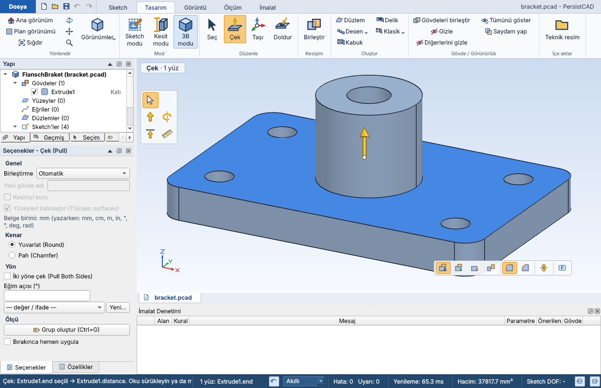

- **Üst şerit (ribbon):** solda mavi **Dosya** düğmesi (Yeni, Aç..., Kaydet, Farklı Kaydet..., Uygulama Olarak
  Kaydet..., Dışa Aktar, Son dosyalar, Ayarlar, Hakkında, Çıkış), yanında hızlı erişim düğmeleri (Yeni, Aç,
  Kaydet, Geri Al, Yinele) ve sekmeler **Sketch · Tasarım · Görüntü · Ölçüm · İmalat**. Menü çubuğu yoktur.
  Sketch modunda **Sketch** sekmesi kendiliğinden seçilir, sketch bitince **Tasarım** sekmesine dönülür. Sekme
  değiştirmek etkin aracı, seçimi ve Seçenekler panelini değiştirmez.
- **Dar pencerede şerit:** gruplar hiçbir zaman sıkıştırılmaz (etiket kısalmaz). Sığmayan gruplar sırayla önce
  **küçük** düğmelere (simge + metin, üç satır), sonra tek bir **grup açılır düğmesine** ("Gövde / Görünürlük ▾")
  dönüşür; yine sığmazsa sağ kenarda **»** düğmesi kalan komutları listeler. Seç, Çek, Taşı, Doldur (Tasarım),
  Oluştur ve Sketch'i Bitir (Sketch) grupları açılır düğmeye dönüşmez: 1024×768'de de doğrudan tıklanır.
- **Yapı paneli (sol üst):** alt kenardaki sekmeler **Yapı** (belge > Gövdeler / Düzlemler / Sketch'ler; onay
  kutusu görünürlük, çift tık sketch'i düzenler, gövde adı yerinde değiştirilir), **Geçmiş** (parametrik özellik
  ağacı, 2.4), **Seçim**, **Gruplar** (parametre tablosu, 3. bölüm), **Katmanlar** ve **Görünümler** (2.5).
- **Seçenekler / Özellikler (sol alt):** etkin aracın seçenekleri (başlık "Seçenekler - Çek (Pull)") ve seçili
  öğenin özellikleri (ad, hacim, oluşturan özellik, yarıçap ... düzenlenebilir). Bir aracın seçenekleri panele
  sığmazsa panel kendiliğinden uzar (Yapı paneli en az 170 piksel kalır); kaydırma çubuğu çıkmaz.
- **Panel başlıkları:** ▲ düğmesi paneli başlığına kadar **daraltır** (komşu panel yeri alır, tekrar tıklayınca
  açılır); yanında ayır ve kapat düğmeleri. Sol sütun dar pencerede pencerenin ≈ %20–26'sına iner (en az 240
  piksel); geniş sayfalar (Gruplar, Katmanlar) panelin içinde kayar.
- **Görünüm (orta):** 3B görünüm. Sketch modunda sketch editörü görünümün üstüne şeffaf olarak açılır; katılar
  yarı saydam görünür. Sol üstte **görünüm yönergesi (HUD)**: "**Çek** · 1 yüz" (etkin araç · seçim), altında
  ileti şeridi (bilgi / uyarı / hata; simge + metin, hata kırmızı ve kalıcı, tıklayınca kapanır). Etkin aracın
  **araç kılavuzları** bunun altında, sol üstte iki sütun hâlinde durur (Seç en üstte). Son tıklamanın yanında
  **mini araç çubuğu** bulunur; sağ tıkta bağlam menüsünün hemen üstünde de açılır.
- **Belge sekmesi:** görünümün altında belgenin adı ("Part1", değişiklikten sonra "Part1*"; ipucunda dosya yolu).
- **İmalat Denetimi (alt)** ve koyu mavi **durum çubuğu** (2.5).
- Görüntü > Pencere: "Düzeni sıfırla" ve panel aç/kapa.
- **İpuçları:** şerit düğmelerinin ipucu komut adını, kısayolu, kısa açıklamayı ve "F1: yardım" satırını
  gösterir; pasif düğmede nedeni yazar. **F1** bu kılavuzu uygulama içinde açar (fare bir şerit düğmesinin
  üzerindeyse o komutun adını arar).

### 2.2 Ribbon grupları

| Sekme | Gruplar |
|---|---|
| Sketch | **Yönlendir** (Ana görünüm, Plan görünümü, Sığdır) · **Oluştur** (Çizgi, Dikdörtgen, Çember, Yay, Nokta, Yapı çizgisi) · **Değiştir** (Kırp, Sil) · **Kısıtlar** · **Ölçüler** · **Düzenle** (Seç, Çek, Taşı, Doldur) · **Sketch'i Bitir** (Sketch'i Bitir, Vazgeç, Düzlem ofseti). 3B modunda çizim grupları görünür ama **pasiftir** (ipucu nedenini söyler); Yönlendir her zaman etkindir |
| Tasarım | **Yönlendir** (Ana görünüm, Plan görünümü, Sığdır, Çevir, Kaydır, Yakınlaştır, Görünümler ▾) · **Mod** (Sketch modu, Kesit modu, 3B modu) · **Düzenle** (Seç, Çek, Taşı, Doldur) · **Kesişim** (Birleştir) · **Oluştur** (Düzlem, Desen ▾, Kabuk, Delik, Klasik ▾ = özellik pencereleri) · **Gövde / Görünürlük** (Gövdeleri birleştir, Gizle, Diğerlerini gizle, Tümünü göster, Saydam yap) · **İçe aktar** (Teknik resim). Sketch açıkken Kesişim / Oluştur / Gövde / İçe aktar pasiftir |
| Görüntü | Görünürlük (Kenarlar, Datum düzlemleri, Sketch ölçüleri, Eksenler, Gövde renkleri), Kesit, Pencere |
| Ölçüm | Ölç (2. faz), Kütle özellikleri |
| İmalat | Denetim (Şimdi Denetle F5, Ayarlar), Uygulama (Uygulama olarak kaydet), Dışa aktar (STEP, STL) |

**Modlar:** **K** sketch modunu açar: seçili düzlemsel yüzde (`OnFace`), seçili datum düzleminde (`OnPlane`),
seçili sketch'i düzenleyerek; boş belgede doğrudan XY'de; aksi halde "Sketch düzlemi seç" durumuna geçer
(düzlemsel bir yüze, datum düzlemine ya da orijindeki XY / XZ / YZ karelerinden birine tıklayın; Esc veya D
iptal). Sketch açılınca görünüm sketch düzlemine dik döner (Plan görünümü). **D** sketch'i bitirir (tek geri alma
adımı) ve 3B moduna döner; **X** kesit görünümünü açar/kapatır. 3B modunda L / R / C sketch modunu da açar.

### 2.3 Araçlar (Düzenle)

- **Seç (S):** tık seçer, Ctrl+tık ekler/çıkarır, çift tık kenar döngüsü, üçlü tık gövde. Seçim filtresi
  durum çubuğunda (Akıllı, Yüz, Kenar, Gövde, Düzlem, Sketch). Ctrl+A: aynı türdeki tüm öğeler.
- **Çek (P):** sketch bölgesine tıklayıp değer yazmak (`8` Enter) yeni Extrude oluşturur; negatif değer kesik
  açar (Otomatik birleştirme). Seçeneklerde Birleştirme: Otomatik / Ekle / **Kes** / Birleştirme yok / Kesişim
  (Kes seçiliyken bir yüz üzerindeki sketch malzemenin içine doğru keser), İki yöne çek. Extrude uç yüzüne
  tıklayıp değer yazmak mesafeyi değiştirir; mesafe düz sayılı bir parametreye bağlıysa parametre güncellenir
  (`T = 10 (parametre güncellendi)`), türetilmiş bir ifadeye bağlıysa işlem reddedilir. Kenara tıklayıp değer
  yazmak Fillet (Seçenekler: Pah = Chamfer), fillet yüzüne tıklayıp değer yazmak yarıçapı değiştirir. Alt+tık
  ile seçilen sketch çizgisi (yapı çizgisi de) dönme eksenidir: Revolve. Sarı ok sürüklenebilir (hayalet
  önizleme, bırakınca 600 ms sonra uygulanır). Tab (kutu kapalıyken) araç kılavuzlarını değiştirir.
- **Taşı (M):** datum düzlemini / sketch düzlemini normal oku boyunca öteler; "Desen oluştur" açıkken bir delik
  ya da Extrude yüzü X/Y/Z oku boyunca taşınınca doğrusal Pattern (2 adet) oluşur.
- **Doldur (F):** fillet/pah kenarını çıkarır, tek delik siler, kesik Extrude/Revolve'u bastırır.
- **Birleştir (I):** hedef ve kesici gövde, mini araç çubuğunda Çıkar / Kesişim / Birleştir.
- **Düzlem, Kabuk:** yüzden / kenardan datum düzlemi; yüz(ler) + kalınlık.
- **Ctrl+G (Grup oluştur):** bağlama göre çalışır (SpaceClaim gibi). Açık ölçü kutusundaki ya da **az önce
  çekilen** değerden parametre oluşturur (ad önerisi ör. `Extrude1_distance`, "Uygulamada göster" seçeneği) ve
  alanı ona bağlar. 3B görünümde **yüz / kenar / gövde seçiliyse** adlandırılmış seçim oluşturur (§3.6);
  sketch'te ölçülebilir bir seçim (çizgi, çember, ölçü etiketi) varsa parametre penceresini açar (§3.5).
- Esc zinciri: ölçü kutusu → çizim / sürükleme → araç → Seç → seçimi temizle (sketch modundan çıkmaz).

### 2.4 Kısayollar ve fare

| Tuş | İşlev | Tuş | İşlev |
|---|---|---|---|
| S, P, M, F, I | Seç, Çek, Taşı, Doldur, Birleştir | K, D, X | Sketch modu, 3B modu, Kesit modu |
| L, R, C, T | Çizgi, Dikdörtgen, Çember, Kırp (sketch) | H, V | Ana görünüm, Plan görünümü |
| Z, Alt+Z | Sığdır | ← / → | Önceki / sonraki görünüm |
| Ctrl++ / Ctrl+- | Yakınlaştır / uzaklaştır | Del | Sil |
| Ctrl+Z / Ctrl+Y | Geri al / Yinele | Ctrl+G | Grup oluştur: seçili yüz/kenar/gövde → adlandırılmış seçim; ölçü/değer → parametre |
| F2 | Gruplar'da seçili adlandırılmış seçimi yeniden adlandır | Del | (Gruplar'da) adlandırılmış seçimi sil |
| Ctrl+N / Ctrl+O / Ctrl+S | Yeni / Aç / Kaydet | Ctrl+Shift+A | Uygulama olarak kaydet |
| Ctrl+H, Alt+H, Ctrl+Shift+H | Gizle (seçili yüz veya gövde), Diğerlerini gizle, Tümünü göster (§3.7) | F5 | Şimdi denetle |
| Ctrl+0 … Ctrl+6 | İzometrik, Trimetrik, Üst, Alt, Sol, Sağ, Ön (yalnız kamera; sketch düzlemi değişmez) | F1 | Yardım (bu kılavuz) |
| F6 / Shift+F6 | Odağı görünüm → Yapı → Seçenekler → şerit sekmeleri arasında dolaştır | | |

Tek harfli kısayollar metin girerken (tablo hücresi, ölçü kutusu, ifade alanı) çalışmaz. PersistCAD'de
olmayan SpaceClaim tuşları (B, Ctrl+C / X / V / D, E, O, U, Ctrl+T / L / Q ...) durum çubuğunda açıklama verir.

**Fare (SpaceClaim şeması):** orta düğme sürükle = çevir, Shift+orta = kaydır, Ctrl+orta yukarı/aşağı =
yakınlaştır, tekerlek = imlece yakınlaştır, Shift+orta çift tık = yüze dik bak. Sol sürükleme boşlukta modeli
döndürmez; Yönlendir grubunda Çevir / Kaydır / Yakınlaştır açıkken sol sürükleme o işi yapar. Düz tık
6 piksel içindeki kenarı yüze tercih eder. **Sağ tık** bağlam menüsünü açar: kenarda "Bu kenara dik düzlem",
"Bu kenardan açılı düzlem", "İki kenardan düzlem", "Yuvarlat (Çek)", "Pahla (Çek)"; datum düzleminde "Bu
düzlemde sketch başlat"; boşlukta / yüzde "Son sketch düzlemini kullan", **Görünüm ▸** (standart görünümler),
araçlar, "Bu yüzde sketch aç", Renk, Gizle / Diğerlerini gizle / Tümünü göster, **Görünürlüğü tersine çevir**
(gizli gövdeler görünür, görünenler gizlenir; tek geri alma adımı), **Yapı ağacında bul**, Kes / Kopyala /
Yapıştır (pasif: pano desteği yok), **Sil** ve **Özellikler** (Özellikler panelini açar). Sağ tık, seçili
olmayan bir yüzde o yüzü seçer; seçimin içindeki bir yüzde seçimi korur. Fareyle üzerine gelmek (hover) yüzü
yalnız vurgular, seçmez. 3B'de bir sketch eğrisine çift tık o sketch'i düzenler. Çalıştırıcı (`persistcad_runner`) eski şemayı korur (sol sürükle = döndür).

### 2.5 Paneller

**Geçmiş.** Her özellik adı ve kısa bir özet satırıyla listelenir, ör. `Extrude1 (T, new)`,
`Hole1 (Ø Dh)`, `Fillet1 (R R, 4 kenar)`. Bastırılmış özellikler `(bastırıldı)`, geri sarma konumunun
ötesindekiler `(geri sarıldı)` ile işaretlenir. Hatalı özellik kırmızı simgeyle ve `HATA: ...` ipucuyla
gösterilir.
- Özelliğe çift tıklamak, sketch ise sketch modunu açar; diğer özellikler için klasik özellik penceresi açılır.
- Bağlam menüsünde şu işlemler vardır: Buraya kadar geri sar, Geri sarmayı kaldır (tüm özellikler),
  Bastır, Etkinleştir, Sil.

**Yapı > Gövdeler (v2).** Modeldeki her gövde (onay kutusu = görünürlük, yerinde yeniden adlandırma). Gövdeyi
seçince Özellikler sekmesi ad, hacim ve oluşturan özelliği gösterir. Ayrıntı için 16.5 bölümüne bakın.

**Gruplar.** İki bölüm: üstte **Parametreler**, altta **Adlandırılmış Seçimler** (yüz / kenar / gövde adları,
durum simgeleri; bkz. §3.6). Parametreler tablosunun sütunları: Ad, İfade, Değer, Birim, Min, Maks, Uygulamada göster, Etiket, Grup,
Açıklama. Düğmeler: Parametre ekle, Seçiliyi sil, Kullanıldığı yerler. Hata veren satırın değer hücresi `hata`
yazar ve ipucunda hata mesajı yer alır.
- Bir parametre, başka bir yerde kullanılıyorsa silinemez; uyarı verilir.
- Bir parametrenin adı değiştirildiğinde, diğer parametrelerin ve özelliklerin ifadeleri de otomatik
  güncellenir (`ParamTable::rename`).

**İmalat Denetimi.** Sütunlar: Alan, Kural, Mesaj, Parametre, Önerilen, Gövde ve her satırda bir
"Öneriyi uygula" düğmesi. Alan sütunu Model, Katmanlı, Konvansiyonel veya Parametre değerlerini alır.
Bir satır seçildiğinde ilgili yüzler 3B görünümde vurgulanır.

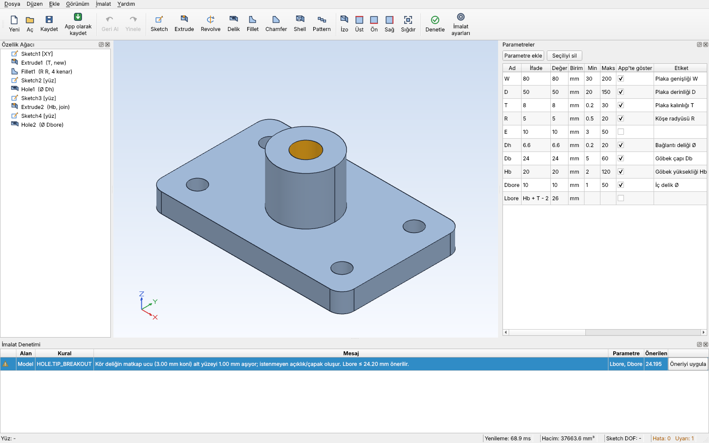

**Seçim.** Başlık seçimin türünü ve sayısını yazar ("Seçili: Yüz (1)", karışık seçimde "Seçili: 3 öğe
(karışık)"). **Tür listesi** ("Tüm türler (All Types)", Yüz, Kenar, Gövde, Düzlem, Sketch) seçim filtresini
ayarlar (durum çubuğundaki filtreyle aynıdır). Arama alanı ve "Tüm gövdelerde ara" bu sürümde pasiftir (ipucu
nedenini yazar).

**Görünümler.** Standart görünümler ve kısayolları: İzometrik Ctrl+0, Trimetrik Ctrl+1, Üst Ctrl+2, Alt Ctrl+3,
Sol Ctrl+4, Sağ Ctrl+5, Ön Ctrl+6, Arka (kısayolsuz). Bir satıra çift tıklamak ya da Enter o görünüme geçer.
**Oluştur** geçerli bakış yönünü "Görünüm1" olarak listeye ekler (yalnız bu oturumda, belgeye kaydedilmez);
**Sil** yalnız böyle kaydedilen görünümleri siler.

**Durum çubuğu (koyu mavi).** Solda araç istemi (ör. "Çek: bölge Sketch1:r0 seçili → yeni Extrude ..."; görünümde
bir hata varsa önünde kırmızı hata simgesi) ve fare altındaki yüzün kalıcı adı; ortada seçim listesi ("1 yüz:
Extrude1.end") ve hızlı ölçü; sağda seçimi geri al, seçim filtresi, **Hata / Uyarı** sayaçları, **Yenileme** (ms),
**Hacim** (mm³), **Sketch DOF** (açık sketch'in serbestlik derecesi; sketch dışında `-`), ← → görünüm düğmeleri.

### 2.6 Geri alma ve geri sarma

- **Geri Al / Yinele (Ctrl+Z / Ctrl+Y):** Belge anlık görüntüleri üzerinden çalışır; her Çek, sketch bitirme ve
  parametre değişikliği tek adımdır. Sketch modundaysa yalnızca sketch içindeki değişiklikler geri alınır.
- **Geri sarma (rollback):** Geçmiş sekmesinde seçilen konuma kadar olan özellikler uygulanır; sonrakiler
  geçici olarak devre dışı kalır. "Geri sarmayı kaldır" ile tüm özellikler yeniden uygulanır.

## 3. Parametreler ve ifadeler

### 3.1 Parametre alanları

| Alan | Açıklama |
|---|---|
| Ad | Tanımlayıcı: `[A-Za-z_][A-Za-z0-9_]*` |
| İfade | Sayı veya başka parametrelere bağlı ifade |
| Tür | Uzunluk (mm), Açı (°), Adet (tam sayı) veya Boyutsuz (`-`) |
| Min, Maks | Sert aralık. Boş bırakılırsa sınırsız kabul edilir |
| Açıklama | Serbest metin |
| Uygulamada göster | Uygulamada son kullanıcıya girdi olarak açılır |
| Etiket | Uygulamadaki etiket. Boşsa parametre adı kullanılır |
| Adım | Uygulamadaki artış adımı. 0 ise otomatik seçilir |
| Grup | Uygulamadaki grup kutusu. Boşsa `Parametreler` kullanılır |

### 3.2 İfade sözdizimi

- İşleçler: `+ - * / ^`, parantezler, tekli `+` ve `-`.
- Fonksiyonlar: `sin cos tan asin acos atan atan2 sqrt abs min max pow floor ceil round exp log`.
- Sabitler: `pi`, `e`.
- Trigonometrik fonksiyonlar derece alır ve derece döndürür.
- Parametreler bağımlılık sırasına göre hesaplanır. Döngüsel bağımlılık, sözdizimi hatası veya
  tanımsız ad bir `PARAM.EVAL` hatası üretir.
- İfadeler özellik özelliklerinde (ör. `distance`, `radius`) ve sketch ölçülerinde kullanılır.
  Ölçü ve özellik pencerelerindeki ifade alanları tamamlama ve canlı değer gösterimi sunar.
  `+P` düğmesiyle ifadeden yeni bir parametre oluşturulabilir.

### 3.3 Aralık ve tam sayı kontrolleri

- Değer `Min` ile `Maks` dışındaysa `PARAM.RANGE` hatası oluşur ve model üretilmez. Öneri, değeri sınıra
  kırpar.
- `Adet` türündeki bir parametre tam sayı değilse `PARAM.COUNT` hatası oluşur ve öneri yuvarlanmış değeri
  verir.

### 3.4 Uygulamada gösterilen parametreler

- "Uygulamada göster" işaretli parametreler uygulamada girdi olur.
- İfadesi sabit bir sayı değilse uygulamada sabit değere dönüşür; bu durumda lint uyarısı verilir.
- İşaretli olmayan parametreler uygulamada görünmez; değerleri ifadelerinden hesaplanır. Örneğin
  `samples/bracket.pcad` içinde `Lbore = Hb + T - 4` açık değildir.
- `Min` veya `Maks` boşsa uygulamada sınırsız değer girilebilir; bu durumda lint uyarısı verilir.

### 3.5 Seçimden parametre

Seç (Select) aracıyla seçtiğiniz bir ölçüyü tek adımda parametreye çevirebilirsiniz. Sketch modunda ve
3B modda aynı şekilde çalışır. Ekran görüntüleri: `docs/param_select/`.

**Neyi ölçer?**

| Seçim (sketch) | Gösterilen değer(ler) | Varsayılan ad |
|---|---|---|
| Çizgi | Uzunluk | `L1`; dikdörtgen kenarıysa yatay `W`, dikey `H` |
| Çember | Çap (Ø⇄R ile yarıçap) | `D1` / `R1` |
| Yay | Yarıçap (Ø⇄R ile çap) ve yay açısı (yalnız bilgi) | `R1` |
| İki nokta | Mesafe, yatay mesafe, dikey mesafe | `L1`, `DX1`, `DY1` |
| İki çizgi | Açı; paralelse aradaki mesafe; ayrıca iki uzunluk | `A1` / `L1` |
| Nokta + çizgi | Nokta-çizgi mesafesi | `L1` |
| Tek nokta | X ve Y (orijinden) | `X1`, `Y1` |
| Ölçü etiketi | O ölçünün değeri (mevcut ölçü yeniden bağlanır) | türüne göre |
| Aynı türden birden çok öğe (ör. 4 delik çemberi) | Tek değer — hepsine **bir** parametre | `D1` |

| Seçim (3B) | Bağlandığı yer |
|---|---|
| Extrude üst / alt yüzü | Extrude `distance` |
| Silindirik yan yüz (sketch çemberinden) | Sketch'teki çap (ölçü yoksa eklenir) |
| Düz yan yüz | Sketch çizgisinin uzunluğu ve Extrude mesafesi |
| Kenar | Sketch eğrisi (uzunluk / çap) ya da iki yan yüz arasıysa Extrude mesafesi |
| Fillet / Chamfer yüzü | `radius` / `distance` |
| Delik duvarı / tabanı | `diameter` / `depth` (havşa: `cbDiameter`, `cbDepth`) |
| Revolve yüzü, Shell iç yüzü | `angle`, `thickness` |

Bir parametreye eşlenemeyen yüz / kenar (ör. yalnız geometrik ölçü) değeri gösterir, **P** pasiftir ve
ipucu nedenini söyler.

**Dört giriş yolu** (hepsi aynı küçük pencereyi açar):

1. **Rozet**: seçimin yanında küçük bir kutu belirir (`Uzunluk = 60 mm  [P]`). **P** = parametre yap,
   **Ø⇄R** çap / yarıçap arasında geçer, **⛓** mevcut bir parametreye bağlar.
2. **Özellikler** paneli: "Seçimden parametre" bölümünde her değerin yanında **Parametre yap** düğmesi.
3. **Sağ tık**: "Parametre olarak ekle ▸ Uzunluk / Çap / Yarıçap / …" ve "Parametreye bağla ▸ W = 80 mm …".
4. **Ctrl+G** (Grup oluştur): sketch'te seçili ölçünün ilk değeri için pencereyi açar. 3B görünümde yüz /
   kenar / gövde seçiliyken Ctrl+G **adlandırılmış seçim** oluşturur (§3.6); 3B ölçüsünü parametre yapmak
   için rozetteki **P**, Özellikler ya da sağ tık kullanılır. Hiçbir şey seçili değilse Ctrl+G eskisi gibi
   "Yeni parametre" penceresini açar.

**Hızlı parametre penceresi** (büyük diyalog değil, görünümün içinde): Bağla (Yeni parametre / mevcut
parametreler), Ad (benzersiz öneri), Değer (sayı veya ifade; mevcut ölçü `W/2` gibi bir formülse formül
önerilir), birim, isteğe bağlı **Min/Maks** (±%50 önerilir, işaretlenince uygulanır), **Uygulamada göster**
(varsayılan açık). **Enter** oluşturur, **Esc** kapatır. Geçersiz ad / değer pencerede kırmızı yazıyla
gösterilir.

**Arka planda ne olur?**

- Sketch: ölçü yoksa sürücü ölçü eklenir, varsa ifadesi parametre adı olur (mevcut yarıçap ölçüsüne çap
  parametresi bağlanırsa `D/2` yazılır). Sketch artık parametreyle sürülür; Gruplar'da değeri değiştirmek
  sketch'i ve modeli günceller.
- 3B: özellik alanı (`Extrude1.distance = T`) ya da ilgili sketch ölçüsü parametreye bağlanır.
- Yeni ölçü sketch'i **aşırı kısıtlarsa** sessizce başarısız olmaz: "Parametre — aşırı kısıt" kutusu
  çakışan kısıtı adıyla gösterir (ör. `Uzunluk W = 80 (#12)`): **Çakışanı kaldır ve bağla** (yalnız o
  kısıt silinir), **Referans parametre** (parametre oluşur, sketch'i sürmez) veya **Vazgeç**.
- Parametre hemen **Gruplar** sekmesinde görünür ve seçilir; sketch kapatılınca, kaydedip yeniden açınca
  korunur; "Uygulamada göster" işaretliyse Uygulama Olarak Kaydet onu girdi olarak listeler.
- **Geri al tek adımdır**: sketch modunda Ctrl+Z hem ölçü bağını hem oluşturulan parametreyi kaldırır
  (Ctrl+Y ikisini birlikte geri getirir); 3B modda parametre + bağ tek belge işlemidir
  ("Parametre (seçimden): DB = 6").

### 3.6 Adlandırılmış seçimler (yüz isimlendirme)

SpaceClaim'deki **Groups > Named Selections** ile aynı iş akışı: bir yüze (kenara, gövdeye) ad verirsiniz;
ad CFD / FEA ağ üreticisine (Fluent Meshing, ANSA, Gmsh, STAR-CCM+) STEP içinde bölge adı olarak gider ve
**sonraki hiçbir işlemle değişmez ya da başka bir yüze kaymaz.**

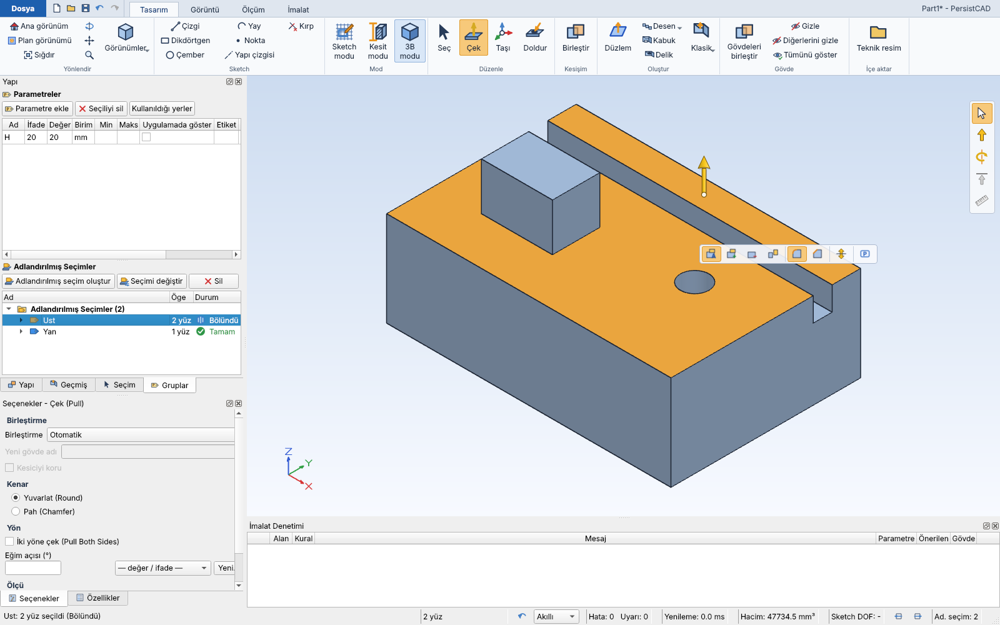

**Oluşturma (üç yol, hepsi aynı sonuç):**

1. 3B görünümde yüzü tıklayın (Ctrl+tık ile birden çok yüz / kenar / gövde) → **Ctrl+G**.
2. **Gruplar** sekmesi > **Adlandırılmış Seçimler** > **Adlandırılmış seçim oluştur** düğmesi.
3. Yüze (kenara) **sağ tık** > **Adlandırılmış seçim oluştur**.

Gruplar sekmesi açılır, "Adlandırılmış Seçimler" klasöründe **Grup1** (Grup2 …) satırı ad düzenleme kipinde
belirir; ad seçilidir, **yazın ve Enter'a basın** (ör. `Inlet`). Esc varsayılan adı bırakır. Oluşturma + yazılan
ad **tek geri alma adımıdır**. Ad büyük/küçük harf duyarsız benzersizdir (`Inlet` ile `inlet` aynı ad sayılır,
çoğu ağ üreticisi gibi); Türkçe karakter serbesttir (STEP'te `Giriş` → `Giris`).

Çek (Pull) aracında az önce bir değer çektiyseniz Ctrl+G **o değeri parametre yapar** (SpaceClaim "Create Group"
davranışı, §2.3). Sonra bir yüze tıkladığınız anda Ctrl+G yeniden adlandırılmış seçim oluşturur. Sketch'te bir
ölçü seçiliyken Ctrl+G her zaman parametre penceresini açar.

**Gruplar paneli** iki bölümdür: üstte **Parametreler** (eski tablo, aynı sütunlar), altta **Adlandırılmış
Seçimler** ağacı. Sütunlar: Ad (renk etiketi), Öge (`2 yüz`, `1 kenar`), Durum (simge + metin). Satırı açınca
üyeler (saklanan referans, şimdiki yüzler, tanı) görünür.

| Eylem | Nasıl |
|---|---|
| Seç ve vurgula | Satıra tık: üye yüzler 3B'de seçilir ve seçimin renginde vurgulanır |
| Yeniden adlandır | **F2** ya da çift tık, yazın, Enter |
| Sil | **Del** (panelde) ya da sağ tık > Sil — geometri değişmez |
| Seçimi değiştir | 3B'de yeni yüzleri seçin, satıra sağ tık > Seçimi değiştir (ya da düğme) |
| Seçili ögeleri ekle / çıkar | 3B'de seçin, sağ tık > Seçili ögeleri ekle / Seçili ögeleri çıkar |
| Renk | sağ tık > Renk (8 renk, Özel renk...) — STEP'te yüz rengi olur |
| STEP'e aktar | sağ tık > STEP'e aktar (kapalıysa ad STEP'e yazılmaz) |
| Yeniden bağla | yalnız **Kayıp** / **Şüpheli** üyelerde: öneri yüzleri ya da "Seçili ögeye bağla" — her zaman sizin seçiminiz |
| Vurguyu göster | sağ tık > Vurguyu göster: yüzler sürekli seçimin rengiyle boyanır (yalnız görünüm) |
| Etiketler | Görünüm > **Adlandırılmış seçim etiketleri**: adlar 3B'de yüzlerin üstünde yazılır |

**Viewport ve Özellikler.** Fare bir yüzün üstündeyken durum çubuğu `Yüz: Extrude1.end — Ad: Inlet` yazar.
Yüz seçiliyken **Özellikler** sekmesinde "Adlandırılmış seçim > **Ad**" satırı vardır: boş bir yüze ad yazıp
Enter = yeni adlandırılmış seçim; var olan bir adı yazmak yüzü o seçime ekler; yalnız bu yüzden oluşan seçimin
adının üzerine yazmak onu yeniden adlandırır; satırı boşaltmak yüzü seçiminden çıkarır.

**Durumlar** (her yenilemeden sonra panelde hemen güncellenir; değişiklik durum çubuğunda kısa bir mesajla
bildirilir, örneğin `Adlandırılmış seçim 'Ust': Tamam → Bölündü` — hiçbir zaman engelleyen bir pencere açılmaz;
sağ alttaki `Ad. seçim: 3 · 1 dikkat` göstergesi ipucunda hepsini listeler):

| Durum | Ne oldu | Ad nereye gider |
|---|---|---|
| ✔ **Tamam** | yüz aynı (kırpıldı, uzadı, delik delindi, taşındı, parametre değişti) | aynı yüz |
| ⫴ **Bölündü** | sonraki bir kesim yüzü parçalara ayırdı | **tüm parçalar** (ad parçaları birlikte kapsar) |
| **Birleşti** | yüz başka yüzlerle birleşti | birleşik yüz |
| ⚠ **Şüpheli** | yüz tipi değişti ya da parça seçimi belirsiz | çözüldü, kontrol edin |
| ✖ **Kayıp** | yüz / kenar tüketildi (ör. kenara fillet, yüz kesilip atıldı) | hiçbir yüz; tanı hangi özelliğin sildiğini söyler |
| **Bastırıldı / Henüz yok / Hatalı** | oluşturan özellik bastırıldı, geri sarmanın ötesinde ya da hatalı | özellik geri gelince kendiliğinden döner |

Kayıp bir üye **asla otomatik olarak başka bir yüze bağlanmaz**; "Yeniden bağla" önerileri yalnız öneridir.

**Örnek** (bloğun üst yüzü `Ust`): üstüne sketch + Çek ile kabartma eklemek, delik delmek, kenarına fillet
atmak, ilk Extrude derinliğini Gruplar'da 20 → 30 yapmak, geri al / yinele, kaydet / aç → `Ust` hep z = H'deki
üst yüzdür, **Tamam**. Üst yüzü boydan boya kesen bir kanal açınca `Ust` **Bölündü** olur ve iki parçayı birlikte
kapsar. Ad, delik delindiğinde bölünmüş sayılmaz (delikli yüz aynı yüzdür).

**Kalıcılık.** Adlandırılmış seçimler belgenin parçasıdır: her düzenleme tek geri alma adımıdır (yalnız
seçimleri değiştiren adımlar modeli yeniden hesaplamaz), `.pcad` dosyasına yazılır, **Uygulama Olarak Kaydet**
onları uygulamaya taşır (pencerede "Adlandırılmış seçimler" bölümü: işaretliler STEP'te yüz adı olur) ve
Dosya > STEP dışa aktarımı ile çalıştırıcının STEP'i adları yüzlere yazar. Ayrıntılar:
[named_selections/MODEL.md](named_selections/MODEL.md).

### 3.7 Gizle / Göster

SpaceClaim'deki **Hide / Hide Others / Show All** gibi çalışır; yüzleri ve gövdeleri ayrı ayrı gizler.
Gizlemek bir **görünüm durumudur**: geometri, hacim, imalat denetimi, STEP / STL dışa aktarımı, Uygulama
Olarak Kaydet ve çalıştırıcı her zaman parçanın tamamını görür.

| Komut | Kısayol | Ne yapar |
|---|---|---|
| **Gizle** | Ctrl+H | Bağlama göre: seçili **yüzler** → yalnız o yüzler; seçili **gövdeler** (Yapı ağacı, üçlü tık) → gövdeler |
| **Diğerlerini gizle** | Alt+H | Seçimi yalnız bırakır: seçilmeyen gövdeler gizlenir; yüzü seçilen gövdede diğer yüzler gizlenir |
| **Tümünü göster** | Ctrl+Shift+H | Gizli bütün yüz ve gövdeleri gösterir |
| **Saydam yap** | — | Seçili yüz / gövdeyi yarı saydam çizer (tekrar: kaldırır); saydam yüz seçilebilir kalır |

**Nereden.** Tasarım > *Gövde / Görünürlük* ve Görüntü > *Gizle / Göster* grupları; 3B görünümde yüze sağ tık
(**Gizle**, **Diğerlerini gizle**, **Gövdeyi gizle: <ad>**, **Yalnız bu gövde**, **Saydam yap**, gövdede gizli yüz
varsa **Bu gövdenin gizli yüzlerini göster (n)**, bir şey gizliyse **Tümünü göster**); Yapı ağacı (gövde onay
kutusu; sağ tık Gizle / Göster / Yalnız bunu göster / Gizli yüzlerini göster / Saydam yap); Gruplar >
Adlandırılmış Seçimler'de seçime sağ tık **Gizle / Göster / Diğerlerini gizle** (ör. `Dis_duvar` grubunu gizleyip
içeriye bakmak). Durum çubuğundaki **"n gizli yüz, m gizli gövde"** düğmesi tıklanınca hepsini gösterir.

**Gizli yüz** çizilmez ve **seçilemez**: aynı yere tıklamak arkadaki yüzü seçer (ör. enjektörün dış yüzlerini
gizleyip iç kanal yüzlerini seçmek). Görünür bir yüzü sınırlayan kenarlar çizilmeye devam eder; yalnız gizli
yüzler arasındaki kenarlar kaybolur (SpaceClaim davranışı). Gizlenen öğe seçimden çıkar.

**Yapı ağacı.** Gizli yüzü olan gövdenin altında **"Gizli yüzler (n)"** düğümü vardır; her satırın onay kutusunu
işaretlemek (veya sağ tık > Göster) o yüzü yeniden gösterir. Gizli gövdenin onay kutusu boştur ve adı gridir;
saydam gövdenin adı italiktir.

**Kalıcılık ve geri alma.** Her gizle / göster tek **geri alma adımıdır** (Ctrl+Z / Ctrl+Y) ve modeli yeniden
hesaplamaz. Görünüm durumu `.pcad` içinde (`"view"`) saklanır; dosya yeniden açılınca aynı yüzler gizli olur.
Gizli yüzler kalıcı yüz adlarıyla (adlandırılmış seçimlerle aynı çözümleme) izlenir: parametre değişikliği gizli
bir yüzü **bölerse bütün parçalar gizli kalır**; yüz modelden kalkarsa sessizce yok sayılır (özellik geri gelirse
yüz yine gizli gelir). Gizli gövde yeniden adlandırılırsa gizli kalır.

**Diğer modlar.** Kesit görünümü (X) ve sketch modu (K) gizli öğelerle çalışır; kısmen gizli bir gövdenin görünür
yüzünde sketch açılabilir.

## 4. Sketch modu

### 4.1 Düzlem

| Tür | Orijin | Normal | Yerel eksenler (u, v) |
|---|---|---|---|
| XY | (0,0,0) | +Z | +X, +Y |
| XZ | (0,0,0) | -Y | +X, +Z |
| YZ | (0,0,0) | +X | +Y, +Z |
| Yüz (OnFace) | Dünya orijinin yüze izdüşümü | Dış yüz normali | Dünya +X'in izdüşümü (yoksa +Y) |
| Datum düzlemi (OnPlane) | Düzlem özelliğinin orijini | Düzlem özelliğinin normali | Düzlem özelliğinin u ve v eksenleri (16.3) |

Yüz düzlemi, `faceRef` alanındaki kalıcı yüz adıyla belirlenir (ör. `Extrude1.end`). Düzlem `offset`
ifadesiyle normal yönünde kaydırılabilir. Datum düzlemi üzerindeki sketch ise `planeRef` alanındaki düzlem özelliğinin kimliğiyle belirlenir (16.4).
Sketch'in 0 numaralı noktası (orijin) her zaman sabittir.

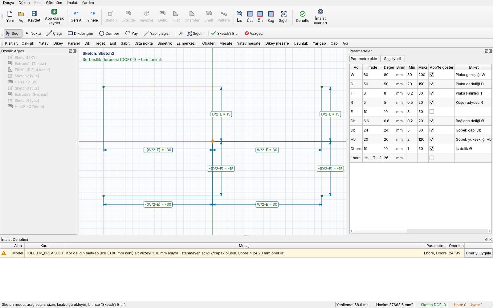

### 4.2 Çizim araçları

Çizerken değerler doğrudan yazılır (SpaceClaim): Dikdörtgen'de ilk köşeden sonra `60` yazın, **Tab** ile
genişliği kilitleyip yüksekliğe geçin, `40` yazıp **Enter**. Yazılan değerler sürücü ölçü olur (Uzunluk,
Çap, Yarıçap, Yatay/Dikey mesafe); orijinden başlayan dikdörtgen böylece tam tanımlıdır (DOF 0). Alanlara
ifade de yazılabilir (`W/2`, tamamlayıcı parametreleri önerir); geçersiz ifade kırmızı görünür ve Enter
reddedilir. Ölçü alanındayken **Ctrl+G** değeri yeni parametreye çevirir. Shift+↑/↓ değeri adımlar,
Ctrl+→ / Ctrl+← ızgarayı (sketch düzlemini) normal boyunca taşır, **V** plan görünümüne döner. Sketch
sırasında orta düğmeyle model döndürülebilir; eğik bakışta da tıklanan nokta sketch düzlemine düşer.

- **Seç:** Eleman seçer. Ctrl ile çoklu seçim yapılır.
- **Nokta, Çizgi, Çember, Yay:** Standart çizim araçları. Yay, başlangıçtan bitişe saat yönünün tersine
  (CCW) çizilir; yarıçapı merkezden başlangıca olan uzaklıktan türetilir.
- **Dikdörtgen:** Köşeleri birleşik dört çizgi oluşturur; yatay ve dikey kısıtlar otomatik eklenir.
- **Yapı çizgisi:** Yeni çizilen elemanları yapı geometrisi yapar; seçiliyse seçili elemanları dönüştürür.
  Yapı geometrisi profile dahil edilmez, ancak ölçü ve referans olarak kullanılabilir.
- **Yakalama:** Noktalar yakalanır; yatay ve dikey hizalamalar otomatik kısıt olarak eklenir.
- **Sil, Sığdır, Sketch'i Bitir, Vazgeç:** Seçili elemanları siler, görünümü sığdırır, sketch'i kaydedip
  modele döner veya değişiklikleri atar. Vazgeç, sketch'teki değişiklikleri atmadan önce onay ister.
  **Sketch'i Bitir** düğmesi sketch'i kaydettikten sonra doğrudan **Çek (Pull)** aracına ve **Tasarım**
  sekmesine geçer (SpaceClaim 2023 R1'deki End Sketch Editing gibi); yeni bölgeler vurgulanır, tıklayıp
  çekebilirsiniz. **D** tuşu ise sketch'i bitirip **Seç** aracına döner. Ayrıntı: 4.8.
- **İşlem durumu:** Çizim araçları ilk tıklamayı beklerken "Seçim bekleniyor", çizerken "Değer bekleniyor",
  değer yazılırken "Önizleme" durumundadır; eleman oluşunca kısa bir "… oluşturuldu" bildirimi gelir.
  Geçersiz bir ölçü metninde Enter'a basılırsa alan açık kalır, kırmızı çerçevenin ipucu (tooltip) nedeni
  söyler (ör. "‘abc’ bir sayı, parametre adı ya da ifade değil.").

### 4.3 Geometrik kısıtlar (11 adet)

| Arayüz adı | Veri modeli türü | Girdi |
|---|---|---|
| Çakışık | `Coincident` | İki nokta veya nokta + eleman |
| Yatay | `Horizontal` | Çizgi veya iki nokta |
| Dikey | `Vertical` | Çizgi veya iki nokta |
| Paralel | `Parallel` | İki çizgi |
| Dik | `Perpendicular` | İki çizgi |
| Teğet | `Tangent` | İki eleman |
| Eşit | `Equal` | İki çizgi veya iki çember/yay |
| Sabit | `Fixed` | Nokta(lar) |
| Orta nokta | `Midpoint` | Nokta + çizgi |
| Simetrik | `Symmetric` | İki nokta + simetri çizgisi |
| Eş merkezli | `Concentric` | İki çember/yay |

Veri modelindeki `HorizontalPts`, `VerticalPts` ve `PointOnEntity` gibi türler çözücüde bulunur, ancak
arayüzde ayrı düğme olarak sunulmaz.

### 4.4 Ölçüler (7 adet)

| Arayüz adı | Veri modeli türü | Anlam |
|---|---|---|
| Mesafe | `Distance` | İki nokta arası uzaklık |
| Yatay mesafe | `DistanceX` | İşaretli yatay fark |
| Dikey mesafe | `DistanceY` | İşaretli dikey fark |
| Uzunluk | `Length` | Çizgi uzunluğu |
| Yarıçap | `Radius` | Yay veya çember yarıçapı |
| Çap | `Diameter` | Yay veya çember çapı |
| Açı | `Angle` | İki çizgi arası işaretli açı (derece) |

Ölçü aracını seçtikten sonra elemanlara tıklanır ve bir ifade ya da parametre sorulur. Mevcut bir ölçüye
çift tıklayarak değerini düzenleyebilirsiniz. `+P` ile yeni parametre oluşturulabilir.

### 4.5 Renkler ve serbestlik derecesi

- **Yeşil:** Tam tanımlı (DOF = 0).
- **Mavi:** Serbestlik derecesi kalmış (eksik kısıtlı).
- **Kırmızı:** Çelişen veya çözülemeyen kısım.
- **Turuncu:** Seçili eleman.
- **Gri:** Yapı çizgisi.

Durum metni `Serbestlik derecesi (DOF): n` biçimindedir; n = 0 ise `- tam tanımlı` eklenir.

Çözücü durumları (`sketch::SolveStatus`):
- **Ok:** Çözüm başarılı.
- **UnderConstrained:** Serbestlik derecesi kalmış; geometri en küçük adımlarla hareket eder.
- **OverConstrained:** Çözüm yakınsadı ve geometri güncellendi, ancak fazla kısıtlar raporlanır ve sketch
  başarılı sayılmaz.
- **Inconsistent:** Geometri değiştirilmez; çelişen kısıtlar listelenir (ör. `Çelişen kısıtlar: 13, 15`).
- **Failed:** Geçersiz referans, ifade hatası veya sıfır/negatif `Distance`, `Length`, `Radius`, `Diameter`.

Sürükleme sırasında canlı çözüm yapılır.

### 4.6 Profil kuralları

- Profil yalnızca yapı dışı elemanlardan oluşur. Eleman bağlantıları ortak nokta veya 1e-6 mm tolerans
  ile kurulur.
- Hatalar Türkçe mesajla bildirilir: `Açık kontur`, `Dallanan kontur`, `Kesişen eğriler`.
- İç içe konturlar: çift derinlikteki konturlar yüz, tek derinlikteki konturlar delik olur. Deliğin
  içindeki adalar yeni yüz olur.

### 4.7 Sınırlar

- Marquee (kutu) seçimi, trim, offset ve mirror yoktur.
- Sketch editöründe 3B modelin alt görüntüsü gösterilmez.

### 4.8 Sketch'i bitirmek: profil özeti ve Yapı türleri

Sketch bittiğinde (Sketch'i Bitir ya da D) ne oluştuğu durum çubuğunda ve görünümün sol üstündeki
bilgi şeridinde (HUD) yazar:

| Durum | Örnek ileti | Görünüm |
|---|---|---|
| Kapalı bölge(ler) | `Sketch1: 1 bölge → yüzey. Çek etkin: bölgeye tıklayın, …` | Bölge açık yeşil düzlemsel yüzdür |
| İç içe konturlar | `Sketch1: 2 bölge (1 delikli, 1 delik) → yüzey. …` | İç kontur dış bölgede deliktir, içindeki ada ayrı bölgedir |
| Bölge + açık uç | `…; 1 açık uç kırmızı işaretli — eğri olarak kaldı (Doldur F)` | Açık uçlar kırmızı daireyle işaretlenir |
| Yalnız açık eğri | `Sketch2: kapalı bölge yok, 2 açık uç — eğri olarak kaldı. …` | Uyarı (sarı); eğriler katı da yüzey de olmaz |

Kırmızı işaretler (Doldur aracının "açık uç" işaretiyle aynı) belge değişene ya da yeniden sketch moduna
girilene kadar kalır.

**Yapı** paneli bu durumu tür olarak gösterir (kökte belge adı, kaydedilmemiş değişiklik varsa `Part1*`):

- **Gövdeler (n):** katı gövdeler; sağ sütunda tür **Katı**.
- **Yüzeyler (n):** henüz çekilmemiş sketch bölgeleri (`Sketch1 · bölge 1`, tür **Yüzey**). Tıklamak bölgeyi
  seçer; ipucunda alan, çevre ve delik sayısı yazar. Bölge Çek ile katıya dönüşünce listeden çıkar.
- **Eğriler (n):** kapalı bölge oluşturmayan ya da açık ucu olan sketch'ler (`Sketch2 · 2 açık uç`, tür **Eğri**).
- **Düzlemler** ve **Sketch'ler** düğümleri önceki gibidir.

Bir bölge seçiliyken **Özellikler** panelinde *Sketch bölgesi* başlığı altında **Tür = Yüzey**, **Alan**
(mm², delikler çıkarılmış), **Çevre** (dış sınırın uzunluğu, mm) ve **Delik sayısı** gösterilir.

Not: PersistCAD'de ayrı bir yüzey gövdesi yoktur; "Yüzey" sketch bölgesinin görüntüsüdür ve dosyaya
sketch olarak kaydedilir. Açık eğriden yüzey üretme ve kalınlaştırma (Thicken) motor değişikliği bekler
(SC23-CR-1/2).

## 5. Özellik türleri

Aşağıdaki anahtarlar `.pcad` dosyasındaki `props` alanındadır. Tüm sayısal alanlar ifade kabul eder.

### 5.1 Sketch

- `plane` alanında düzlem türü (XY, XZ, YZ, OnFace, OnPlane), `faceRef`, `planeRef` (OnPlane için düzlem
  özelliğinin kimliği) ve `offset` yer alır.
- Sketch'in profil ve ölçüleri `sketch` alanında saklanır. Ayrıntı için 4. ve 13. bölümler.

### 5.2 Extrude

| Anahtar | Arayüz | Varsayılan | Açıklama |
|---|---|---|---|
| `sketch` | Sketch | — | Kaynak sketch |
| `distance` | Mesafe (mm) | `10` | Uzaklık ifadesi |
| `direction` | Yön | `normal` | `normal`, `reverse` (Ters) veya `symmetric` (Simetrik) |
| `op` | İşlem | `new` veya `join` | `new` (Ayrı gövde), `join` (Birleştir), `cut` (Çıkar), `intersect` (Kesişim). Gövde yoksa `new`, varsa `join` |
| `draft` | Eğim açısı (°) | `0` | Pozitif değer içeri doğru daraltır |
| `through` | Tümünden geçir | `0` | Yalnızca `cut` için; `distance` yerine kesmeyi tüm malzeme boyunca yapar |
| `targets` | Hedef gövdeler | boş | Gövde adları, virgülle ayrılmış. Boş bırakılırsa AUTO (16.5) |
| `keepTool` | Aracı ayrı gövde olarak koru | `0` | Yalnızca `cut` ve `intersect` ile |
| `bodyName` | Gövde adı | özellik kimliği | `new` ile yeni gövdenin adı; `cut` ve `intersect` ile yalnızca `keepTool=1` iken |

Notlar:
- `through=1` yalnızca kesmede geçerlidir. Sketch'e bakan yüzden kesmek için `direction=reverse` kullanılır.
- `symmetric` yönde eğim, sketch düzleminin altındaki yarı için dışa doğru uygulanır.
- Eğim başarısız olursa uyarı verilir ve eğim yok sayılır.
- İnce özellik (thin feature) ve "yüze kadar" (up-to-face) çekme yoktur.

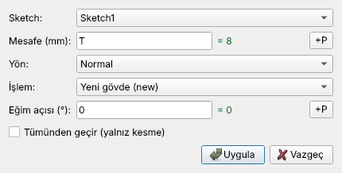

### 5.3 Revolve

| Anahtar | Arayüz | Varsayılan | Açıklama |
|---|---|---|---|
| `sketch` | Sketch | — | Kaynak sketch |
| `axis` | Eksen | `U` | `U` (Sketch U ekseni), `V` (Sketch V ekseni) veya bir sketch çizgisinin kimliği (`Çizgi N` veya `Çizgi N (yapı)`) |
| `angle` | Açı (°) | `360` | Döndürme açısı |
| `op` | İşlem | `new` veya `join` | Extrude ile aynı |

Notlar: `U` ve `V` eksenleri sketch orijininden geçer. 360° dışındaki açılarda başlangıç (`start`) ve bitiş
(`end`) yüzleri oluşur. Tam dönüşte düzlemsel yüzler `BRepSweep` ile alınır. İşlem, hedef gövdeler, "Aracı ayrı gövde olarak koru"
ve Gövde adı alanları Extrude ile aynıdır (16.5).

### 5.4 Delik (Hole)

| Anahtar | Arayüz | Varsayılan | Açıklama |
|---|---|---|---|
| `sketch` | Delik konumları | — | Kaynak sketch |
| `kind` | Tür | `simple` | `simple` (Basit), `counterbore` (Havşalı), `countersink` (Konik havşa) |
| `diameter` | Çap (mm) | `6` | Delik çapı |
| `through` | Delik boydan boya | `0` | Malzemeyi tamamen deler |
| `depth` | Derinlik (mm) | `10` | Kör delik derinliği |
| `cbDiameter`, `cbDepth` | Havşa çapı, derinliği | `12`, `4` | Yalnızca `counterbore` |
| `csDiameter`, `csAngle` | Konik havşa çapı, açısı | `12`, `90` | Yalnızca `countersink` |
| `tipAngle` | Uç açısı (°) | `118` | Yalnızca kör delik; `0` düz dip anlamına gelir |

Notlar:
- Delik konumları, sketch'teki serbest noktalar ile yapı dışı çemberlerin merkezlerinden oluşur. Konumlar
  (u, v) sırasına göre dizilir ve tekrarlar silinir.
- Delik ekseni sketch normalinin tersidir; malzemeyi sketch düzleminin altına doğru deler.
- Her konum için ayrı bir takım üretilir ve tek bir kesme işlemi yapılır.
- Hedef gövdeler (`targets`) listesi vardır; boşsa deliğin değdiği gövdeler seçilir. Aracı koru ve Gövde adı
  alanları yoktur (16.5).

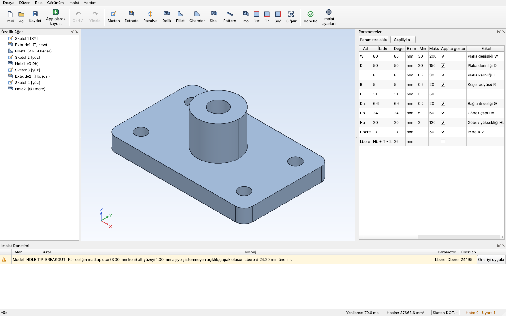

### 5.5 Fillet (yuvarlatma)

- `radius` (Yarıçap, mm).
- `refs`: kenar adları (`edge(...)`) veya `face:<yüz adı>`.
- Klasik pencerede kenar seçmek için 3B görünümde kenara tıklanır (SpaceClaim şeması: düz tık kenarı tercih
  eder). Bir yüze tıklamak o yüzün tüm kenarlarını ekler. Hızlı yol: Çek (P) ile kenara tıklayıp yarıçap yazmak.
- Başarısız olursa `Fillet1: yarıçap 30 mm kenar için çok büyük` gibi bir hata döner.
- Yüz adı: `<fid>.f<k>`, `k` kaynak kenarın sıralı indeksidir.

### 5.6 Chamfer (pah)

- `distance` (Pah mesafesi, mm).
- `refs`: Fillet ile aynı seçiciler.
- Başarısız olursa `pah mesafesi ...` biçiminde hata döner.
- Yüz adı: `<fid>.c<k>`.

### 5.7 Shell (kabuk)

- `thickness` (Et kalınlığı, mm).
- `direction`: `inward` (İçeri, varsayılan) veya `outward` (Dışarı).
- `refs`: kaldırılacak (açık bırakılacak) yüzler. Hiç yüz seçilmezse kapalı, içi boş bir kabuk oluşur ve
  onay istenir.
- Adlandırma: korunan yüzler aynı adı taşır. Bir `F` yüzünün ofset yüzü `<fid>.inner.F` (dışarı için
  `<fid>.outer.F`) adını alır. Kaldırılan `F` yüzü halka (rim) olur ve `F` adını korur.

### 5.8 Pattern (çoğaltma)

| Anahtar | Arayüz | Açıklama |
|---|---|---|
| `kind` | Tür | `linear` (Doğrusal) veya `circular` (Dairesel) |
| `source` | Kaynak özellik | Tekrarlanacak Extrude, Revolve, Hole veya Pattern |
| `count` | Adet | Örnek sayısı |
| `spacing` | Aralık (mm) | Yalnızca doğrusal |
| `dirX`, `dirY`, `dirZ` | Yön | Doğrusal yön vektörü, varsayılan `1,0,0` |
| `angle` | Toplam açı (°) | Yalnızca dairesel, varsayılan `360` |
| `axis` | Eksen | `X`, `Y` veya `Z`; dünya orijininden geçer |

Notlar:
- Kaynağın aracı tekrarlanır. Pattern'in `op` anahtarı verilmişse o kullanılır (`new` ise yeni gövdeler oluşur).
  Verilmemişse kaynağın işlemi kullanılır ve kaynaktaki `new`, `join` gibi davranır. Hedef gövdeler listesi vardır (16.5).
- Dairesel çoğaltmada 360° için adım `360/count`, diğerlerinde `angle/(count-1)` olur.
- Örnekler sabit kopyadır; geometriyi takip etmez.
- Örnek yüzleri `<fid>.i<k>.<orijinal ad>` biçimindedir (`k` = 1 … count-1).

### 5.9 Çek (Pull) ile değer girme, işlem durumu ve hatalar

Çek aracında bir bölge, yüz ya da kenar seçiliyken rakam yazmak (ya da **Space**) değer alanını açar.

**Birimler.** Belge birimi **mm**'dir (açılar derece). Alana birimle yazılabilir; değer belge birimine
çevrilerek kaydedilir:

| Yazılan | Kaydedilen | Not |
|---|---|---|
| `15`, `15 mm`, `15mm` | `15` | |
| `1.5 cm` / `1,5 cm` | `15` | Ondalık virgül kabul edilir |
| `0.5 in`, `0.5"` | `12.7` | |
| `2 m` | `2000` | |
| `90°`, `90 deg`, `1.2 rad` | derece | Yalnız açı alanlarında |
| `L`, `L/2 + T` | ifade olduğu gibi | Parametre ilişkisi korunur |
| `(L) cm` | `(L)*10` | Birimli ifade, ilişki korunur |

**Geçersiz değerler.** Değer uygulanmaz, alan açık kalır; neden alanın ipucunda, durum çubuğunda ve
görünümdeki kırmızı HUD şeridinde yazar (işlem durumu "Geçersiz"):

| Girdi | Sonuç |
|---|---|
| `abc` | `‘abc’ bir sayı, parametre adı ya da ifade değil.` |
| `10 xyz` | `‘xyz’ bilinmeyen birim; kullanılabilir: mm, cm, m, in, ".` |
| `10 deg` (mesafe alanında) | Birim türü uyuşmuyor |
| `0` | `Mesafe sıfır olamaz: sıfırdan farklı bir değer yazın (negatif = ters yön).` |
| `-8` | Geçerli: **ters yön** (sketch düzleminin öbür tarafına çeker) |
| `1e7` | Çok büyük değer: sınır max(100000 mm, 100 × model köşegeni). Aynı değerle **ikinci Enter** onaylar; Esc vazgeçer. Modal pencere açılmaz. |

**Başarısız işlem.** Motor bir özelliği oluşturamazsa (ör. kenara sığmayan yuvarlatma yarıçapı) değişiklik
**uygulanmaz**: inceleme penceresi açılmaz, "Yine de Uygula" yoktur, otomatik onay kipinde de uygulanmaz.
Önceki model aynen kalır; HUD kırmızı şeritte ve durum çubuğunda özelliğin adı ve nedeni yazar, ör.
`Fillet1: yarıçap 100 mm kenar için çok büyük. Yarıçapı / mesafeyi küçültün. Önceki model korundu (…).`
Şerit bir sonraki eylemde (Esc, yeni seçim, başka araç) kalkar. Belgede zaten hatalı olan özellikler yeni
değişiklikleri engellemez; bağımlı özellikleri olan bir özelliği onay vererek **silmek** de mümkündür
(onaylanan bağımlılar hata verebilir). Gerçek imalat kuralı hataları için inceleme penceresi (8.3) aynen
çalışır.

**Önizleme sözleşmesi.** Ok sürüklenip bırakıldıktan sonraki önizleme belgeyi değiştirmez; 600 ms sonra
kendiliğinden uygulanır. Önizleme sırasında:

| Olay | Sonuç |
|---|---|
| Enter | Hemen uygular (tek geri alma adımı) |
| Esc, başka araç (ör. M), seçim değişimi, K / X / D | Önizleme iptal edilir, belge değişmez |
| Ribbon sekmesi değişimi | Etkisiz: araç, seçim ve önizleme kalır |
| Bir panele tıklamak (odak görünümden çıkar) ya da başka pencereye geçmek | 600 ms zamanlayıcısı **durur**, önizleme kalır; kendiliğinden uygulanmaz. HUD: "önizleme bekletiliyor — Enter uygular, Esc iptal eder" |
| Ctrl+Z / Geri Al | Önce önizleme iptal edilir, sonra son değişiklik geri alınır |

**Seçenekler – Çek.** **Genel** grubunda Birleştirme (Otomatik, Ekle, Kes, Birleştirme yok, Kesişim),
yeni gövde adı ve kesiciyi koru bulunur. **Yüzeyleri kalınlaştır (Thicken surfaces)** satırı işaretli ve
pasiftir: PersistCAD'de bölge çekilince her zaman katı oluşur; ipucu nedenini söyler. Altında belge birimi
(`Belge birimi: mm`) ve yazılabilen birimler gösterilir. Döndürme ekseni (Alt+tık) ve Kadar / Cetvel
hedefi gibi ikincil referanslar aracın işlem durumuyla birlikte yayımlanır (Seçim paneli için).

## 6. Kalıcı yüz ve kenar isimlendirme

### 6.1 İsim biçimleri

| Kaynak | Yüz adları | Açıklama |
|---|---|---|
| Extrude | `<fid>.start`, `<fid>.end`, `<fid>.side.e<entityId>` | `entityId` sketch elemanının kimliği. Tam çemberde `e<circleId>` |
| Revolve | `<fid>.rev.e<entityId>`, `<fid>.start`, `<fid>.end` | `start` ve `end` yalnızca açı 360° değilse oluşur |
| Hole (k. konum) | `<fid>.h<k>.wall`, `.bottom`, `.cb_wall`, `.cb_floor`, `.cs`, `.top` | `top` giriş diskidir ve genellikle kaldırılır |
| Fillet | `<fid>.f<k>` | `k`: kaynak kenarın sıralı indeksi |
| Chamfer | `<fid>.c<k>` | Aynı kural |
| Shell | `<fid>.inner.<orijinal>` (dışarı: `.outer.`) | |
| Pattern | `<fid>.i<k>.<orijinal>` | `k` = 1 … count-1 |

Kenarlar: `edge(<A>|<B>)` biçimindedir; `A` ve `B` sözlük sırasıyla dizilir. Aynı yüz çiftini paylaşan
kenarlar `:1`, `:2` ekleriyle, orta noktanın sırasına göre ayrılır. Tek yüze bağlı kenarlar
`edge(<yüz>)` adını alır.

Bir yüz birden fazla parçaya bölünürse parçalar `<ad>:1`, `<ad>:2` biçiminde, ağırlık merkezinin
(x, sonra y, sonra z) sırasına göre adlandırılır.

### 6.2 Örnekler (`samples/bracket.pcad`)

- Sketch1 dikdörtgeninin kenarları `Extrude1.side.e5` … `Extrude1.side.e8` adını alır.
- `Fillet1` kenarları `edge(Extrude1.side.e5|Extrude1.side.e6)` gibi referans verir.
- Sketch2 düzlemi üst yüze bağlıdır: `faceRef = Extrude1.end`.
- `Hole1` dört konumda delik açar: `Hole1.h0.wall` … `Hole1.h3.wall`.

### 6.3 Dikkat edilmesi gerekenler

- Bir referans bölünmüş bir yüze gider ve sistem bunu bildirir. Örneğin `'Extrude1.end' bölünmüş,
  kullanılan: Extrude1.end:1` uyarısı verilir.
- Fare bir yüzün üzerindeyken durum çubuğunda kalıcı adı görünür; referans olarak kopyalamak için bunu
  kullanın.

## 7. İmalat ayarları ve süreç ön ayarları

### 7.1 İmalat Ayarları penceresi

İmalat sekmesi > Denetim > **Ayarlar** düğmesiyle (ya da Dosya > Ayarlar > İmalat ayarları...) açılır. İki sekme vardır:
**Katmanlı imalat** ve **Konvansiyonel imalat**. Her sekmenin en üstünde ilgili denetimleri açıp kapatan bir
onay kutusu vardır.

Süreç (preset) seçildiğinde sınır değerleri o sürecin tipik değerleriyle doldurulur. Bundan sonra değerler
elle değiştirilebilir.

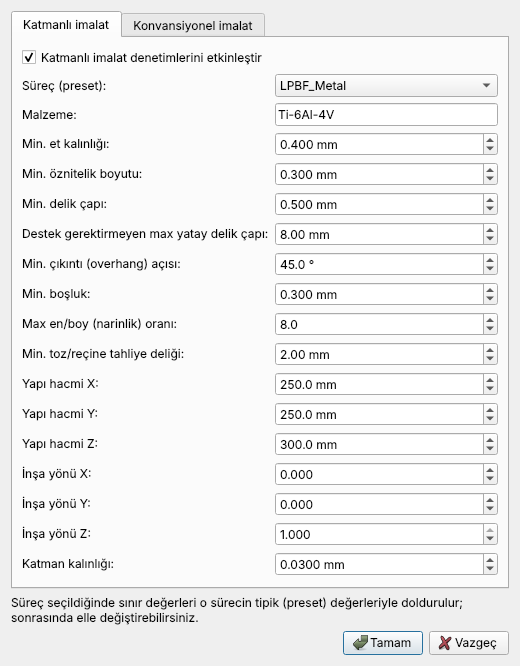

### 7.2 Katmanlı imalat alanları

| Arayüz etiketi | `.pcad` anahtarı | Açıklama |
|---|---|---|
| Süreç (preset) | `process` | `None`, `LPBF_Metal`, `EBM_Metal`, `DED_Metal`, `FDM_Polymer`, `SLA_Resin`, `SLS_Polymer` |
| Malzeme | `material` | Metin; yoğunluk tablosu için kullanılır (7.5 bölümü) |
| Min. et kalınlığı | `minWallThickness` | Minimum duvar |
| Min. öznitelik boyutu | `minFeatureSize` | Minimum pim veya kaburga |
| Min. delik çapı | `minHoleDiameter` | Minimum açık delik |
| Destek gerektirmeyen max yatay delik çapı | `maxSelfSupportingHoleDia` | Bu çapın üstündeki yatay delikler destek ister |
| Min. çıkıntı (overhang) açısı | `minOverhangAngle` | Yapı tabanına göre bu açıdan düz yüzeyler destek ister |
| Min. boşluk | `minGap` | Duvarlar arası minimum boşluk |
| Max en/boy oranı | `maxAspectRatio` | Yükseklik/kalınlık sınırı |
| Min. toz/reçine tahliye deliği | `minEscapeHoleDia` | Kapalı boşluklar için tahliye deliği |
| Yapı hacmi X, Y, Z | `build` `[X, Y, Z]` | Yapı hacmi (mm) |
| İnşa yönü X, Y, Z | `buildDir` `[X, Y, Z]` | İnşa yönü vektörü |
| Katman kalınlığı | `layerThickness` | Bilgi amaçlı |

Ek alan: `enabled` (katmanlı denetimleri açar/kapatır).

### 7.3 Konvansiyonel imalat alanları

| Arayüz etiketi | `.pcad` anahtarı | Açıklama |
|---|---|---|
| Süreç (preset) | `process` | `None`, `CNC_Milling3Axis`, `CNC_Milling5Axis`, `CNC_Turning` |
| Malzeme | `material` | Metin |
| Min. takım çapı | `minToolDiameter` | En küçük freze; iç köşe yarıçapı D/2 ile sınırlanır |
| Max takım boyu / çap | `maxToolLengthToDia` | Cep derinliği/çap sınırı |
| Max delik derinliği / çap | `maxHoleDepthToDia` | L/D sınırı |
| Min. et kalınlığı | `minWallThickness` | Minimum duvar |
| Max duvar yüksekliği / kalınlık | `maxWallHeightToThickness` | Duvar oranı |
| Min. delik çapı | `minHoleDiameter` | Minimum delik |
| Standart matkap çaplarını tercih et | `preferStandardDrills` | Standart dışı çaplarda bilgi verir |
| Tezgah / ham parça X, Y, Z | `stock` `[X, Y, Z]` | Ham parça boyutları |
| Takım ekseni X, Y, Z | `toolAxis` `[X, Y, Z]` | Takım mili yönü |

Ek alan: `enabled`.

### 7.4 Süreç ön ayarları

Ön ayar değerleri `src/mfg/MfgChecks.cpp` içinde tanımlıdır.

- **Katmanlı:** LPBF (duvar 0.4 mm, Ø8 kendinden destekli delik, 45°, tahliye Ø2 mm, yapı 250×250×300 mm),
  EBM (duvar 0.6 mm, tahliye Ø3 mm, yapı 200×200×380 mm), DED (duvar 2.0 mm, 60°, toz kuralı yok),
  FDM (duvar 0.8 mm, Ø2 delik, 10 mm köprü), SLA (duvar 0.5 mm, 30°, drenaj Ø3.5 mm), SLS (duvar 0.7 mm,
  destek ve çıkıntı kuralı yok, tahliye Ø3.5 mm).
- **Konvansiyonel:** 3 eksen (Ø3 mm takım, L/D 4 freze, delik L/D 10, duvar 0.8 mm), 5 eksen (L/D 6,
  500×500×400 mm), torna (Ø100×300 mm çubuk).

### 7.5 Malzeme ve yoğunluk

Hangi malzemenin kullanılacağı şu sırayla belirlenir: katmanlı imalat etkinse ve süreç `None` değilse
katmanlı malzeme; aksi halde konvansiyonel malzeme. Çalıştırıcıdaki kütle hesabı için yoğunluk tablosu
şöyledir (g/cm³): Ti-6Al-4V 4.43, 316L 7.99, IN718 8.19, 7075 2.81, 6061 2.70, PA12 1.01, PLA 1.24,
reçine 1.15. Tabloda olmayan malzemeler 7.85 kabul edilir.

### 7.6 Devre dışı bırakma

- `enabled = false` veya süreç `None` ise ilgili kurallar çalışmaz.
- Çalıştırıcıda, uygulama seçeneklerindeki "Katmanlı imalat (AM) kontrollerini göster" ve "Konvansiyonel
  (CNC) kontrollerini göster" kutuları, o alanın hatalarının kabul kararına girmesini engeller.

## 8. Değişiklik boru hattı ve inceleme penceresi

### 8.1 Adımlar

Bir parametre değişikliği şu sırayla denetlenir (`pc::mfg::validateChange`):

1. **Değerlendirme:** Tüm parametreler (değişiklik uygulanmış hâlde) hesaplanır. Hata varsa `PARAM.EVAL`
   üretilir ve işlem durur (model üretilmez).
2. **Parametre kontrolleri:** Aralık ve tam sayı kontrolleri. Hata varsa model üretilmez.
3. **Analitik kontrol:** B-Rep olmadan, özellik bazlı kurallar. Örnek parçada sorunsuz durumda yaklaşık
   0.6 ms, sekiz sorun ve önerilerle birlikte yaklaşık 6 ms sürer.
4. **Model üretimi:** Aday model yeniden üretilir.
5. **Geometrik kontrol:** B-Rep tabanlı kurallar. Örnek parçada 110–280 ms sürer.
6. **Birleştirme:** Aynı kural kimliği ve aynı özellik için tek sorun kalır; yüksek önem öncelik alır.
   Sorunlar Hata, Uyarı, Bilgi sırasına göre dizilir.

Analitik kontroller sketch'leri çözülmüş kopyalar üzerinde çalıştırır. Çözülemeyen sketch'ler için
saklı koordinatlar kullanılır ve `ANALYTIC.SKETCH_UNSOLVED` (Bilgi) bildirilir.

### 8.2 Öneri hesabı

Öneriler, sorunla ilgili ifadelerde geçen parametrelerden hesaplanır.
- Açık (Uygulamada göster) parametreler önce gelir; türetilmiş parametrelerin bağlı olduğu açık parametreler de
  adaylara girer (ör. `Lbore = Hb + T - 4` ise `Hb` ve `T`).
- Aday değerler yeniden hesaplanır ve model yeniden üretilerek değişimin etkisi ölçülür. Etkisiz adaylar
  elenir.
- İlk sürücü parametre için kök bulunur. Değer, parametrenin `[Min, Maks]` aralığında olmalıdır; değilse
  sonraki sürücü denenir.
- Değer 0.1, 0.05 veya 0.01 ızgarasına yuvarlanır (açılar için 0.5°, sayılar için tam sayı). Yuvarlamadan
  sonra metrik yeniden kontrol edilir.
- Mesaj, önerinin mevcut değerin hangi tarafında olduğunu gösterir: `P ≥ v` veya `P ≤ v`. `CNC.STD_DRILL`
  için `=` kullanılır.

### 8.3 İnceleme penceresi

Hata (Error) içeren bir değişiklikte, değişiklik henüz uygulanmadan inceleme penceresi açılır. Aday geometri
3B görünümde turuncu hayalet olarak gösterilir.

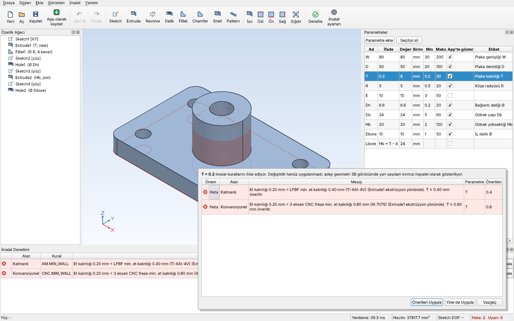

Düğmeler:
- **Önerileri Uygula:** Her sorunun ilk parametresine önerilen değeri aday değişikliğe yazar ve yeniden
  denetler. Hiç öneri yoksa bu düğme pasiftir.
- **Yine de Uygula:** Hatalarla birlikte adayı uygular.
- **Vazgeç:** Değişikliği iptal eder; model ve parametreler önceki hâline döner.

Önerileri Uygula döngüsü en fazla 10 tur çalışır. Döngü bitince son aday, kalan hatalarıyla birlikte işlenir.
Bu kod davranışıdır ve kullanıcının kalan hataları düzeltmesi gerekebilir.

Öneriler varken hiçbiri uygulanamazsa "Uygulanabilir bir öneri bulunamadı." mesajı çıkar ve inceleme penceresi
yeniden açılır. Öneriler hataları giderirse aday, pencere tekrar açılmadan işlenir.

Özellik ağacındaki ya da İmalat Denetimi tablosundaki **Öneriyi uygula** düğmesi tek bir öneriyi aday
değişikliğe yazar ve aynı boru hattından geçirir.

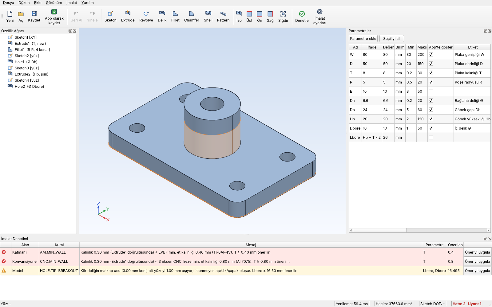

## 9. İmalat kuralları

Önem sütununda Hata (Error), Uyarı (Warning) ve Bilgi (Info) karşılıkları yer alır. Kural kimlikleri
`src/mfg/STATUS.md` dosyasındaki listeyle ve kaynak kodla karşılaştırılmıştır. Çalıştırıcının JSON çıktısında
önem ve alan değerleri Türkçe etiketlerle yazılır (`Hata`, `Uyarı`, `Bilgi`; `Katmanlı İmalat`,
`Konvansiyonel İmalat`, `Model`, `Parametre`).

### 9.1 Parametre ve model kuralları

| Kural | Anlamı | Önem | Formül / Eşik |
|---|---|---|---|
| `PARAM.EVAL` | Parametre hesaplanamadı, eksik veya NaN | Hata | Değerlendirme başarısız |
| `PARAM.RANGE` | Değer `Min`/`Maks` dışında | Hata | `v < min` veya `v > maks`; öneri sınır değeri |
| `PARAM.COUNT` | Adet parametresi tam sayı değil | Hata | `v ≠ round(v)`; öneri yuvarlanmış değer |
| `PARAM.FEATURE_EXPR` | Özellik ifadesi hatalı | Hata | Özellik ifadesi değerlendirilemiyor |
| `PARAM.SKETCH_EXPR` | Sketch ölçü ifadesi hatalı | Hata | Ölçü ifadesi değerlendirilemiyor |
| `MODEL.FEATURE_FAILED` | Özellik üretilemedi | Hata | `status.ok == false`; parametreler özelliğin referanslarıdır |
| `MODEL.REGENERATE` | Model üretimi istisna verdi | Hata | Üretim sırasında istisna |
| `MODEL.MULTI_BODY` | Birden fazla gövde | Bilgi / Uyarı | Bilgi: her ek gövde bilinçli oluşturulmuş (`op=new`, `keepTool=1`, `bodyName` veya Combine `keepTools=1`). Uyarı: adı `:k` ile biten bölünmüş gövde, bayrak olmadan oluşmuş gövde ya da birden çok katı içeren gövde |
| `MODEL.BODY_INTERFERENCE` | İki gövde birbirinin içine giriyor | Hata | Ortak hacim `> max(1e-3 mm³, 1e-6 × min(V_A, V_B))`; sorun, sonradan oluşan gövdenin özelliğine bağlanır |
| `HOLE.TIP_BREAKOUT` | Kör deliğin matkap ucu alttaki yüzeyi aşıyor | Uyarı | Uç apeksi altında malzeme `< 0`; öneri, uç apeksinin `max(AM, CNC)` minimum duvarını korumasıdır |
| `ANALYTIC.SKETCH_UNSOLVED` | Sketch çözülemedi | Bilgi | Saklı koordinatlar kullanıldı |
| `GEOM.CHECK_FAILED` | Geometrik kontrol OCCT istisnası verdi | Uyarı | Geometrik kontrol tamamlanamadı |
| `APP.EXCEPTION` | Çalıştırıcıda doğrulama istisnası | Hata | Doğrulama tamamlanamadı; yalnızca çalıştırıcı |

### 9.2 Katmanlı imalat (AM) kuralları

| Kural | Anlamı | Önem | Formül / Eşik |
|---|---|---|---|
| `AM.MIN_WALL` | Duvar çok ince | Hata | `t < minWallThickness`; `t` duvar, plaka, cep tabanı, delik ucu, kabuk veya B-Rep ışın ölçümüdür |
| `AM.MIN_HOLE` | Delik çapı çok küçük | Hata | `Ø < minHoleDiameter` |
| `AM.HORIZONTAL_HOLE` | Yatay delik destek ister | Uyarı | Eksen açısı `< minOverhangAngle` ve `Ø > maxSelfSupportingHoleDia`; SLS hariç |
| `AM.ASPECT_RATIO` | Duvar veya pim çok narin | Uyarı | Yükseklik/kalınlık `> maxAspectRatio`; önce yükseklik parametresi önerilir |
| `AM.MIN_GAP` | Duvarlar arası boşluk dar | Uyarı | Boşluk `< minGap` |
| `AM.MIN_FEATURE` | Yuvarlatma veya pah çok küçük | Uyarı | Fillet yarıçapı veya pah mesafesi `< minFeatureSize` |
| `AM.BUILD_ENVELOPE` | Parça yapı hacmine sığmıyor | Hata | İnşa çerçevesinde boyutlar `> buildX/Y/Z`; X-Y takası serbest |
| `AM.OVERHANG` | Destek gerektiren aşağı bakan yüzey | Uyarı | Yüzey açısı `< minOverhangAngle`; kısa köprüler (process limiti içinde) Bilgi; SLS hariç |
| `AM.TRAPPED_POWDER` | Kapalı kabukta toz kalır | Hata | Kapalı kabuk, kapalı kesim veya birden fazla kabuk; yalnızca LPBF, EBM, SLS, SLA |
| `AM.BLIND_HOLE` | Kör delikten toz/reçine tahliyesi zor | Uyarı / Bilgi | Ø `< minEscapeHoleDia` (Uyarı) veya derinlik/Ø `> 4` (Bilgi); toz ve reçine süreçleri |
| `AM.BODY_GAP` | İki gövde arası boşluk dar ya da gövdeler temas ediyor | Uyarı | Gövdeler arası mesafe `< minGap`; yalnızca LPBF, EBM, SLS, SLA. Temas (mesafe 0) da bildirilir; üst üste binen gövdeler bildirilmez |

### 9.3 Konvansiyonel imalat (CNC) kuralları

| Kural | Anlamı | Önem | Formül / Eşik |
|---|---|---|---|
| `CNC.MIN_WALL` | Duvar çok ince | Hata | `t < minWallThickness` (AM ile aynı ölçümler) |
| `CNC.WALL_RATIO` | Duvar çok yüksek ve ince | Uyarı | Yükseklik/kalınlık `> maxWallHeightToThickness` |
| `CNC.HOLE_LD` | Delik çok derin | Hata | `L/Ø > maxHoleDepthToDia`; L kör derinlik veya malzeme uzunluğu |
| `CNC.MIN_HOLE` | Delik çok küçük | Hata | `Ø < minHoleDiameter` |
| `CNC.STD_DRILL` | Standart matkap değil | Bilgi | `preferStandardDrills` ve `Ø ≤ 50`; öneri en yakın standart çap |
| `CNC.FILLET_TOOL_RADIUS` | İç yuvarlatma takımdan küçük | Hata | İçbükey, takım eksenine paralel kenar ve `R < minToolDiameter/2` |
| `CNC.CORNER_RADIUS` | İç yay veya yuvarlak cep takımdan küçük | Hata | Eksene paralel içbükey yay veya cep ve `R < minToolDiameter/2` |
| `CNC.SHARP_INTERNAL_CORNER` | Keskin iç köşe | Hata | İçbükey dikey köşe (malzeme açısı > 180°) ve Fillet ile kaplı değil |
| `CNC.SLOT_WIDTH` | Yarık takımdan dar | Hata | Boşluk/yarık `< minToolDiameter` |
| `CNC.POCKET_DEPTH` | Cep çok derin | Uyarı | Derinlik `> maxToolLengthToDia × D`; `D = max(minToolDiameter, min(cep genişliği, 2 × en küçük köşe yarıçapı))` |
| `CNC.STOCK_ENVELOPE` | Parça ham parçaya sığmıyor | Hata | Takım çerçevesinde boyutlar `> stockX/Y/Z`; torna için `2·Rmax > stockX` ve uzunluk `> stockZ` |
| `CNC.ACCESS` | Takımla erişilemeyen delik veya kesim | Uyarı / Bilgi | 3 eksende eksen takım eksenine paralel değil (Uyarı) veya alttan delinecek (Bilgi, ikinci bağlama) |
| `CNC.UNDERCUT` | Alt kesim | Hata / Uyarı | Analitik: iki yanı da malzemeyle kapalı kesim (Hata). B-Rep: yüz örneklerinin en az üçte biri ulaşılamıyor (Uyarı; yalnızca 3 eksen) |
| `CNC.ENCLOSED_VOID` | Kapalı boşluk | Hata | Kapalı kabuk, kapalı kesim veya iç kabuk |
| `CNC.TURN_AXISYMMETRY` | Torna parçası eksen simetrik değil | Uyarı / Bilgi | Eksen dışı prizma (Uyarı) veya eksen dışı delik (Bilgi) |
| `CNC.SEPARATE_PARTS` | Birden çok gövde ayrı parça olarak işlenir | Bilgi | Konvansiyonel imalat etkin ve gövde sayısı 1'den büyük; her gövde ayrı bağlama olarak işlenir |

Ön ayar değerleri, kural eşiklerinin varsayılanlarını belirler (7.4 bölümü).

Çok gövdeli parçada B-Rep kuralları her gövdeye ayrı uygulanır; mesajlar "Gövde <ad>: " ile başlar.
Yapının ya da ham parçanın tamamı için AM.BUILD_ENVELOPE ve CNC.STOCK_ENVELOPE ayrıca, tüm gövdeler
birlikte değerlendirilerek denetlenir ("Tüm yapı: ..." mesajı). Ayrıntı için 16.6 bölümüne bakın.

## 10. Uygulama Olarak Kaydet

### 10.1 Açma

- Ctrl+Shift+A, Dosya menüsündeki **Uygulama Olarak Kaydet... (Save as App)** veya İmalat sekmesindeki
  **App olarak kaydet** düğmesiyle açılır.
- Pencere, `persistcad_runner` dosyasını **tasarım ortamının çalıştığı dizinde** arar. Bulunamazsa
  `Çalıştırıcı (persistcad_runner) bulunamadı` hatası verilir.
- Pencerede yapılan "Uygulamada göster", etiket ve sınır değişiklikleri açık belgeye `App parametre ayarları`
  adıyla değişiklik olarak işlenir (geri alınabilir). Dosyaya yazmak için belgeyi ayrıca Kaydet ile kaydedin.

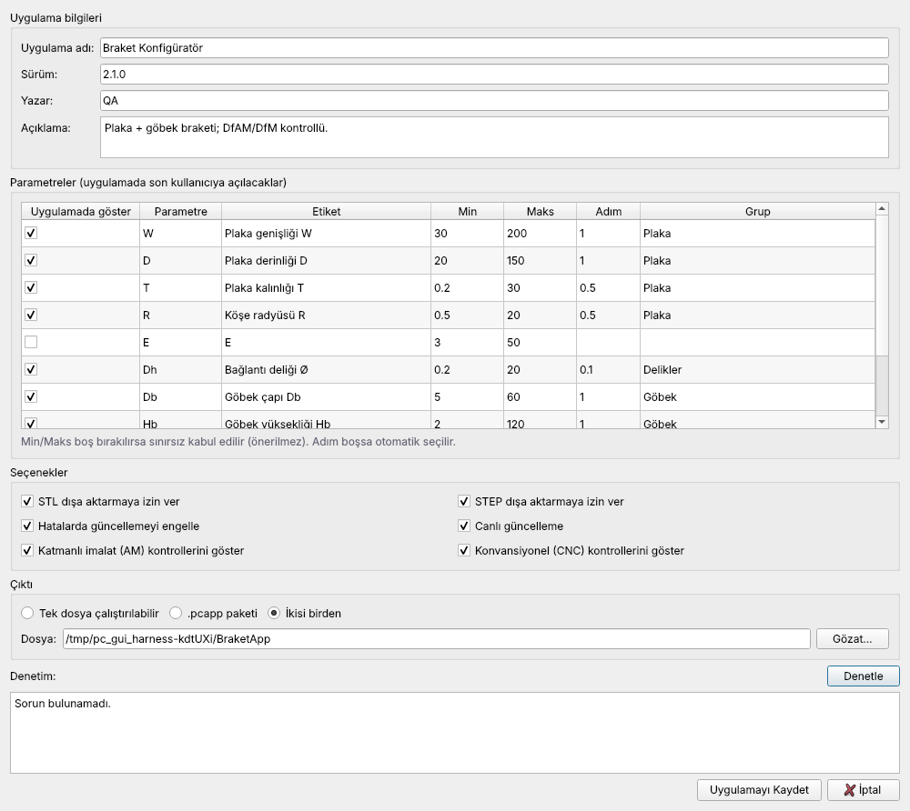

### 10.2 Alanlar

**Uygulama bilgileri:**
- Uygulama adı (boş olamaz; varsayılan belge adıdır).
- Sürüm (varsayılan `1.0.0`).
- Yazar, Açıklama (isteğe bağlı).

**Parametreler (uygulamada son kullanıcıya açılacaklar):** Sütunlar: Uygulamada göster, Parametre, Etiket,
Min, Maks, Adım, Grup. İfade ve açıklama bilgisi hücre ipucunda görünür. Min ve Maks boş bırakılırsa sınırsız
kabul edilir; bu önerilmez.

**Seçenekler:**
- STL dışa aktarmaya izin ver (`allowExportSTL`).
- STEP dışa aktarmaya izin ver (`allowExportSTEP`).
- Hatalarda güncellemeyi engelle (`blockOnErrors`).
- Canlı güncelleme (`liveUpdate`); kapalıysa kullanıcı "Güncelle" düğmesine basmalıdır.
- Katmanlı imalat (AM) kontrollerini göster (`showAdditiveChecks`).
- Konvansiyonel (CNC) kontrollerini göster (`showConventionalChecks`).

**Çıktı:**
- Tek dosya çalıştırılabilir, `.pcapp` paketi veya ikisi birden.
- Dosya yolu; varsayılanı `<kullanıcı dizini>/<belge adı>_app` biçimindedir (belge adındaki boşluklar `_` olur).
  Gözat ile değiştirilebilir.

**Denetim:** Denetle düğmesi lint sonuçlarını alt kutuda gösterir.

### 10.3 Lint kuralları (`pc::app::lintApp`)

- **HATA** (kaydetmeyi engeller):
  - Uygulama adı boş.
  - Açık parametre yok.
  - Parametrede `min > maks`.
  - Adım değeri negatif.
  - Açık parametrenin varsayılanı aralığın dışında.
  - Model varsayılan değerlerle üretilemiyor.
  - Varsayılan değerler imalat HATA'sı üretiyor.
- **UYARI** (onay ister):
  - Açık parametrenin min veya maks değeri sonlu değil.
  - Açık parametre bir ifade ile tanımlı; uygulamada sabit sayıya dönüşecek.
  - Varsayılan değerlerde imalat uyarıları var.
  - İmalat denetimi çalıştırılamadı.

Pencere, HATA varsa `Aşağıdaki hatalar giderilmeden uygulama kaydedilemez` mesajını gösterir. Yalnızca
UYARI varsa `Yine de kaydedilsin mi?` diye sorar.

### 10.4 Çıktı biçimleri

**Tek dosya çalıştırılabilir:** Çalıştırıcının ikili kodu, ardından JSON yük (payload), 8 baytlık little-endian
boyut ve 16 baytlık `PCAPP_PAYLOAD_V1` izi gelir. Çalıştırıcıda eski bir yük varsa önce atılır. Dosya
`0755` izniyle yazılır. Çalıştırıcı kendi ikilisinin sonunda bu izi arar; bulursa paketi okur.

**.pcapp paketi:** JSON, şema `persistcad-app/1`. Alanlar: `appName`, `version`, `author`, `description`,
`options` (altı seçenek) ve `document` (`.pcad` içeriğiyle aynı yapı). Şema farklıysa okuma reddedilir.

## 11. Çalıştırıcı (persistcad_runner)

### 11.1 Açılış

- `persistcad_runner uygulama.pcapp`: paketi açar.
- Gömülü yük içeren tek dosya uygulama: doğrudan çalıştırılır.
- Hiçbiri yoksa `Uygulama paketi aç` diyaloğu açılır (*.pcapp).

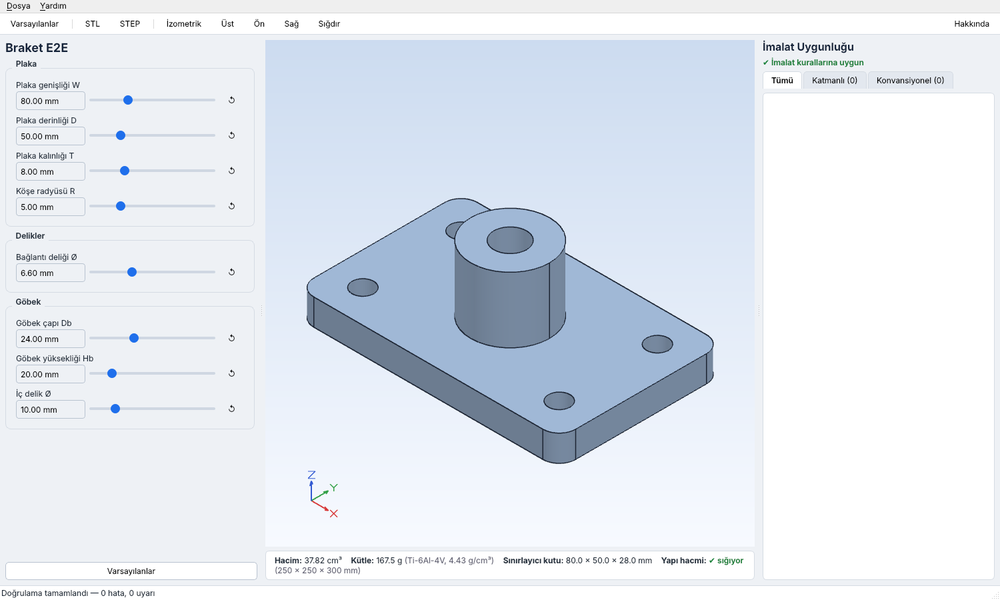

### 11.2 Düzen

- **Üst çubuk:** Dosya menüsünde STL/STEP dışa aktarma ve Çıkış; Yardım menüsünde Hakkında. Araç çubuğunda
  Varsayılanlar, STL, STEP, İzometrik, Üst, Ön, Sağ, Sığdır, Hakkında.
- **Sol panel:** Uygulama adı, açıklama ve grup kutuları. Her parametre için bir sayı kutusu, bir kaydırıcı ve
  ↺ (varsayılana dön) düğmesi bulunur.
- **Orta:** 3B görünüm ve altında bilgi şeridi: hacim (cm³), kütle (g) ve malzeme/yoğunluk, sınırlayıcı kutu
  (mm) ve (katmanlı imalat etkinse) yapı hacmine sığıp sığmadığı.
- **Sağ panel: İmalat Uygunluğu:** Hata ve uyarı sayaçları ve üç sekme: Tümü, Katmanlı (n), Konvansiyonel (n).
  Sekmeler, uygulama seçeneklerine göre gizlenebilir.
- **Gövdeler (çok gövdeli uygulamada):** Sağ panelde gövde listesi, gövde filtresi ve "Yardımcı düzlemleri göster"
  kutusu bulunur. Ayrıntı için 16.7 bölümüne bakın.

### 11.3 Güncelleme ve geri bildirim

- **Canlı güncelleme açıksa:** Değişiklik, kısa bir gecikmeden sonra otomatik doğrulanır.
- **Kapalıysa:** `Değişiklikler henüz uygulanmadı` yazısı çıkar ve **Güncelle** düğmesi görünür.
- **Alan geri bildirimi:** Sorunlu alanın kenarlığı renklenir, altında mesaj çıkar ve varsa `Öneri: X mm — Uygula`
  düğmesi görünür.
- **Üst şerit:** Hata varsa `Parametreler imalat kurallarını ihlal ediyor — model güncellenmedi` mesajı ve
  **Önerileri Uygula** düğmesi gösterilir. Bu düğme, her sürücü parametre için mevcut değerden en uzak öneriyi
  seçer.
- **Doğrulama:** Arka planda çalışır; eski sonuçlar yenileriyle değiştirilir.

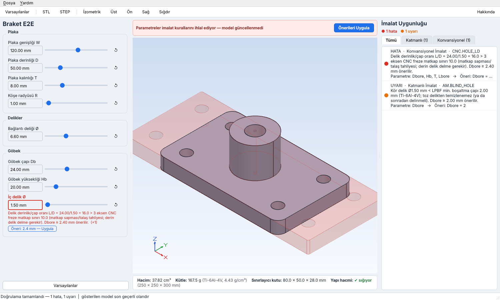

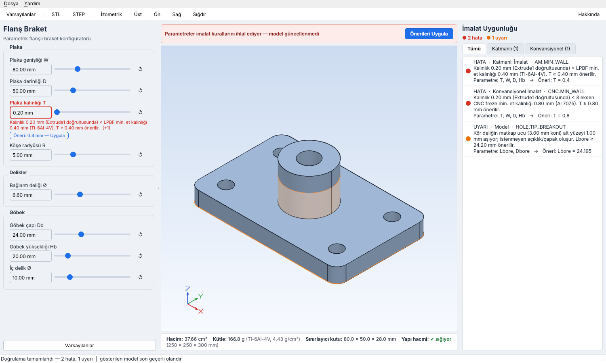

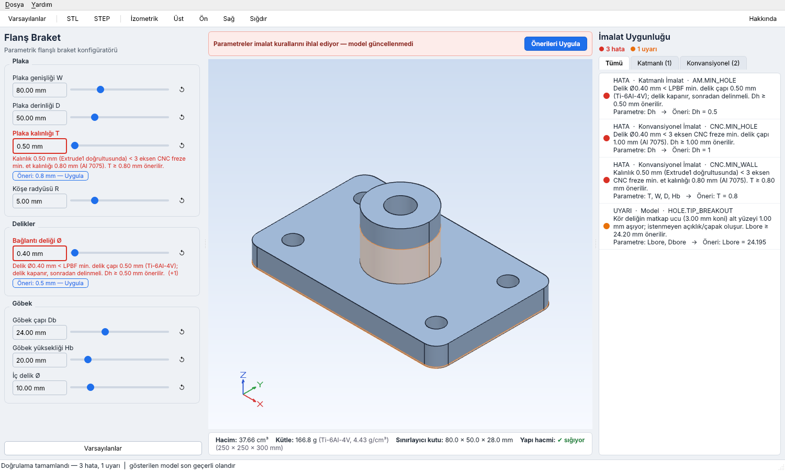

### 11.4 Hata davranışı

- **`blockOnErrors = true`:** Hata varsa model güncellenmez. Ekranda son geçerli model kalır ve durum
  çubuğunda `gösterilen model son geçerli olandır` yazar.
- **`blockOnErrors = false`:** Model üretilebiliyorsa güncellenir ve turuncu bir uyarı şeridi gösterilir.

### 11.5 Dışa aktarım

STL ve STEP menüleri, ilgili izin kapalıysa devre dışı kalır. Dışa aktarım başarısız olursa hata gösterilir.
Çok gövdeli uygulamada önce "Hangi gövde dışa aktarılsın?" sorusu çıkar: "Tüm gövdeler" ya da tek bir gövde seçilir.

## 12. Komut satırı araçları

### 12.1 pc_mkapp

```
pc_mkapp in.pcad runner out_base [--name N] [--version V] [--author A] [--desc D] [--no-exe] [--no-pcapp]
```

- `in.pcad`: belge. Açık parametreler belgedeki `exposed` bayraklarından okunur.
- `runner`: `persistcad_runner` dosyasının yolu. Tek dosya çıktısı için gereklidir.
- `out_base`: tek dosya çıktısının yolu; `.pcapp` de `out_base.pcapp` olarak yazılır.
- `--name`, `--version`, `--author`, `--desc`: uygulama bilgileri. `--name` verilmezse belge adı kullanılır;
  varsayılan sürüm `1.0.0`.
- `--no-exe`: tek dosya çıktısını atlar. `--no-pcapp`: `.pcapp` çıktısını atlar.
- Çıkış kodu: `0` başarılı; `1` kullanım, yükleme veya yazma hatası.

Önemli: `pc_mkapp` lint sonuçlarını stderr'e yazar ancak **işlemi engellemez**. HATA içeren bir belge de
paketlenir. Dağıtımdan önce çalıştırıcıyla `--validate-only` denetimi yapın.

Örnek:

```bash
mkdir -p out
./build/bin/pc_mkapp samples/bracket.pcad ./build/bin/persistcad_runner out/flans_app --name "Flanş Braketi"
```

### 12.2 persistcad_runner

```
persistcad_runner [app.pcapp] [--set AD=DEĞER ...] [--screenshot çıktı.png] [--validate-only [--text]]
```

| Seçenek | Açıklama |
|---|---|
| `app.pcapp` | Açılacak paket. Verilmezse gömülü yük kullanılır |
| `--set AD=DEĞER`, `--set=AD=DEĞER` | Parametre ayarlar; tekrarlanabilir. Değer sayı veya sabit ifade olabilir. Virgül ondalık ayracı olarak kabul edilir |
| `--screenshot DOSYA` | Pencereyi kaydedip çıkar. Yaklaşık 120 saniye içinde tamamlanmazsa çıkış kodu 3 olur |
| `--validate-only` | Pencere açmadan denetler. Varsayılan çıktı JSON'dur |
| `--text` | `--validate-only` ile birlikte düz metin çıktı verir |
| `--show-planes` | Yardımcı düzlemleri başlangıçta gösterir. Varsayılan gizlidir |
| `-h`, `--help` | Yardımı gösterir. GUI olmayan ortamda `QT_QPA_PLATFORM=offscreen` gerekebilir |

Notlar:
- `--validate-only` `QCoreApplication` kullanır; görüntü sunucusu gerektirmez.
- `--validate-only` modunda `--set` ile açık olmayan parametreler de verilebilir. Bilinmeyen parametre
  `Bilinmeyen parametre: AD` mesajıyla çıkış kodu 1 verir.
- GUI modunda `--set` değerleri spin kutusunun aralığına kırpılır ve stderr'e uyarı yazılır.

Çıkış kodları: `0` uygun; `2` uygun değil; `1` yükleme veya kullanım hatası.

Düz metin çıktısı örneği (`samples/bracket.pcad` ile, `T = 0.4`):

```
Flanş Braketi v1.0.0
  T = 0.4
Parametreler: W = 80, D = 50, T = 0.4, R = 5, Dh = 6.6, Db = 24, Hb = 20, Dbore = 10
Model: oluşturuldu
[Hata] (Konvansiyonel İmalat) CNC.MIN_WALL: Et kalınlığı 0.40 mm < 3 eksen CNC freze min. et kalınlığı 0.80 mm (Al 7075) (Extrude1 ekstrüzyon yönünde). T ≥ 0.80 mm önerilir.  [Gövde: Extrude1]  -> Öneri: T = 0.8
Sonuç: UYGUN DEĞİL
```

JSON çıktısının alanları:
- Üst düzey: `app`, `version`, `overrides` (verilen değerler), `parameters` (uygulamanın girdileri = "Uygulamada
  göster" işaretli parametreler ve bu çalıştırmada kullanılan değerleri, ör. `{"T": 20}`), `regenerated`,
  `modelOk`, `acceptable`, `counts` (`errors`, `warnings`, `info`), `issues`, `bbox` (`xmin` ... `zmax`, mm) ve
  `volumeMm3`.
- Her sorun: `severity`, `domain`, `ruleId`, `message`, `featureId`, `params`, `suggestedValue`, `actual`,
  `limit`, `faces`, `edges`, `body` (çok gövdeli parçada).
- Çok gövdeli parçada üst düzeyde `bodies` dizisi bulunur: her öğede `name`, `volumeMm3`, `massG`.
- Düz metinde birden çok gövde varsa `Gövdeler (n):` bloğu yazılır; sorun satırları `[Gövde: ad]` etiketi taşır.

`acceptable` alanı yalnızca etkin alanların hatalarını dikkate alır.

## 13. Dosya biçimleri

### 13.1 `.pcad` (şema `persistcad/1`)

Üst düzey alanlar: `schema`, `name`, `parameters`, `features`, `mfg`.

`parameters` öğesi:
- `name`, `expr` (sayı veya ifade metni), `kind` (`length`, `angle`, `count`, `scalar`).
- `min`, `max`: sınır değeri veya `null` (sınırsız).
- `description`, `exposed`, `label`, `step`, `group`.

`features` öğesi:
- `id`, `type` (`Sketch`, `Extrude`, `Revolve`, `Hole`, `Fillet`, `Chamfer`, `Shell`, `Pattern`, `Plane`, `Combine`), `suppressed`, `props`, `refs`.
- v2 anahtarları: Extrude, Revolve, Hole ve Pattern için `targets`, `keepTool`, `bodyName`. `Plane` için `kind`
  (`edgeNormal`, `edgeAngle`, `twoEdges`, `faceOffset`), `t`, `angle`, `offset`, `rotate`, `flip` ve `refs` (kenar veya yüz adları).
  `Combine` için `op`, `target`, `tools`, `keepTools`. Ayrıntı için 16. bölüm.
- `sketch` (yalnızca `Sketch` türünde): `plane` (`kind`, `faceRef`, `offset`), `points` (`id`, `x`, `y`),
  `entities` (`id`, `type` = `line`/`circle`/`arc`, `points`, isteğe bağlı `radius`, `construction`),
  `constraints` (`id`, `type`, `refs`, isteğe bağlı `value`), `nextId`.

`mfg` öğesi: `additive` ve `conventional` nesneleri (7. bölüm). Dizi alanları `build`, `buildDir`, `stock`,
`toolAxis` şeklindedir.

Örnek: `samples/bracket.pcad` içinde `Sketch1` ve `Extrude1` kayıtları bu yapıdadır.

### 13.2 `.pcapp` (şema `persistcad-app/1`)

Üst düzey alanlar: `schema`, `appName`, `version`, `author`, `description`, `options`, `document`.
`options` altı boolean içerir: `allowExportSTL`, `allowExportSTEP`, `blockOnErrors`, `liveUpdate`,
`showAdditiveChecks`, `showConventionalChecks`. `document` alanı `.pcad` içeriğidir.

### 13.3 Gömülü yük

Çalıştırılabilir dosyanın sonunda şu sıra bulunur: çalıştırıcı ikilisi, JSON yük, `uint64` (little-endian) boyut,
ve `PCAPP_PAYLOAD_V1` izi (16 bayt).

## 14. Bilinen sınırlamalar

Bu liste modül `STATUS.md` dosyalarından ve kaynak kodundan derlenmiştir.

**Model ve özellikler**
- Analitik model taslak, pah, yuvarlatma ve kabukları malzeme sınıflandırıcısına almaz. Revolve yalnızca
  boyutlara katkı verir.
- Analitik duvar ve boşluk ışınları yalnızca analiz eksenine paralel prizmaların sınırlarını kullanır.
  Paralel olmayan birleşmelerde duvar gizlenebilir; bu durumları geometrik kontroller yakalar.
- Pattern örnekleri geometriyi takip etmeyen sabit kopyalardır.
- Eğim (draft) simetrik Extrude'da yalnızca bir taraflıdır.
- İnce özellik ve "yüze kadar" çekme yoktur.
- Revolve `U` ve `V` eksenleri yalnızca sketch orijininden geçer.
- Pattern ve Revolve pencereleri tüm model durumlarına karşı sınanmamıştır.

**Sketch**
- Marquee seçimi, trim, offset ve mirror yoktur.
- Sketch editöründe 3B model altlık olarak gösterilmez.

**Düzlemler ve çok gövde (v2)**
- Datum düzlemlerinin görüntü boyutu modelin ipucu boyutunun %60'ı kadardır; düzlemler "Sığdır" hesabına katılmaz.
- Yüzden ofsetli düzlem (faceOffset) için yüz bağlam menüsü yoktur; yalnızca Düzlem penceresinden oluşturulur.
- Analitik imalat modeli Plane özelliklerine malzeme etkisi tanımaz ve Combine ile "Aracı koru" gövdelerini modellemez.
  Bu gövdeler geometrik kontrollerle denetlenir.
- Gövdeler panelinde yeniden adlandırma yalnızca Extrude, Revolve veya Pattern ile oluşan gövdelerde yapılır.
- Gövdeyi gizlemek yalnızca 3B görünümü etkiler; yüzleri seçilemez hâle gelir.

**Denetim**
- B-Rep ince kalınlık ölçümü 5×5 veya 6×6 UV ızgarasıyla yapılır; çok yerel ince noktalar kaçabilir. Analitik
  geçiş ligamentleri tam olarak bulur.
- `solveParamFor` tam kökü verir; yön bilgisi taşımadığı için yuvarlatılmış değerler içeride üretilir.
- Önerileri Uygula döngüsü 10 turla sınırlıdır ve kalan hatalara rağmen işler (8.3 bölümü).
- "Yine de Uygula" ile işlenmiş bir değişiklik geri alındığında denetim zaman uyumsuz olarak yeniden çalışır.

**Çalıştırıcı ve dağıtım**
- Uygulamada gösterilmeyen parametreler için öneri uygulanamaz; giriş alanı yoktur.
- Standalone uygulama Qt ve OCCT çalışma zamanı kütüphanelerini kendi içinde taşımaz (README'deki Windows notu).
- `pc_mkapp` HATA içeren belgeleri de paketler.

**Kılavuz ve görüntüler**
- `final_*.png` dışındaki ekran görüntüleri ara sürümlerden alınmıştır.

## 15. Eğitim: flanş braketi

Bu eğitim `samples/bracket.pcad` dosyasını kullanır. Parça bir plaka (`Extrude1`, kalınlık `T`), dört köşe
yuvarlatması (`Fillet1`), dört through delik (`Hole1`, çap `Dh`), üstte bir göbek (`Extrude2`, çap `Db`,
yükseklik `Hb`) ve göbekte bir kör iç delik (`Hole2`, çap `Dbore`, derinlik `Lbore = Hb + T - 4`) içerir.

Açık parametreler: `W`, `D`, `T`, `R`, `Dh`, `Db`, `Hb`, `Dbore`. Açık değil: `E` (delik kenar mesafesi)
ve `Lbore`.

### 15.1 Açma ve inceleme

```bash
./build/bin/persistcad samples/bracket.pcad
```

Özellik ağacı: `Sketch1 [XY]`, `Extrude1 (T, new)`, `Fillet1 (R R, 4 kenar)`, `Sketch2 [yüz]`, `Hole1 (Ø Dh)`,
`Sketch3 [yüz]`, `Extrude2 (Hb, join)`, `Sketch4 [yüz]`, `Hole2 (Ø Dbore)`.

Sketch1'e çift tıklayın. 80 × 50 mm dikdörtgen, `W` ve `D` ölçüleriyle tam tanımlıdır; durum çubuğunda
`Sketch DOF: 0` yazmalıdır. Çıkın (Sketch'i Bitir).

Parametre tablosunda değerler sırasıyla `T = 8`, `R = 5`, `Dh = 6.6`, `Db = 24`, `Hb = 20`, `Dbore = 10`
olmalıdır. Denetle (F5) düğmesine basın. Varsayılan değerlerde imalat hatası olmamalıdır.

### 15.2 Denemeler

Her adımda ilgili parametrenin İfade sütunundaki değeri değiştirin. Sonuçlar aşağıdaki gibi olmalıdır.
Aynı sonuçlar komut satırında `--validate-only` ile de doğrulanmıştır.

| Değişiklik | Beklenen sonuç |
|---|---|
| Varsayılanlar | Hata ve uyarı yok (`UYGUN`) |
| `T = 0.4` | `CNC.MIN_WALL` (Hata). Öneri `T = 0.8` |
| `Dh = 0.4` | `AM.MIN_HOLE`, `CNC.MIN_HOLE`, `CNC.HOLE_LD` (Hata). Öneriler `Dh = 0.5`, `Dh = 1`, `Dh = 0.8` |
| `R = 0.1` | `PARAM.RANGE` (Hata). Model üretilmez. Öneri `R = 0.5` |
| `Dbore = 2` | `CNC.HOLE_LD` (Hata). Öneri `Dbore = 2.4`. `AM.BLIND_HOLE` (Bilgi) |

`T = 0.4` denemesinde inceleme penceresi açılır. **Önerileri Uygula** düğmesi `T = 0.8` değerini uygular ve
değişiklik kabul edilir.

### 15.3 Uygulama olarak kaydetme

1. Ctrl+Shift+A ile Uygulama Olarak Kaydet penceresini açın.
2. Uygulama adını `Flanş Braketi` yapın. Sürümü `1.0.0` bırakın.
3. "Uygulamada göster" işaretlerini kontrol edin: `E` ve `Lbore` işaretli olmamalıdır.
4. Çıktıyı "Tek dosya çalıştırılabilir" yapın ve kaydedin.
5. Denetle düğmesiyle lint sonuçlarını görün. Boş ise `Uygulamayı Kaydet`e basın.

Oluşan uygulamayı çalıştırın. Ardından komut satırında kontrol edin:

```bash
./out/flans_app --validate-only --set T=0.4 --text
echo $?   # 2 beklenir
```

Ayrıca `--set R=0.1` ile çalıştırıldığında `PARAM.RANGE` hatası alınır ve model üretilmez.

---

## 16. Yardımcı düzlemler ve çoklu gövde (v2)

Bu bölüm iki v2 özelliğini anlatır: kenar ve yüzlerden tanımlanan **datum düzlemleri** ve bir parçada birden
çok katının (**gövde**) yönetimi. Burada yazılan davranışlar `src/core/pc/Feature.h` tanımına, modüllerin
`STATUS.md` notlarına ve kaynak koda dayanır. Bölüm 16.8 örnek dosyayı (`samples/v2_multibody.pcad`) adım
adım kurar.

### 16.1 Kavramlar

- **Datum düzlem (Plane):** Geometri üretmeyen, yalnızca sketch için referans olan bir özelliktir. Sketch bu
  düzleme bağlanabilir (16.4).
- **Gövde (body):** Parçanın ayrı bir katısıdır ve bir adı vardır. İmalat denetimi her gövdeyi ayrı değerlendirir (16.6).
- **İşlem:** Extrude ve Revolve'un mevcut gövdelerle nasıl ilişkileneceğini belirler: Birleştir, Çıkar,
  Kesişim veya Ayrı gövde.
- **Hedef gövdeler:** İşlemin uygulanacağı gövde adları. Boş bırakılırsa otomatik seçilir (16.5).
- **Combine:** İki veya daha fazla gövde arasında boolean işlem yapan özelliktir (16.5).

### 16.2 Kenardan düzlem oluşturma

Düzlem oluşturmanın en hızlı yolu 3B görünümde bir kenardır. Kenara **sağ tıklayın** (SpaceClaim şeması; düz
tık kenarı yalnızca seçer); açılan menüde şu komutlar vardır:

| Menü komutu | Sonuç |
|---|---|
| Bu kenara dik düzlem | `edgeNormal` düzlemini hemen oluşturur. `t = 0.5` (kenarın ortası). |
| Bu kenardan açılı düzlem | `edgeAngle` düzlemi için Düzlem penceresini açar. Açının başlangıç değeri 45°'dir. |
| İki kenardan düzlem | Bu kenarı birinci kenar olarak alır; ardından ikinci kenara tıklamanız istenir. |
| Düzlem diyaloğu... | Düzlem penceresini tüm alanlarıyla açar. |

Oluştur > Klasik ▾ > Düzlem... boş bir Düzlem penceresi açar (ribbon'daki **Düzlem** aracı ise doğrudan seçili yüzden / kenardan düzlem oluşturur):

- **Tür:** Dört türden biri (16.3).
- **Kenar 1, Kenar 2, Yüz:** Referans alanları salt okunurdur. Her biri için **Seç** düğmesine basıp 3B görünümde
  kenara tıklayın; yüz için de tıklama kullanılır. Hangi alanların etkin olduğu türe bağlıdır: Kenar 2
  yalnızca "İki kenardan" türünde, Yüz yalnızca "Kenardan açılı" ve "Yüzden ofset" türlerinde etkindir.
- **Kenar boyunca konum t (0..1), Açı (°), Öteleme (mm), Döndürme (°):** İfade alanlarıdır; `+P` ile yeni
  parametre oluşturulabilir. Açı yalnızca "Kenardan açılı" türünde, t yalnızca kenar türlerinde etkindir.
- **Normali ters çevir:** `flip` anahtarını ayarlar.
- **Önizleme satırı:** Düzlemin orijinini gösterir ya da hatayı yazar. **Oluştur** düzlemi işlem hattından
  geçirerek ekler.

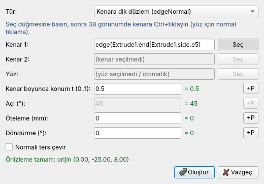

Kenardan oluşturulan düzlem, referans verdiği kenarı izler: model her üretimde düzlemi yeniden hesaplar.
Parametre değişince düzlem de yer değiştirir.

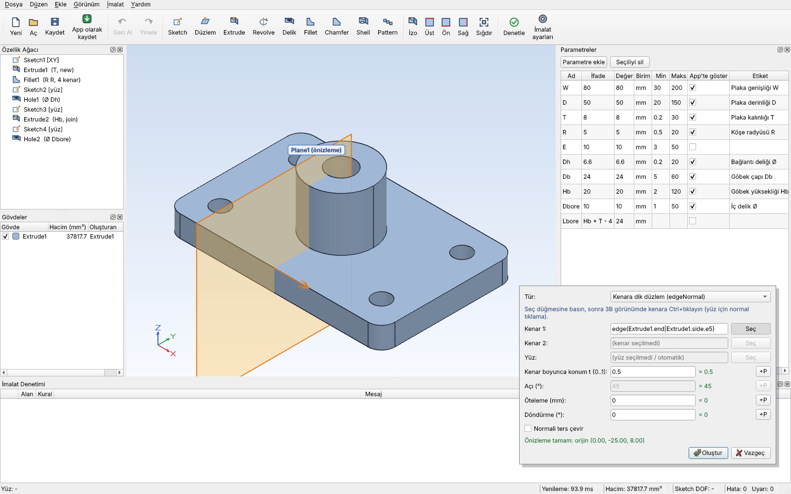

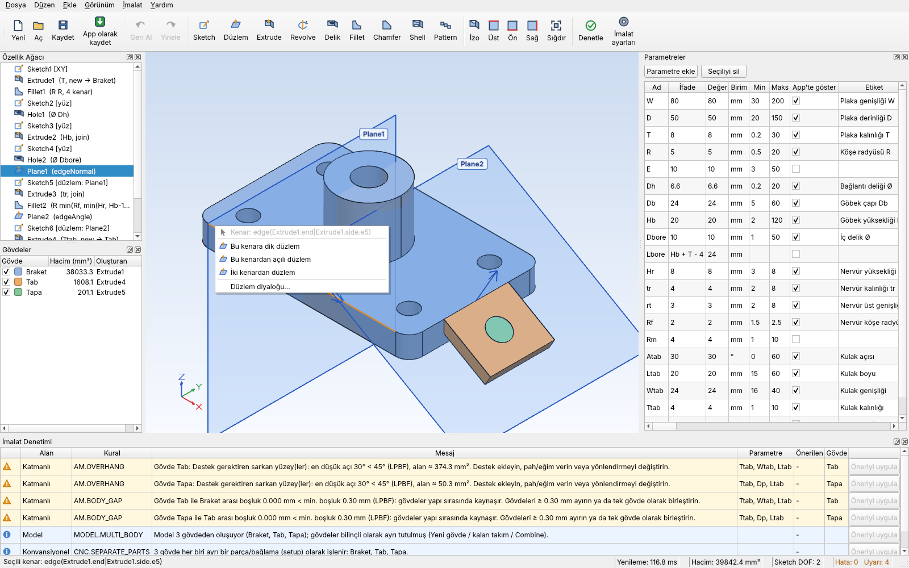

Görüntü > Görünürlük > Datum düzlemleri ile düzlemler gösterilir ya da gizlenir. Bir düzleme sağ tıklamak bağlam menüsü
açar; bu menüden **Bu düzlemde sketch başlat** ve **Düzlemi düzenle...** seçilebilir.

### 16.3 Düzlem türleri ve çerçeve kuralları

Her düzlemin bir orijini, u ve v eksenleri ve bir normali vardır; u × v = normal (sağ el kuralı). Aşağıdaki
tablo `Feature.h` tanımındaki kuralları verir.

| Tür | Referanslar | Orijin | Normal | u ekseni |
|---|---|---|---|---|
| `edgeNormal` | `refs[0]`: kenar | Kenar üzerinde `t` konumu (0..1; kenar eğrisinin parametre yönünde) | Kenarın o noktadaki teğeti | Dünya +X'in düzleme izdüşümü (yoksa +Y) |
| `edgeAngle` | `refs[0]`: düz kenar; `refs[1]`: referans yüz (isteğe bağlı) | Kenar üzerinde `t` (varsayılan 0.5) | Referans yüzün dış normali (kenara dik bileşen); kenar doğrultusu etrafında `angle` kadar sağ el kuralıyla döndürülür | Kenar doğrultusu |
| `twoEdges` | `refs[0]`, `refs[1]`: aynı düzlemde düz kenarlar (kesişen veya paralel) | `refs[0]`'ın orta noktası | normalize(d0 × (m1 − m0)); bu olmazsa d0 × d1 | `refs[0]` doğrultusu |
| `faceOffset` | `refs[0]`: düzlemsel yüz | Yüzün düzlemi | Yüzün dış normali | Dünya +X'in izdüşümü (yoksa +Y) |

Referans yüz verilmezse `edgeAngle` için kenara bitişik düzlemsel yüzlerden adı sözlük sırasında önce gelen
kullanılır. Örnek parçada bu `Extrude1.end` yüzüdür. Her türde v ekseni = normal × u'dur.

Ortak alanlar şu sırayla uygulanır:
1. `rotate`: u ve v, normal etrafında döner.
2. `flip`: normal ve v ters çevrilir; u korunur.
3. `offset`: düzlem son normal yönünde ötelenir.

Referans verilen kenar veya yüz bölünmüşse ilk parça kullanılır (ada göre sıralı, `:1`) ve durum çubuğunda
"'<ref>' bölünmüş, kullanılan: <parça>" uyarısı çıkar. Hata durumunda özellik atlanır ve mesaj "<kimlik>: ..."
ile başlar. Yaygın hatalar: "kenar bulunamadı", "kenar düz değil", "t 0 ile 1 arasında olmalı", "kenarlar aynı
doğru üzerinde, düzlem tanımsız", "kenarlar aynı düzlemde değil", "yüz düzlemsel değil".

### 16.4 Düzlem üzerinde sketch

- Datum düzleme tıklayıp açılan menüden **Bu düzlemde sketch başlat** seçin. Ya da Sketch aracındaki
  **Seçili düzlemde (datum)** seçeneğini kullanın. Seçili düzlem yoksa bu seçenek "Henüz datum düzlemi yok" uyarısı verir.
- Sketch'in çerçevesi düzlemin çerçevesidir. Sketch `offset` değeri (mm) normal yönünde ayrıca uygulanır.
- Özellik ağacında ve sketch başlığında `[düzlem: Plane1]` görünür.
- Düzlem bastırılmış ya da hatalıysa sketch hata verir: "düzlem '<kimlik>' kullanılamıyor (bastırılmış veya hatalı)".

### 16.5 Çoklu gövde: işlem, hedef gövdeler ve birleştirme

**Extrude ve Revolve penceresi.** İşlem listesi dört seçenek sunar:

| Arayüz | `.pcad` değeri | Anlamı |
|---|---|---|
| Birleştir (Add) | `join` | Aracı hedef gövdelerle birleştirir |
| Çıkar (Subtract) | `cut` | Aracı hedef gövdelerden çıkarır |
| Kesişim (Intersect) | `intersect` | Hedef gövdelerle kesişimini alır |
| Ayrı gövde (New body) | `new` | Yeni gövde oluşturur; hedef gövdeler devre dışı kalır |

Ek alanlar:
- **Hedef gövdeler** (`targets`): Gövde adlarının işaretlenebilir listesi. Hiçbiri işaretlenmezse AUTO modu çalışır.
- **Aracı ayrı gövde olarak koru** (`keepTool`): Yalnızca Çıkar ve Kesişim'de etkindir. Aracın katı bir kopyası
  ayrı gövde olarak kalır.
- **Gövde adı** (`bodyName`): `new` işleminde yeni gövdenin adıdır. Çıkar ve Kesişim'de yalnızca "Aracı ayrı gövde
  olarak koru" işaretliyse etkindir. Boş bırakılırsa özelliğin kimliği kullanılır. Gövde adında boşluk ve
  `, . | : ( )` karakterleri kullanılamaz; aynı ad iki gövdeye verilemez.

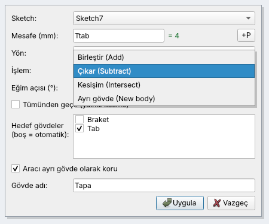

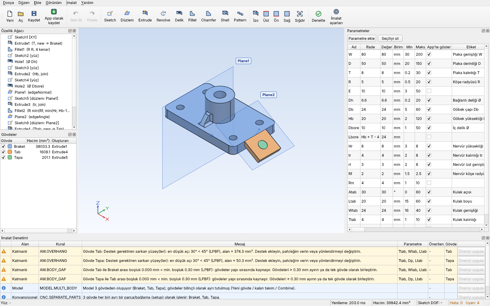

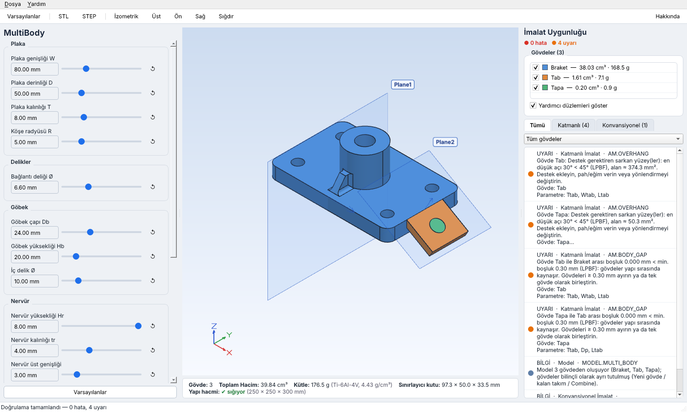

Yukarıdaki görüntüde Sketch7 kesimi yalnızca "Tab" gövdesini hedefler ve aracı "Tapa" adıyla korur.

**AUTO kuralları (hedef gövde boşken).** "Değmek", iki gövde arasındaki mesafenin 1e-5 mm veya daha az olması ya
da birinin diğerinin içinde olması demektir.

| İşlem | Davranış |
|---|---|
| join | Aracın değdiği gövdelerin tümü aracla birlikte tek gövdede birleşir; birleşik gövde en eski gövdenin adını taşır. Hiçbir gövdeye değmiyorsa yeni bir gövde olur. |
| cut | Değen her gövde ayrı ayrı kesilir. Hiçbirine değmiyorsa "araç hiçbir gövdeye değmiyor (değişiklik yok)" uyarısı verilir ve model değişmez. |
| intersect | Değen gövdeler araçla kesişir. Değmeyen gövdeler kaldırılır (uyarılı). |

Bir işlem sonunda boşalan gövde kaldırılır ve uyarı verilir. Hiçbir gövde kalmazsa "işlem sonucu boş gövde" hatası verilir.

**Gövde adlandırma.**
- Birleşen gövdeler en eski gövdenin adını ve konumunu korur.
- Bölünen gövdenin parçaları `<gövde>:1`, `<gövde>:2` adını alır. Sıralama ağırlık merkezinin x, sonra y, sonra z değerine göredir.
- Hedef adı bölünmüş bir gövdeyi gösteriyorsa, o gövdenin tüm parçaları seçilir ve uyarı verilir.
- "Aracı koru" ile oluşan gövdenin adı `bodyName` boşsa `<kimlik>.tool` olur. Yüz adları `<kimlik>.tool.<kalan ad>` biçimindedir.

**Hole ve Pattern.** Bu özelliklerin penceresinde yalnızca Hedef gövdeler listesi vardır; "Aracı koru" ve "Gövde adı"
yoktur. Pattern'in `op` anahtarı .pcad dosyasında verilebilir: `op=new` yeni gövdeler üretir. Verilmezse kaynağın
işlemi kullanılır ve kaynaktaki `new`, `join` gibi davranır.

**Combine (Tasarım > Gövde > Gövdeleri birleştir).** En az iki gövde gerekir; yoksa durum çubuğunda uyarı çıkar.
- **İşlem:** Birleştir, Çıkar veya Kesişim (`op`).
- **Hedef gövde** (`target`): Tek gövde. Araç listesinde hedef gövde işaretlenemez.
- **Araç gövdeler** (`tools`): İşaretlenen gövdeler.
- **Araç gövdeleri koru** (`keepTools`): İşaretliyse işlem araçların kopyalarıyla yapılır ve araç gövdeleri kalır.
  Hedefe katkı veren yüzler `<CombineKimliği>.<araç yüz adı>` adını alır (ör. `Combine1.Extrude1.side.e6`).
  İşaretli değilse araç gövdeleri tüketilir ve kaybolur.

Hedef gövde bölünmüşse parçalardan birini seçmeniz istenir.

**Gövdeler paneli.** Özellik ağacının altındaki panel modeldeki her gövdeyi listeler.
- Sütunlar: gövde (renk kutusuyla), hacim (mm³), oluşturan özellik.
- Onay kutusu gövdeyi görünümde gizler. Gizlenen gövdenin yüzleri seçilemez.
- Bir satır seçmek o gövdenin yüzlerini vurgular.
- Satıra çift tıklamak gövdeyi yeniden adlandırır. Yeni ad, oluşturan özelliğin `bodyName` alanına yazılır ve
  `targets` ile `tools` içindeki eski ad güncellenir. Bu işlem yalnızca Extrude, Revolve veya Pattern ile oluşan
  gövdelerde yapılır; diğer gövdelerde uyarı verilir.

### 16.6 Çok gövdede imalat denetimi

- Geometrik kurallar her gövde için ayrı çalışır. Gövde sayısı birden fazlaysa mesajlar "Gövde <ad>: " ile başlar
  ve sorun satırının Gövde sütunu dolar.
- Parçanın tamamı yapı hacmine ya da ham parçaya sığmalıdır. Bunun için tüm gövdelerin birlikte değerlendirildiği
  ayrı bir AM.BUILD_ENVELOPE ve CNC.STOCK_ENVELOPE kontrolü yapılır; mesajı "Tüm yapı: ..." ile başlar.
- Analitik kontrollerde bir işlemin malzeme etkisi yalnızca hedef olduğu gövdelere uygulanır. Bu nedenle bir
  gövdedeki kesim başka bir gövdenin malzemesini silmez.
- Düzlem özellikleri malzeme eklemez. Datum düzlemlerindeki sketch'lerden oluşan özellikler, Combine ve
  "Aracı koru" gövdeleri v3'ten itibaren analitik kontrollere de girer: `validateChange` model oluşturulduktan
  sonra bu özellikler için analitik kuralları ikinci kez çalıştırır (datum çerçevesi oluşturulan modelden alınır).
  Böylece örneğin nervür kalınlığı `tr` için de parametre önerisi gelir. Yalnızca `checkAnalytic` (model
  olmadan) çağrıldığında bu özellikler atlanır.
- Dairesel kesimler (through-cut) delik gibi değerlendirilir: `CNC.STD_DRILL` ve `CNC.HOLE_LD` uygulanır.
- Sarkma (AM.OVERHANG) kontrolünde her gövdenin kendi en alt noktası baskı tablası kabul edilir.

Çok gövdeye özgü kurallar şunlardır (tam tablolar 9.1, 9.2 ve 9.3 bölümlerindedir):
- `MODEL.BODY_INTERFERENCE` (Hata): iki gövde birbirinin içine girer.
- `AM.BODY_GAP` (Uyarı): gövdeler arasında `minGap`'ten dar boşluk veya temas. Temas eden gövdeler, örneğin
  bir kesimin açtığı yuvaya oturan parça, bu uyarıyı alır. Bilinçli bir tasarımsa uyarı beklenen sonuçtur.
- `CNC.SEPARATE_PARTS` (Bilgi): her gövde ayrı bir parça ya da bağlama olarak işlenir.
- `MODEL.MULTI_BODY` artık bilinçli oluşturulmuş gövdeler için Bilgi düzeyindedir.

### 16.7 Çalıştırıcıda çok gövde

Parçada birden çok gövde varsa çalıştırıcı şunları gösterir:
- **Gövdeler (n) kutusu** (sağ panel): her gövdenin rengi, adı, hacmi (cm³), kütlesi (g) ve görünürlük onay kutusu.
  Satır seçilince gövdenin yüzleri vurgulanır.
- **Gövde filtresi:** İmalat Uygunluğu listesini tek bir gövdeye göre süzer ("Tüm gövdeler" ile sıfırlanır).
  Sorun satırları "Gövde: <ad>" bilgisini yazar.
- **Bilgi şeridi:** gövde sayısı, toplam hacim, kütle, sınırlayıcı kutu ve yapı hacmine sığma durumu.
- **Yardımcı düzlemleri göster:** Düzlemler varsayılan olarak gizlidir. Kutu işaretlenerek ya da `--show-planes`
  ile başlangıçta açılır.
- **STL ve STEP:** Dışa aktarmadan önce "Tüm gövdeler" ya da tek bir gövde seçilir.
- Tek gövdeli uygulamalar v1 gibi davranır: renk ve gövde kutusu yoktur.

Komut satırı doğrulaması (`--validate-only --text`) örnek dosyada şöyle bir çıktı verir (kısaltılmıştır):

```
BraketV2_CokGovde v1.0.0
Model: oluşturuldu
Gövdeler (3):
  - Braket: hacim 38.03 cm3, kütle 168.5 g
  - Tab: hacim 1.61 cm3, kütle 7.1 g
  - Tapa: hacim 0.2 cm3, kütle 0.9 g
[Uyarı] (Katmanlı İmalat) AM.OVERHANG: Gövde Tab: ... [Gövde: Tab]
...
Sonuç: UYGUN
```

JSON çıktısında üst düzeyde `bodies` dizisi (`name`, `volumeMm3`, `massG`) ve her sorunda `body` alanı bulunur.

### 16.8 Adım adım: samples/v2_multibody.pcad

Bu eğitim, 15. bölümdeki `samples/bracket.pcad` parçasının üzerine v2 özelliklerini ekler. Adımlar
`samples/v2_multibody.pcad` dosyasındaki özellikleri aynı sırayla kurar. Aşağıdaki kimlikler (Plane1, Sketch5 ...)
örnek dosyadan alınmıştır; tasarım ortamı kimlikleri kendisi atar, bu yüzden adları ve sıra numaralarını
karşılaştırırken dikkat edin.

**Adım 1: Açın ve Extrude1'i adlandırın.** `persistcad samples/bracket.pcad` ile açın. Extrude1'e çift tıklayın,
**Gövde adı** alanına `Braket` yazın. İşlem "Ayrı gövde" olarak kalır.

**Adım 2: Parametreleri ekleyin.** Gruplar sekmesinde **Parametre ekle** ile aşağıdakileri oluşturun.
Değer, aralık ve grup bilgileri örnek dosyadandır:

| Ad | İfade | Min | Maks | Grup | Uygulamada göster |
|---|---|---|---|---|---|
| Hr | 8 | 3 | 8 | Nervür | evet |
| tr | 4 | 2 | 8 | Nervür | evet |
| rt | 3 | 2 | 8 | Nervür | evet |
| Rf | 2 | 1.5 | 2.5 | Nervür | evet |
| Rm | 4 | 1 | 10 | (boş) | hayır |
| Atab | 30 | 0 | 60 | Kulak | evet |
| Ltab | 20 | 15 | 60 | Kulak | evet |
| Wtab | 24 | 16 | 40 | Kulak | evet |
| Ttab | 4 | 1 | 10 | Kulak | evet |
| Dp | 8 | 2 | 12 | Kulak | evet |

**Adım 3: Plane1 (kenardan dik düzlem).** Ön üst kenara sağ tıklayın. Bu kenar, Extrude1 üst yüzünün
y = −D/2 tarafındaki kenarıdır (`edge(Extrude1.end|Extrude1.side.e5)`). **Bu kenara dik düzlem** seçin.
Düzlem t = 0.5 ile oluşur.

**Adım 4: Sketch5 ve nervür profili.** Plane1'i seçip **Bu düzlemde sketch başlat** deyin. Orijinden başlayan,
dört çizgili kapalı bir profil çizin. Her köşe için iki ölçü verin (u: dünya +Y, v: dünya +Z). Orijin sabittir.

| Köşe | u (DistanceX) | v (DistanceY) |
|---|---|---|
| 1 | min(Rm, D/2−Db/2−rt−1) | 0 |
| 2 | D/2−Db/2+(Db−Dbore)/4 | 0 |
| 3 | D/2−Db/2+(Db−Dbore)/4 | min(Hr, Hb−1) |
| 4 | D/2−Db/2−rt | min(Hr, Hb−1) |

Dört köşe için sekiz ölçü verildiğinde sketch tam tanımlı olur (DOF = 0).

**Adım 5: Extrude3 (nervür, simetrik, birleştir).** Sketch5'i seçin. Mesafe `tr`, Yön `Simetrik`, İşlem
`Birleştir (Add)`, Hedef gövdeler boş. Nervür otomatik olarak Braket ile birleşir.

**Adım 6: Fillet2.** Fillet aracını seçin ve yarıçapa `min(Rf, min(Hr, Hb-1)/2)` yazın. Dört kenara tıklayarak
seçin: `edge(Extrude1.end|Extrude3.start)`, `edge(Extrude1.end|Extrude3.end)`,
`edge(Extrude2.side.e1|Extrude3.start)`, `edge(Extrude2.side.e1|Extrude3.end)`. Tıklamada durum çubuğu
seçilen kenarın adını gösterir.

**Adım 7: Plane2 (açılı düzlem).** Sağ üst kenara sağ tıklayın (`edge(Extrude1.end|Extrude1.side.e6)`) ve
**Bu kenardan açılı düzlem** seçin. Açı alanına `Atab`, t alanına `0.5` yazın. Yüz alanını boş bırakın.

**Adım 8: Sketch6 ve Tab gövdesi.** Plane2 üzerinde yeni bir sketch açın ve dört köşeli bir dikdörtgen çizin.
Köşeler (u, v) için iki ölçü verin: (−Wtab/2, −Ltab), (Wtab/2, −Ltab), (Wtab/2, 0), (−Wtab/2, 0).
Ardından Extrude4: Sketch6, Mesafe `Ttab`, Yön `Ters`, İşlem `Ayrı gövde (New body)`, Gövde adı `Tab`.

**Adım 9: Sketch7 ve Tapa.** Plane2 üzerinde yeni bir sketch açın ve bir çember çizin. Merkezin u ve v
ölçülerini `0` ve `-Ltab/2` yapın; çapa `Dp` verin. Ardından Extrude5: Sketch7, Mesafe `Ttab`, Yön `Ters`,
İşlem `Çıkar (Subtract)`, Hedef gövdeler yalnızca `Tab`, "Aracı ayrı gövde olarak koru" işaretli, Gövde adı `Tapa`.
Tab'de delik açılır ve kesilen parça "Tapa" olarak kalır.

**Adım 10: Combine1.** Tasarım > Gövde > Gövdeleri birleştir seçin. İşlem `Çıkar`, Hedef gövde `Tab`,
Araç gövdeler `Braket`, "Araç gövdeleri koru" işaretli. Kulağın Braket ile çakışan kısmı kesilir.

**Adım 11: Denetleyin.** Denetle (F5) düğmesine basın. Varsayılan değerlerde beklenen sonuç:
- Gövdeler: Braket (yaklaşık 38.03 cm³), Tab (yaklaşık 1.61 cm³), Tapa (yaklaşık 0.20 cm³).
- Hata yok.
- Uyarılar: `AM.OVERHANG` (Tab, Tapa) ve `AM.BODY_GAP` (Tab–Braket, Tapa–Tab).
- Bilgiler: `MODEL.MULTI_BODY` ve `CNC.SEPARATE_PARTS`.

Uyarıların nedeni: Kulak 30° eğimli olduğu için alt yüzü LPBF'nin 45° sınırının altında kalır; baskıda destek
gerektirebilir. Kulak Braket'e ve Tapa Tab'e temas ettiği için (boşluk 0 mm) toz tabanlı süreçte gövdeler
kaynaşabilir. Tasarım bilinçliyse bu uyarılar beklenen sonuçtur; gerçek üretimde gövdeler arasına en az 0.3 mm
boşluk bırakın.

**Adım 12: Komut satırından kontrol edin.**

```bash
mkdir -p out
./build/bin/pc_mkapp samples/v2_multibody.pcad ./build/bin/persistcad_runner out/braket_v2 --name "Çok Gövdeli Braket"
./build/bin/persistcad_runner out/braket_v2.pcapp --validate-only --text
echo $?   # 0 beklenir (UYGUN)
```

Çıktıda `Gövdeler (3):` bloğu ve yukarıdaki uyarılar görünmelidir. Uygulamayı kaydetmek için 10. bölümdeki
Uygulama Olarak Kaydet adımlarını izleyin. Çok gövdeli uygulama gövde listesini ve gövde bazlı dışa aktarımı
içerir (16.7).

---

## 17. SpaceClaim kullanıcıları için: ilk 10 dakika

Bu akışın tamamı `tests/gui/gui_harness_sc_e2e.cpp` düzeneğiyle gerçek tuş ve fare olaylarıyla sınanır
(`--shots` ile `docs/spaceclaim_ux/shots/final_*.png` görüntülerini yazar).

| SpaceClaim alışkanlığı | PersistCAD'de |
|---|---|
| Yapı ağacı | Yapı paneli > Yapı sekmesi (Gövdeler, Düzlemler, Sketch'ler) |
| Geçmiş yok, doğrudan modelleme | Her Çek bir parametrik özellik olur (Geçmiş sekmesi); yüzler kalıcı adlıdır (`Extrude1.end`) |
| Gruplar (sürücü ölçüler) | Gruplar sekmesi = parametre tablosu; "Uygulamada göster" = Save-as-App girdisi |
| Seçenekler paneli | Seçenekler - <araç> (Birleştirme: Otomatik / Ekle / Kes / Birleştirme yok / Kesişim ...) |
| Kesit modu | X; yalnızca görünümdür, model değişmez |
| Blend, kopyala/yapıştır, Ölç | Yok (durum çubuğu açıklar) |

**1. Boş belge, sketch.** Ctrl+N, sonra **K**: boş belgede sketch doğrudan XY'de açılır ve görünüm düzleme dik
döner (dolu belgede önce düzlem seçilir: düzlemsel yüz, datum düzlemi ya da orijin kareleri).

**2. Dikdörtgen.** **R**, orijine tıklayın, `60` yazın, **Tab**, `40` yazın, **Enter**. Ölçüler görünür, durum
çubuğu `Sketch DOF: 0` gösterir.

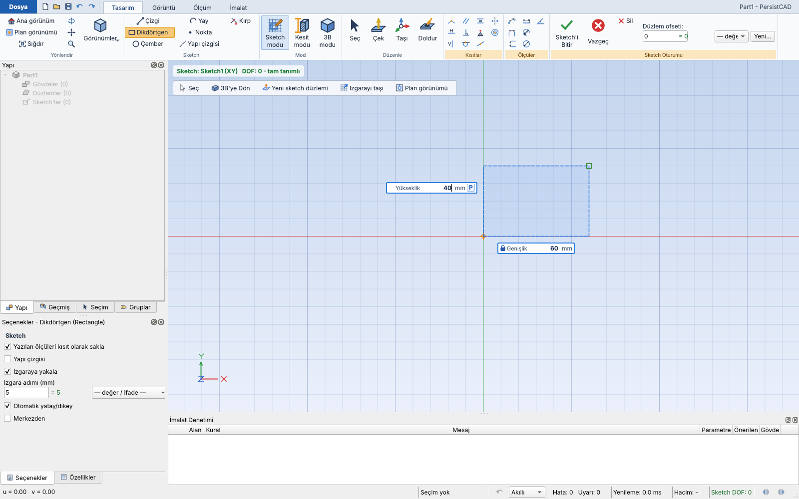

**3. 3B'ye dön, çek.** **D**: sketch belgeye işlenir (tek geri alma adımı) ve dikdörtgen yarı saydam mavi
bölge olarak görünür. **P**, bölgeye tıklayın: sarı ok ve Seçenekler - Çek paneli çıkar. `8` yazıp **Enter**:
60 × 40 × 8 katı (19200 mm³), Geçmiş'te `Extrude1 (8, new)`.

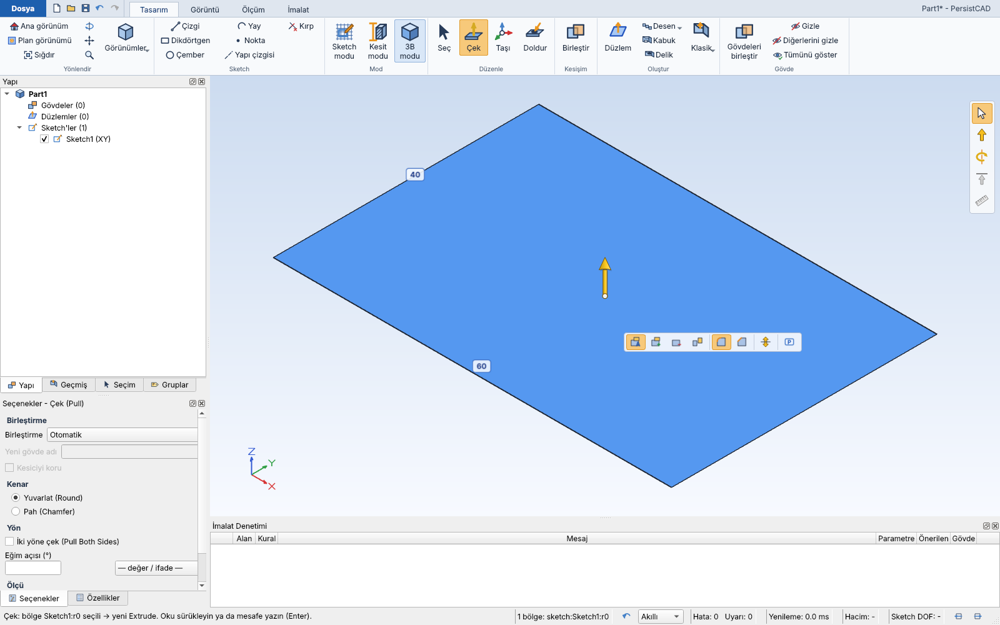

**4. Parametre yap.** Çek'ten hemen sonra **Ctrl+G**: Yeni parametre penceresi `Extrude1_distance` önerir. Adı
`T` yapın, "Uygulamada göster" işaretleyin, Tamam. Gruplar sekmesinde `T = 8` görünür ve Extrude1'in mesafesi
`T` olur. Gruplar'da T'nin İfade hücresine `12` yazın: model güncellenir, yüz adları korunur. Ctrl+Z / Ctrl+Y
geri alır / yineler.

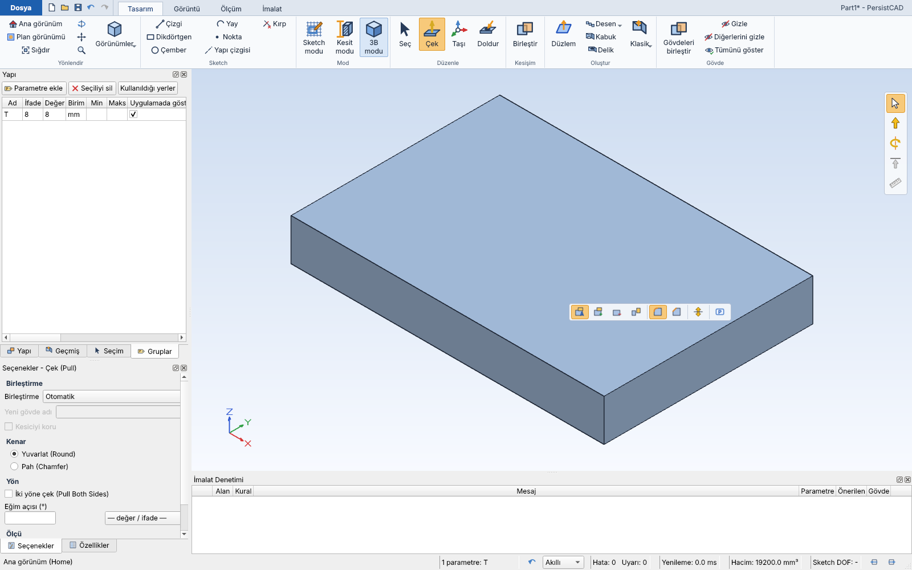

**5. Yüzü çek.** Çek açıkken üst yüze tıklayıp `2` Enter: mesafe T'ye bağlı olduğu için `T` güncellenir
(durum çubuğu: `T = 14 (parametre güncellendi)`).

**6. Kenar yuvarlat.** Bir kenara düz tıklayın (Ctrl yok), `3` Enter: `Fillet1` (r = 3). Fillet yüzüne tıklayıp
`5` Enter yarıçapı değiştirir. Özellikler sekmesi seçili yüzün Yarıçap alanını düzenlenebilir gösterir.

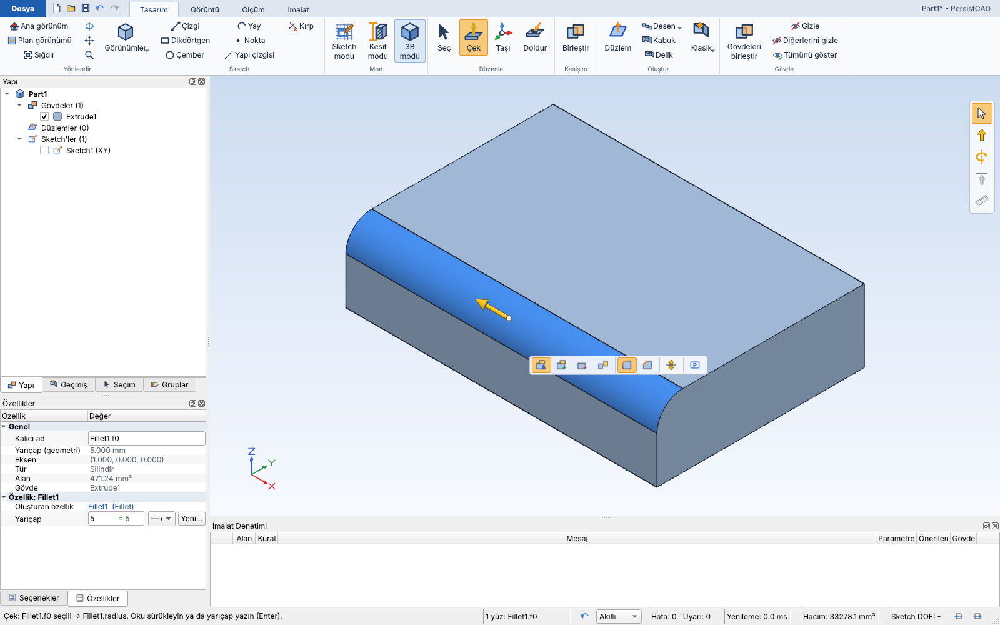

**7. Cep (Kes).** Üst yüze tıklayın, **K** (yüzde sketch), **C**, bir noktaya tıklayın, `10` Enter (Ø10), **D**.
**P**, çember bölgesine tıklayın, Seçenekler'de Birleştirme = **Kes (Cut)**, `5` Enter: 5 mm derinlikte cep.
(Otomatik birleştirmede `-5` yazmak da keser.)

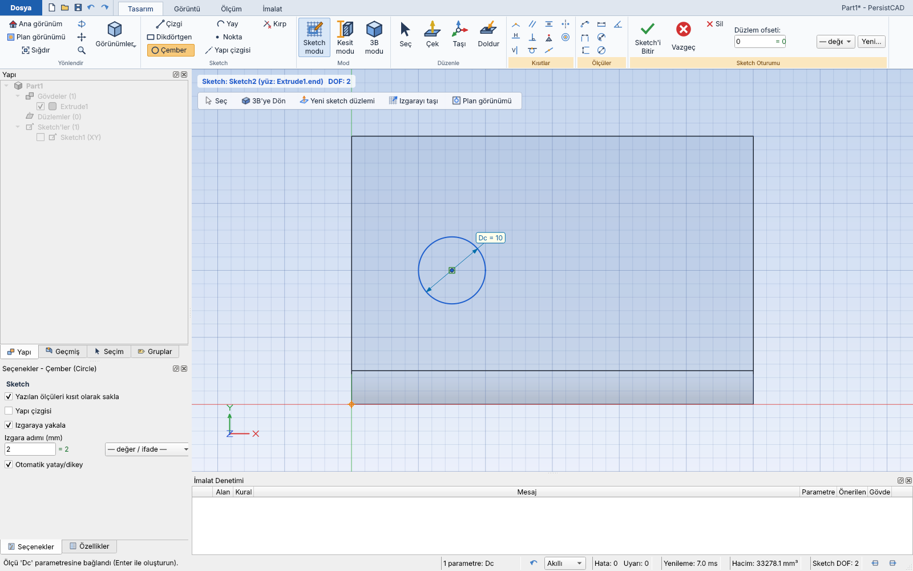

**8. Delik ve desen.** Üst yüzde yeni sketch, Sketch > **Nokta** ile bir nokta, D. Oluştur > **Delik**:
konum sketch'i, çap, "Delik boydan boya". Deliği çoğaltmak için **M**, Seçenekler'de "Desen oluştur", delik
yüzüne tıklayın, aralığı yazın (`-20` Enter): `Pattern1` (doğrusal, 2 adet).

**9. Kesit.** **X**: kesit görünümü (XZ, kaydırıcı ile konum, ters çevir); **D** kapatır.

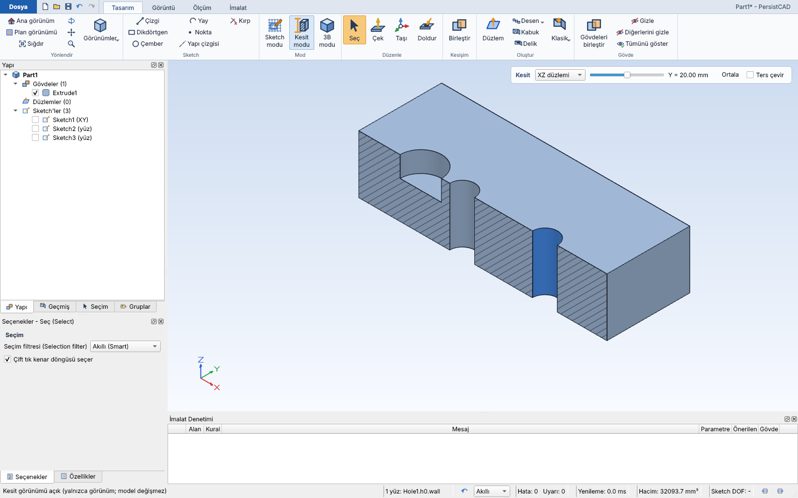

**10. Kaydet ve uygulama yap.** Ctrl+S (`.pcad`), Ctrl+Shift+A (Uygulama Olarak Kaydet): T zaten girdi olarak
işaretlidir. Üretilen uygulama komut satırında da denetlenebilir:

```bash
./E2EApp --validate-only                 # "parameters": {"T": 14}, "bbox" 60 x 40 x 14
./E2EApp --validate-only --set T=20      # bbox yüksekliği 20
```

**Dönme (Revolve).** Boş seçimle **K** → orijindeki XZ karesine tıklayın, bir dikdörtgen ve Seçenekler'de "Yapı
çizgisi" ile bir eksen çizgisi çizin, **D**, **P**, bölgeye tıklayın, eksen çizgisine **Alt+tık** (Döndür
kılavuzu etkinleşir), `360` Enter.

## 18. Teknik resimden içe aktarma

2B teknik resimden (DXF, vektör PDF, taranmış PNG/JPG/TIFF ya da PDF) sketch, parametre ve 3B model üretilir.
Sonuç mevcut belgeye **tek geri alma adımı** ("Teknik resimden içe aktar") olarak eklenir; ölçülerden gelen
parametreler **Gruplar** sekmesinde görünür ve "Uygulamada göster" işaretli gelir (Save as App girdisi olurlar).
Akışın tamamı `tests/gui/gui_harness_drawing_import.cpp` düzeneğinde gerçek tasarımcı üzerinden sınanır.

### 18.1 Başlatma

- **Dosya > Teknik resimden içe aktar…** ya da şeritte **Tasarım > İçe aktar > Teknik resim**.
- Komut satırı: `pc_drawing_cli resim.pdf --out parca.pcad [--ir resim.pcdrw.json] [--strategy Revolve]
  [--tolmid] [--strict]` (bölüm 12'deki araçlarla aynı klasörde).

### 18.2 Sihirbaz adımları

| Adım | Ne yapılır |
|---|---|
| 1 Kaynak | Dosya seçilir (Gözat… ya da yolu yazın); tür ve sayfa sayısı tespit edilir. Çok sayfalı PDF'de sayfa, taramada DPI ve "fotoğraf" seçilebilir. |
| 2 Sayfa düzeni | Çerçeve, antet alanları, ölçek (antetten ve ölçülerden), projeksiyon yöntemi (ISO E / ISO A) ve görünüş kutuları. Kutular sürüklenerek düzeltilir; görünüş rolü (Ön, Üst, Sol, Kesit…) tabloda değiştirilir. |
| 3 Geometri | Çizgi rolleri (görünür, gizli, eksen, ölçü, tarama) renkli gösterilir; yanlış sınıflanan çizgiler seçilip rolü değiştirilir ya da silinir. |
| 4 Ölçüler | Tanınan ölçüler: metin, nominal, tolerans, ölçülen değer, fark, parametre adı, sürücü bayrağı. Metin ve parametre adı tabloda düzeltilir (ör. `Dh1` → `Delik_cap`). |
| 5 Sketch | Önerilen sketch'ler ve DOF. DOF > 0 ise "DOF'u kapat" ölçülmüş `[Ö]` parametrelerle tamamlar. |
| 6 3B | Aday yöntemler puanlarıyla: Döndürme, Kesitten döndürme, İki görünüşten çekme, Tek görünüş + kalınlık, Yalnız sketch. Seçilen aday 3B önizlenir (hacim, yeniden izdüşüm hatası). |
| 7 Özet | Parametre listesi, uyarılar; "Mevcut belgeye ekle" (varsayılan). **Bitir** belgeye işler. |

Her adımda "Bu adımdan itibaren yeniden hesapla" yapılan düzeltmeleri uygular; düzeltmeler çizimin yanına
yazılan `<dosya>.pcdrw.json` içinde saklanır ve dosya yeniden açıldığında tekrar uygulanır.

### 18.3 Parametre etiketleri

| Etiket | Anlamı | Uygulamada |
|---|---|---|
| `[D]` | Çizimdeki bir ölçüden (ör. `D1 = 120` ← "Ø120") | gösterilir |
| `[Ö]` | Ölçü yok, geometriden ölçüldü (DOF'u kapatmak için) | gösterilmez |
| `[T]` | Fazla (zincir toplamı) ölçü; referans olarak doğrulanır | gösterilmez |
| `[V]` | Varsayım (ör. tek görünüşte kalınlık) | gösterilmez |

Adlar: çaplar `D1..`, boylar `L1..`, toplam boy `L_top`, prizmatik `W/H/T`, delik `Dh1`, adet `n_h1`, bölüm dairesi
`D_bc1`, yarıçap `R1`. Belgede aynı ad varsa `_2` eklenir. `Ø30±0.02` gibi toleranslı ölçüler nominal değerle
gelir; "--tolmid" / sihirbaz seçeneği tolerans ortasını kullanır.

### 18.4 Girdi türleri ve beklenti (faz 1)

| Girdi | Durum |
|---|---|
| DXF (DIMENSION'lı ya da patlatılmış) | Doğru yöntem ve hacim (test korpusu: plaka, L braket, flanş, mil, burç) |
| Vektör PDF (gerçek metin) | Aynı; ölçü metinleri tam okunur |
| PDF (yazıcı sürücüsü, yaylar parçalı) | Çoğunlukla doğru; kesikli daireler (gizli delikler) kaçabilir |
| Temiz tarama PNG | En az kısıtsız bir sketch; basit prizmatik parçada 3B (plaka %1 hacim farkı) |
| Kötü tarama / fotoğraf | Deneysel: sonuç sketch olarak gelir, elle düzenleyin |

Bilinen sınırlar: diş, anahtar ağzı (A/F), radyal delikler, pah/yuvarlatma tanıma ve tek görünüşte çok parçalı
montaj resimleri faz 2'dir; L braketteki gibi çekme yönüne dik delikler henüz eklenmez (uyarı verilir).
Taramalarda OCR süresi sayfa başına birkaç saniyedir.

### 18.5 Windows notu

OCR, PDF ve tarama desteği isteğe bağlı kütüphanelere bağlıdır (qpdf, OpenCV, Tesseract, QtPdf).
`scripts/windows/kurulum.sh` bunları kurmayı dener; bulunamazsa derleme yine başarılı olur ve sihirbaz o girdi
türü için "bu derlemede yok" der (DXF her zaman çalışır). OCR dil verisi `share/persistcad/tessdata`
klasöründedir ve `paketle.sh` bunu `dist/share/persistcad/tessdata` altına kopyalar.

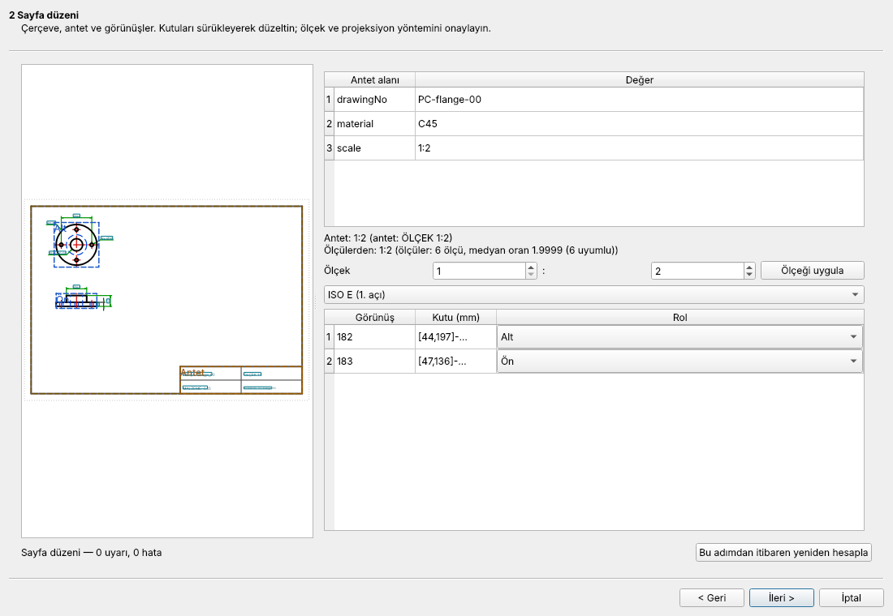

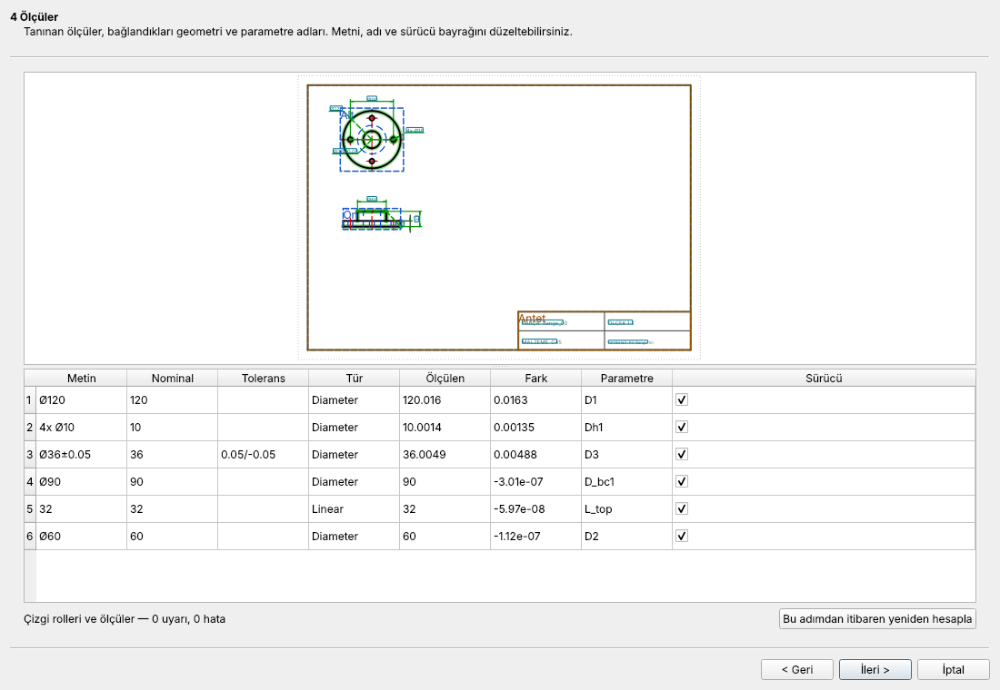

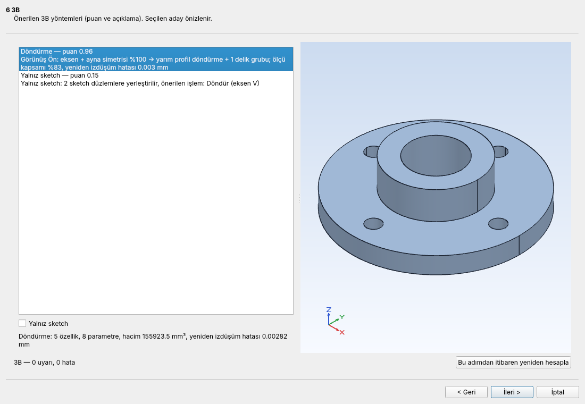

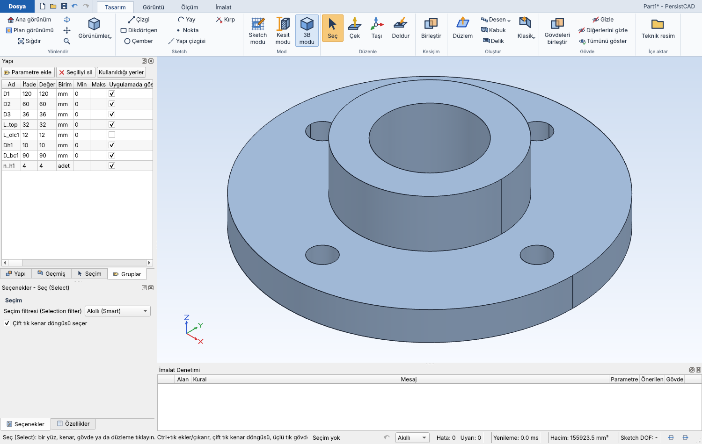

### 18.6 Gerçek çizimler (eksenel simetrik kesitler, kanallar)

`tests/drawing/real/` altındaki iki gerçek PDF (yanma odası swirl cup **SWC-RR-001**, simplex atomizer
**ATM-PS-001**) sihirbazdan ve `pc_drawing_cli`'dan doğrudan içe aktarılır. Hat şu adımları birleştirir:

* **Yazı konturları (R1):** metni dolgu konturu olarak çizen PDF'lerde ölçü ve notlar glif tanıma ile geri okunur.
* **Kesit → döndürme (R2):** taralı, eksenli SECTION A-A görünüşünde tarama ailesi başına bir parça = bir gövde
  (atomizer: `NOZZLE_TIP` + `SWIRLER_INSERT`). Ø, eksenel uzunluk, pah ve koni açıları yarım profile kısıt olur.
* **Enine görünüşler ve notlar (R3):** B-B / C-C / VIEW B'deki teğetsel yarıklar ve oluklar kesim + dairesel
  desen olarak eklenir (`N_pri`, `W_pri`, `OFS_pri` … grup "Kesit özellikleri (R3)").
* **Görünüşler arası ölçüler:** kesitte ölçüsü olmayan çaplar enine görünüş/nottan alınır (Ø24, Ø34, Ø14 THROAT).
  Kesit düzlemi yarıkları kestiği için A-A'da görünen r=14.14 çizgisi yarık duvarıdır; döndürme çapı B-B'deki Ø24
  olur, yarıklar bu çizgiyi yeniden oluşturur (uyarı listesinde not edilir).
* **Ölçek:** her iki PDF küçültülerek basılmıştır; ölçek Ø ölçülerinden bulunur, antet ölçeğiyle uyuşmazlık
  uyarı olarak kalır ("Antet ölçeği … uyuşmuyor"). Küçük basılmış sayfalarda ok uçları yazı yüksekliğine göre tanınır.

| Çizim | Gövde | Hacim (referans R4) | Kanallar |
|---|---|---|---|
| SWC-RR-001 | 1 | 26288.4 mm³ (26288.4) | 8 birincil CCW + 10 ikincil CW |
| ATM-PS-001 | 2 | 471.84 mm³ (471.85) | 3 teğetsel yarık + 3 besleme oluğu |

Atomizer'de yarık, VIEW B'de çizildiği gibi teğet noktasından besleme oluğunun içine kadar uzanır (`LS_slt`).
Sihirbazın 4. sayfası kesitten (R2) ve enine görünüşlerden (R3) bağlanan ölçüleri de listeler. İmalat denetimi
0.5 mm yarıklar için uyarı verir; "Yine de Uygula" ile içe aktarılır. Doğrulama: `ctest -R "RealAcceptance|drawing_real"`.

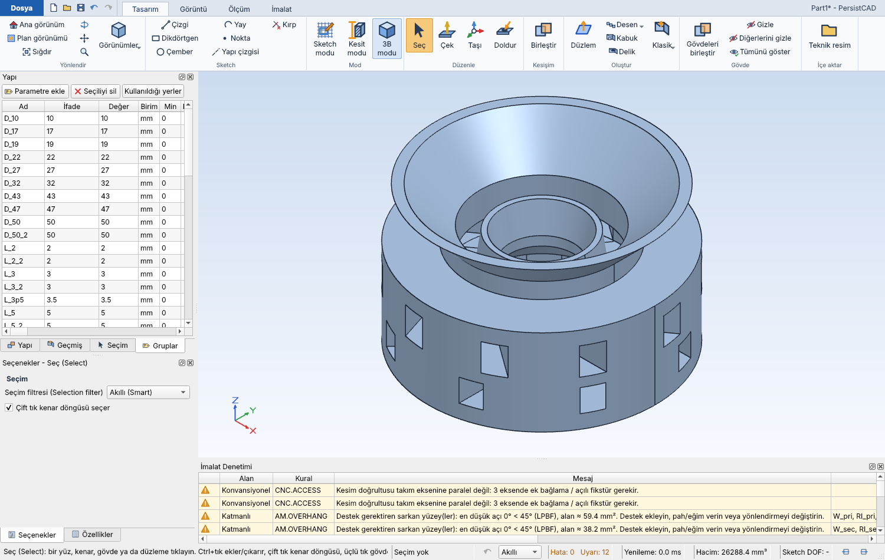

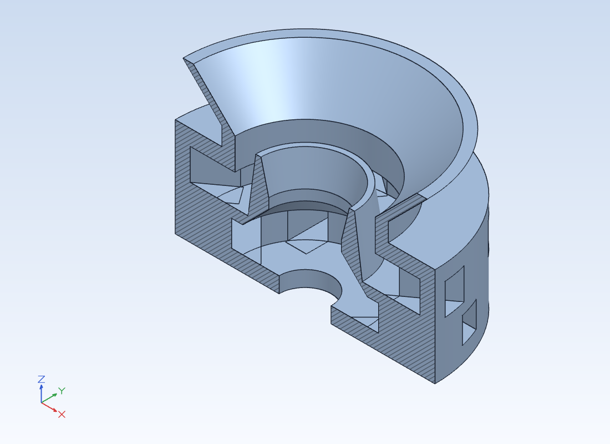

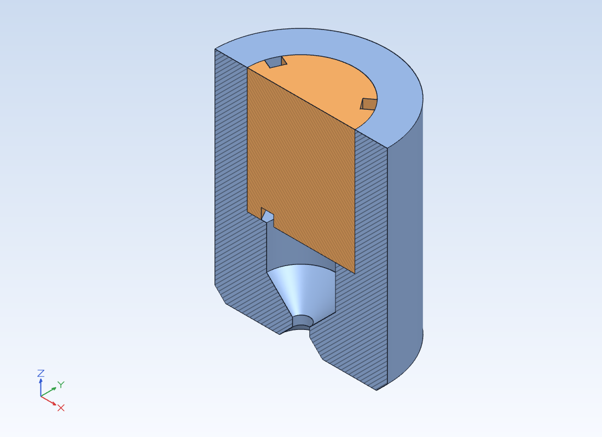

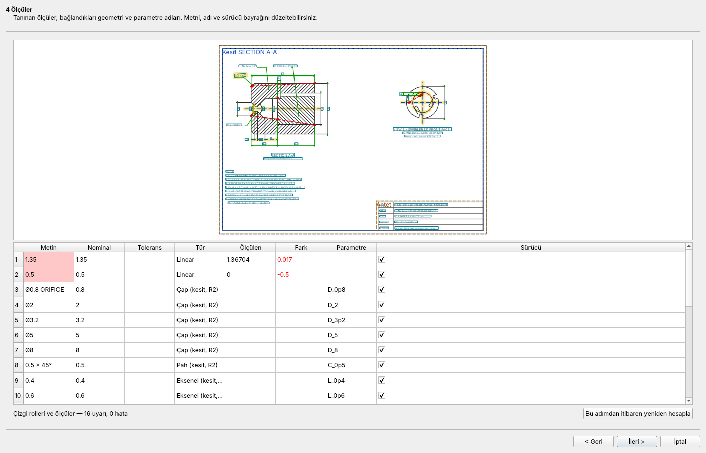

## 19. 2B çizimden 3B'ye (SpaceClaim yöntemi)

SpaceClaim'in "Convert 2D Drawings to 3D Models in Minutes" videosundaki akış: çizim **eğri olarak** açılır,
gereksiz katmanlar gizlenir, yan görünüş dik düzleme katlanır, kapalı konturlar doldurulur ve **Kadar (Up To)** ile
derinlik öbür görünüşten alınarak çekilir. Bölüm 18'deki sihirbazdan farkı: hiçbir şey tahmin edilmez, her adımı
kullanıcı yapar; eğriler parametrik değildir. Ayrıntılar: `docs/import2d/IMPORT2D.md`,
`docs/spaceclaim_ux/PULL_UPTO.md`, `docs/colors/COLORS.md`.

| Adım | Ne yapılır | Kısayol / yer |
|---|---|---|
| 1. İçe aktar | **Dosya > İçe aktar > 2B çizim (eğri olarak)…** ya da `.dxf` / `.pdf` dosyasını pencereye sürükleyin. Çizim gerçek ölçekte XY düzlemine (seçili datum varsa ona) eğri olarak gelir; her DXF katmanı bir katman olur. | Görüntü > Katmanlar / 2B çizim > **2B çizim** |
| 2. Katmanları gizle | Yapı panelinin **Katmanlar** sekmesinde ölçü (Ölçüler/Notlar), gizli çizgi (GIZLI), eksen (EKSEN), çerçeve ve antet katmanlarının kutusunu boşaltın. Gizli katmanın eğrileri çizilmez, **seçilemez ve Kadar hedefi olamaz**. Sağ tık > *Yalnız bunu göster* tek tıkla aynısını yapar. | her kutu = 1 geri alma adımı |
| 3. Görünüş seç | **Görünüş seç**'i açın, katlanacak görünüşün bir eğrisine tıklayın: birbirine değen tüm eğrileri seçilir (Ctrl+tık ekler). Gizli katmanlardaki eğriler seçime girmez, yerinde kalır. | Görüntü > **Görünüş seç** |
| 4. Görünüşü yerleştir | **Görünüşü yerleştir…**: görünüş, komşu görünüşe bakan kenarı etrafında 90° katlanır ve o görünüşün kenarına oturur (hayalet önizleme). Kenar uygun değilse açılır listeden Üst / Alt / Sol / Sağ seçin; **Uygula**. | Görüntü > **Görünüşü yerleştir** |
| 5. Doldur | Görünüşün bir eğrisine tıklayın, **F**, **Enter**: kapalı konturlar bölge olur ve hepsi seçilir. Birbirini kesen / T-birleşimli çizgiler (ör. L profili iki dikdörtgen olarak çizilmişse) tolerans içinde birleştirilir; açık uçlar kırmızı işaretlenir. | **F**, **Enter** |
| 6. Çek, Kadar | **P**; gerekirse yalnız istediğiniz bölgeye tıklayın (Ctrl+tık ekler; deliklerin iç adaları da bölgedir, plakayı delikli çekmek için yalnız dış bölgeyi seçin). **U** (Kadar), sonra **öbür görünüşün köşesine** tıklayın (eğri ucuna 14 piksel içinde yakalanır): derinlik o noktanın uzaklığıdır, önizleme ve "Kadar … mm" kutusu görünür. **Enter** uygular. Birbirine değen bölgeler tek katı gövde olur. Delik için: bölgeyi seçin (gövdenin yüzündeki bölge de tıklanır), Seçenekler'de *Birleştirme: Kes*, **U**, hedef, **Enter**. | **P**, **U**, **Enter**, **Esc** = hedefi bırak |
| 7. Renk | Yeni yüzleri seçin (Ctrl+tık), **Görüntü > Stil > Renk** paletinden renk seçin; sonraki Çek işlemleri rengi korur. | Görüntü > Stil > **Renk** |

* Kadar **ilişkiseldir**: hedef nokta değişirse derinlik yeniden hesaplanır (içe aktarılan eğriler sabittir; hedefi
  değiştirmek için çekilen yüzü seçip yeniden **U** kullanın). Cetvel (Ruler) = Kadar + boşluk.
* Tüm akış **Ctrl+Z** ile adım adım geri alınır, **Ctrl+Y** ile yinelenir; katmanlar, renkler ve yerleştirilmiş
  görünüşler `.pcad`'de saklanır.
* Sınırlar: görünüş yalnızca dünya eksenine paralel düzleme katlanır; katlanmayan görünüşler (ör. sol görünüş) XY'de
  kalır, isterseniz onların katmanını gizleyin veya onları da yerleştirin; bölge alanları (Doldur durum satırı)
  çokgen yaklaşımıdır, katı geometri gerçek yay ve çemberlerle oluşur.

Doğrulama: `ctest -R gui_harness_video2d` (plate ve lbracket, `QT_FONT_DPI=72` ile de); `--shots` ile
`docs/import2d/shots/video_*.png`.

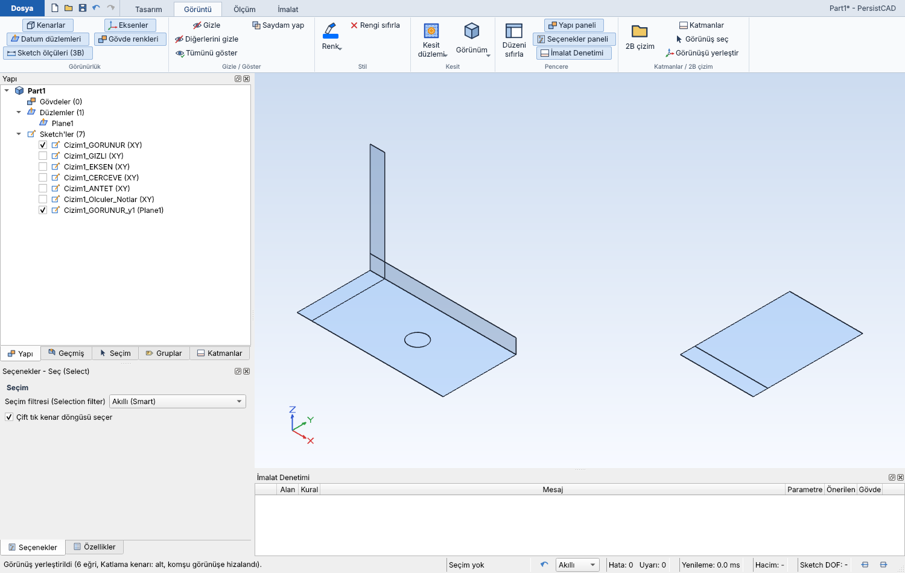

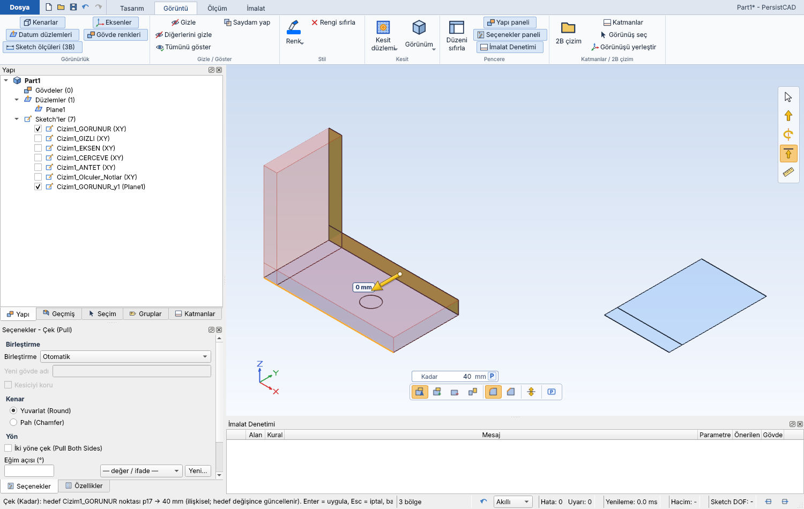

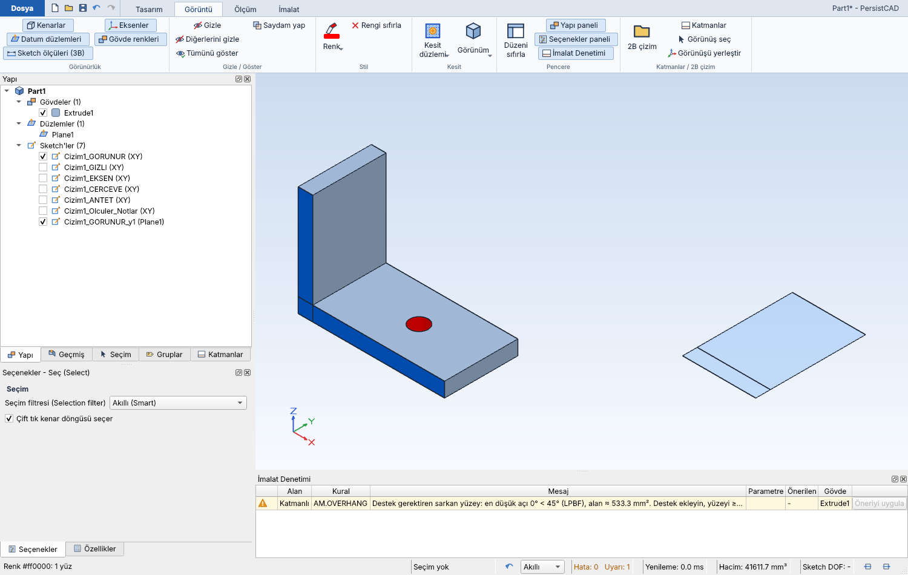
