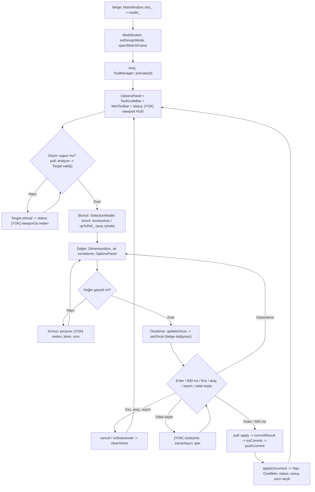
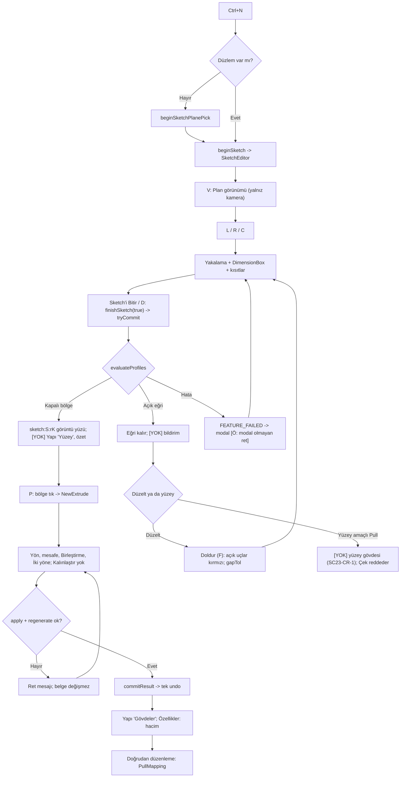

# PersistCAD × SpaceClaim 2023 R1 — Analiz ve Uygulama Planı (SC23)

Durum: ANALİZ + PLAN (18 Kasım 2026). Bu adımda ürün kodu **değişmedi**. Girdi: `docs/sc2023/PROMPT.txt` (kanıt
sözleşmesiyle), referans ekran `docs/sc2023/spaceclaim-2023r1-pull.jpg`, mevcut belgeler (`docs/spaceclaim_ux/*`,
`docs/named_selections/MODEL.md`, `docs/import2d/IMPORT2D.md`, `docs/colors/COLORS.md`, `src/designer/STATUS.md`,
`docs/KULLANIM_KILAVUZU.md`, `README.md`) ve `src/designer`, `src/viewer`, `src/model`, `src/core` kodu.

## 0. Kanıt etiketleri ve bu belgedeki kullanımları

| Etiket | Anlam |
|---|---|
| **[G]** | Yerel SpaceClaim 2023 R1 GUI'sinde görüldü veya denendi (PROMPT §1–§5, referans ekran). |
| **[B]** | Resmî dokümantasyon (çoğu v19). Yerel sürümde ayrıca denenmemiş olabilir. |
| **[Ö]** | Bu belgenin PersistCAD için önerdiği tasarım veya uygulama kararı. |
| **[D]** | Doğrulanmadı. Varsayımla tamamlanmaz, açık soru olarak kalır. |

**Dikkat (etiket çakışması):** `docs/spaceclaim_ux/SPEC.md` başka bir etiket seti kullanır. Oradaki **[D]** ("2025 R2
resmî yardımda doğrulandı") burada **[B]** olarak okunur; SPEC'teki **[U]** burada **[D]**, **[PC]** ise **[Ö]** olur.

**PersistCAD ölçümü** etiketi, bu analiz sırasında gerçek `MainWindow` üzerinde (Xvfb, 1240×800) koşulan ölçümleri
gösterir. Sürücü geçicidir (repoya girmedi). Ekran görüntüleri `docs/sc2023/shots/pc_*.png`. Kalan bilgiler kod okumasından.

---

## 1. Kapsam ve açık sorular

### 1.1 Ortamın gerçek yetenekleri
* C++17, Qt6 Widgets, OpenCASCADE 7.6 B-rep. Model **geçmiş tabanlı ve parametrik**: `pc::Document` →
  `pc::model::regenerate` → `ModelResult` (`src/model/pc/Model.h`).
* SpaceClaim tarzı tasarımcı zaten var (Ribbon, Yapı/Geçmiş/Seçim/Gruplar/Katmanlar, Seçenekler/Özellikler, K/X/D,
  Çek/Taşı/Doldur/Birleştir, DimensionBox, ToolGuideBar, MiniToolbar). Bu iş **2023 R1 [G] kanıtına göre düzeltme ve
  tamamlama**dır, yeniden yazma değildir.
* 2B → 3B zinciri çalışır (ACC 12–14 `gui_harness_sc_e2e`, 19200 mm³). İç döngü = delik (`pc::sketch::arrangeRegions`).
  **PersistCAD ölçümü:** 60×40 + Ø10, 5 mm → 11607.30 mm³ ((2400 − 25π)·5).
* **Motorda olmayanlar** (görsel prototiple gizlenmez): yüzey gövdesi yok (`BodyInfo` yalnız katı; sketch bölgeleri
  görüntü yüzü), açık profilden yüzey yok, Thicken yok, birim sistemi yok (örtük mm, `pc::Expression` birim soneki
  kabul etmez), bileşen/montaj yok.

### 1.2 Kanıtın desteklediği ve desteklemediği
| Konu | Kanıt | Tutum |
|---|---|---|
| Ana düzen: sol panel sütunu, Options ortada, Properties altta; Structure/Layers/Selection/Groups/Views sekmeleri | [G] | Uyulacak (oranlar) [Ö] |
| Options başlığının araçla değişmesi | [G] | Var, korunacak |
| Pull tool guide'ları viewport **sol üstünde**, 2 sütun | [G] | Taşınacak (bugün sağda, tek sütun) |
| Viewport sol üstünde "Pull 1 face" | [G] | Eklenecek (HUD) |
| End Sketch Editing → düzlemsel yüz, Design + Pull etkin, Structure'da **Surface** | [G] | Yapı'da "Yüzey"; Sketch'i Bitir → Çek [Ö] |
| Space → 0 değerli alan, rakamla giriş | [G] | Var |
| Pull sonucu katı | [B] (yerelde [D]) | Motorda var; SC davranışı diye sunulmaz |
| Thicken, Both Sides, Add/Cut/No Merge | [B] | Both Sides ve Add/Cut/No Merge var; Thicken model CR |
| Açık çizgi çekilince yüzey | [B] | Motor yok; ret + düzeltme yolu, katı gibi gösterilmez |
| Kesin mesafe/birim, boolean, açık profil sonucu, Undo/Redo (SC'de) | [D] | PersistCAD kendi sözleşmesini tanımlar [Ö] |
| Smart seçim önceliği, renk sözlüğü, isimsiz ikon adları | [D] | İcat edilmez |

### 1.3 Açık sorular ([D])
1. "Design sekmesi ve Pull **etkinleşti**" [G]: seçili mi, kullanılabilir mi? Karar [Ö]: "Sketch'i Bitir" Çek'i etkinleştirir
   (bugünkü "3B'ye Dön" gibi); **D** tuşu Seç'e döner (`gui_harness_sc_shell` satır 332).
2. Araç değişimi açık işlemi iptal mi onay mı ediyor [D]. Karar [Ö]: iptal (bugünkü davranış; ölçüldü).
3. Odak kaybında SC davranışı [D]. Karar: §4.4.
4. Sayısal alan birim soneki kabul ediyor mu [D]. Karar [Ö]: arayüzde ayrıştırılır, mm'ye çevrilir (O-P0-3).
5. 2023 R1 Pull guide ikon adları eşleştirilmedi [D]. Yalnız PersistCAD'in kılavuzları (Seç, Yön, Döndür, Kadar, Cetvel).
6. Views listesinde Front sonrası ve kayıtlı görünümlerin saklandığı yer [D].
7. "Search all bodies" ve "Surface edge loop" anlamı [D].
8. Anchor Pull Handle, Suppress for Physics, Clip with Volume denenmedi [D].
9. Sketch ızgarası altındaki 4 küçük düğme [D].
10. Seçim/hover/önizleme renk sözlüğü [D]; görülen: seçili yüz turuncu, seçilmemiş açık yeşil, tutamaç sarı [G].
11. PROMPT `spaceclaim-2023r1-pull.png` der; klasördeki dosya **`.jpg`**. Bu analizde .jpg kullanıldı.

---

## 2. Envanter (P0/P1 kontrolleri)

Sütunlar PROMPT §13/2'ye göre. **PersistCAD durumu**: **Var** / **Kısmen** / **Yok** + dosya.

### 2.1 Pencere kabuğu
| Bölge | Kontrol | Koşul | Girdi | Model etkisi | Geri bildirim | İptal/undo | PersistCAD durumu |
|---|---|---|---|---|---|---|---|
| Başlık | Belge adı ortada [G] | Her zaman | — | — | `*` [G] | — | **Kısmen**: ribbon sağında "Part1* - PersistCAD", `MainWindow::updateTitle` |
| Hızlı erişim | Aç, Kaydet, Geri al/Yinele, açılır seçenekler [G] | Her zaman | Tık | Belge/undo | — | — | **Var** (`Ribbon::quickAccessBar`, `MainWindowShell.cpp:451`); açılır seçenek yok |
| Sekme şeridi | File, Sketch, Design, Display, Assembly, Measure… [G] | Sketch sekmesi eskizde [G] | Tık | Yok | Etkin sekme | — | **Kısmen**: Dosya + Tasarım/Görüntü/Ölçüm/İmalat. **Sketch sekmesi yok** (`buildRibbon`, `MainWindowShell.cpp:513–548`) |
| Ribbon | ≈90 px, gruplar [G] | Sekmeye göre | Tık | Araca göre | Vurgu | — | **Kısmen**: `Ribbon.h/.cpp` (94 px). **Ölçüm:** 1240 px'te Düzenle grubunda yalnız Seç görünür; **Çek/Taşı/Doldur taşma okunda**; etiketler kısalır ("Bir…tir") (`pc_05`) |
| Ribbon taşması | Dar alanda taşma [Ö] | Dar pencere | — | — | — | — | **Yok** |
| Tooltip | Ad, kısayol, açıklama, F1/F3 [G] | Hover | — | — | — | — | **Kısmen**: yalnız "Çek (Pull) — P" (`Shortcuts.cpp::applyShortcuts`) |
| Belge sekmesi | "Design1*" [G] | Belge açık | Tık | — | `*` | — | **Yok** (merkez widget `viewer_`, `MainWindow.cpp:132`) |
| Durum çubuğu | Koyu mavi; yönerge, koordinat/seçim "1 Face", ikonlar [G] | Her zaman | Tık | Yok | Yönerge | — | **Kısmen**: açık Qt varsayılanı; `StatusBarWidgets.cpp`, `buildStatusBar` |
| Sol panel sütunu | ≈240 px, sabitleme ikonları [G] | Her zaman | Sürükle | — | — | — | **Kısmen**: QDockWidget, 1240 px'te ≈415 px; daraltma yok (`buildDocks`) |

### 2.2 Sol paneller
| Bölge | Kontrol | Koşul | Girdi | Model etkisi | Geri bildirim | İptal/undo | PersistCAD durumu |
|---|---|---|---|---|---|---|---|
| Structure | "Design1*" kökü, **Surface**, görünürlük kutusu [G] | Her zaman | Tık | Görünürlük | Seçim eşitlenir | [D] | **Kısmen**: `StructurePanel.cpp`; kök "Part1" (`*` yok); **Yüzey türü yok** (ölçüm: D sonrası yalnız "Sketch1 (XY)"); Çek sonrası "Gövdeler (1) > Extrude1" |
| Structure [B] | Nesne ağacı | — | — | — | — | — | **Var** (geçmiş ayrı sekmede) |
| Layers | Layer0, renk, ampul [G] | Her zaman | Tık | Görünüm | — | Undo | **Var** (Katmanlar, `Import2DUi.cpp`) |
| Selection | "Selected: Face", All Types, arama, Search all bodies [G] | Seçim | Tık | Seçim | — | — | **Kısmen**: `SelectionPanel.cpp`; başlık/tür/arama **Yok** |
| Groups | Create NS, Create Parameter, View groups in [G] | Seçime göre | Tık | NS/param | — | Undo | **Var/Kısmen** (`MainWindowShell.cpp:653–732`, `NamedSelectionPanel.cpp`) |
| Views | Create/Delete; Isometric Ctrl+0, Trimetric Ctrl+1, Top Ctrl+2, Bottom Ctrl+3, Left Ctrl+4, Right Ctrl+5, Front Ctrl+6 [G] | Her zaman | Tık/kısayol | Kamera | — | — | **Yok** (menü var, `MainWindowShell.cpp:290–305`; Trimetric `ShapeViewer::View`'da yok) |
| Options | "Options – <araç>" [G] | Araç | — | — | — | — | **Var** (`OptionsPanel.cpp`) |
| Options–Sketch | Merkezden, auto constraints, snap grid/angle, Layout Sketch, Cartesian/Polar [G] | Rectangle | Kutu | Eskiz | — | — | **Kısmen** (`SketchToolAdapter.cpp`); snap to angle, Layout, Polar **Yok** |
| Options–Pull | Add, Cut, No merge [G] | Pull | Seçim | İşlem | — | — | **Var/Kısmen** (`PullTool::options`); **Thicken [B] Yok** |
| Properties | Appearance > Color, Style [G] | Seçim | Düzenle | Görünüm | — | Undo | **Kısmen** (`PropertiesPanel.cpp`); Style yok; bölgede alan/çevre/delik yok |

### 2.3 Viewport ve araç etkileşimi
| Bölge | Kontrol | Koşul | Girdi | Model etkisi | Geri bildirim | İptal/undo | PersistCAD durumu |
|---|---|---|---|---|---|---|---|
| Viewport | Triad, grid [G] | — | — | Kamera | — | Görünüm geçmişi | **Var** (`ShapeViewer`) |
| Plan View (V) | Kamera gride dik [G] | — | V | Yok | — | ← | **Var**; düzlemin değişmediği test yok (T10) |
| Home (H) | Eğik 3B [G] | — | H | Yok | — | ← | **Var** |
| Sketch (K) | [B] | 3B | K | — | Grid | Esc | **Var** (`DesignMode.cpp`) |
| Rectangle (R) | "Snapping to Grid", 2 ölçü [G] | Eskiz | R, sayı, Tab | Eğri | Ölçü kutuları | Esc, eskiz undo | **Var** (`SketchEditor`, `DimensionBox`) |
| End Sketch Editing | Bölge, Design + Pull etkin [G] | Eskiz | Tık | Yüzey [G] | Structure Surface | [D] | **Kısmen**: `finishSketch(true)` → `tryCommit`; Yapı'da Yüzey yok; D/Bitir → Seç, "3B'ye Dön" → Çek; profil özeti yok (`MainWindowOps.cpp:569`) |
| Pull (P) | Turuncu vurgu, sarı tutamaç, mini-toolbar, "Pull 1 face", status "1 Face" [G] | Pull | Tık, sürükle | Katı [B] | Ghost | Esc | **Var/Kısmen** (`PullTool`, `PullMapping`); viewport yönergesi **Yok** |
| Sayısal giriş | Space → "0" [G] | Pull | Space, rakam | Commit | Kutu | Esc | **Var** |
| Geçersiz değer | — | — | "abc", "10mm" | Yok | [Ö] neden | — | **Kısmen**: kırmızı çerçeve, Enter sessiz, neden yok; "10mm" geçersiz (`pc_07`) |
| Sıfır/negatif/büyük | — | — | 0, −8, 1e7 | — | — | — | **Kısmen**: 0 → status; −8 → ters (doğru); 1e7 → **modal ChangeReviewDialog** |
| Tool guides | Sol üst, 2 sütun [G] | Pull/Move | Tık | Kip | — | — | **Kısmen**: `ToolGuideBar::place()` sağ kenar, tek sütun |
| Mini-toolbar | Seçimde ve sağ tıkta [G] | — | Tık | — | — | — | **Kısmen**: pick'te var, sağ tıkta yok |
| Sağ tık | Use Last Sketch Plane, View, Hide/Show, Inverse Visibility, Locate in Structure Tree, Cut/Copy/Paste, Delete, Properties… [G] | Sağ tık | Tık | — | — | Esc [G] | **Kısmen** (`MainWindowV2.cpp::viewerContextMenu`); Use Last Sketch Plane, View ▸, Inverse Visibility, Locate, Delete, Properties **Yok** |
| Sekme ≠ araç | Sekme değişince Pull ve seçim kalır [G] | — | — | Yok | — | — | **Var** (kod); test yok (T11) |
| Undo/Redo | QAT [G] | Yığın | Ctrl+Z/Y | Anlık görüntü | `*` | — | **Var** (`QUndoStack undo_`; ölçüm doğru) |

---

## 3. İki akış şeması

### 3.1 Servis eşlemesi
| Servis | PersistCAD karşılığı | Durum |
|---|---|---|
| `evaluateProfiles` | `pc::sketch::sketchRegions/arrangeRegions/describeRegions` (`src/sketch/pc/Regions.h`), `pcd::sketchRegionInfo/sketchRegionFaces` | **Var**; End Sketch'te özet verilmiyor |
| `previewPull` | `pull::analyze`, `PullTool::updateGhost`, `pull::upToPreview` + `evaluateCandidate`, `IDesignHost::setGhost` | **Var** (ghost = araç gövdesi) |
| `commitOperation` | `pull::apply` → `commitResult` → `insertFeature/commitDocument/changeParameter` → `tryCommit` (`mfg::validateChange`, modal) → `pushCommit` → `applyDocument` | **Var**; başarısız özellik modal + "Yine de Uygula" (**risk**) |
| `cancelPreview` | `PullTool::cancel/onDeactivate/clearGhost`, `ToolManager::cancel` | **Var**; odak kaybı sözleşmesi yok |
| `queryEntityProperties` | `PropertiesPanel::rebuild`, `selectionSummary`, `massProperties` | **Kısmen** |
| `undo/redo` | `QUndoStack undo_`; eskizde `SketchEditor::undo` | **Var** |
| `operationState` (yeni) | araç içi `PullTool::St` | **Yok** |

### 3.2 GUI araç akışı

Ribbon sekme değişimi akışa girmez (`Ribbon::currentTabChanged` araca dokunmaz).

### 3.3 2B eskiz → 3B gövde akışı

---

## 4. Durum mimarisi

### 4.1 Katmanlar
| Katman | Bugün | Eksik |
|---|---|---|
| document | `doc_`, `model_`, `undo_`, `path_`; dirty = `!undo_.isClean() \|\| sketchEd_->modified()` | Birim; bileşen; belge sekmesi |
| workspace | `designMode()`, `openSketchFrame`, `ShapeViewer` kamera | Plan View ↔ düzlem testi (T10) |
| ui | `Ribbon::currentTabKey`, `StructurePanel::currentPageKey`, QSettings düzeni | Ribbon/panel daraltma; belge sekmesi |
| tool | `ToolManager::activeId`, `options/guides/prompt` | Kısa HUD metni |
| selection | `SelectionModel`, `setPreselection` | İkincil referanslar SelectionModel dışında |
| operation | Araç başına örtük (`PullTool::St`, `drawStage`) | **Açık durum makinesi/sinyal yok** |

### 4.2 Operation durum makinesi
| Hedef [Ö] | PullTool bugün | Sketch bugün | UI etkisi |
|---|---|---|---|
| idle | Idle + hedef yok | drawStage==0 | Varsayılan istem |
| awaitingSelection | Idle (tgt None) | ilk tık | HUD: "Çek: yüz, kenar ya da bölge seçin" |
| awaitingInput | Armed, Typing | drawStage>=1 | HUD: "Çek · 1 bölge", kutu |
| preview | Dragging, Pending, Typing+ghost | önizleme | Ghost, değer |
| invalid | refusal veya kırmızı kutu (ayrı değil) | kırmızı | HUD/status: **neden** + düzeltme |
| committing | commitResult içinde | finishSketch | Yeniden giriş koruması |
| completed | commit sonrası Armed | — | "Extrude1 oluşturuldu" + HUD 2 sn |
| cancelled | cancel() | Esc | "iptal edildi" |

[Ö] `enum class OpState { Idle, AwaitingSelection, AwaitingInput, Preview, Invalid, Committing, Completed, Cancelled }`,
`struct OpStatus { OpState state; QString toolId, reason, valueText, unit; }`. `IActiveTool::operation()` ile okunur,
`operationChanged(OpStatus)` ile yayılır (ToolApi 1.1). `St` iç ayrıntı kalır. Completed/Cancelled anlık olaylardır;
sonra durum AwaitingInput ya da AwaitingSelection olur.

### 4.3 Önizleme ≠ commit
* Önizleme yalnız `setGhost`/`evaluateCandidate`; `doc_`, `undo_`, dirty değişmez. Kanıt testi: Esc/araç/seçim/mod
  değişimi/undo sonrası `toJson(doc)` aynı (T07).
* Commit = tek undo adımı; başarısızlıkta hiçbir şey yazılmaz (§4.5).
* Commit sonrası budama (`pruneSelection`) genel kural olarak sözleşmeye yazılır.

### 4.4 Olay sözleşmesi [Ö]
| Olay | preview/awaitingInput iken | Geometri | Undo | Bugün |
|---|---|---|---|---|
| Enter | geçerliyse commit; değilse invalid + neden | commit | +1 | Kısmen |
| Esc | bir adım geri zinciri | yok | 0 | Var |
| Araç değişimi | **iptal** | yok | 0 | Var |
| Seçim değişimi | iptal + yeniden hedefleme | yok | 0 | Var |
| Mod değişimi (K/X/D) | iptal | yok | 0 | Var |
| Ribbon sekme değişimi | **etkisiz** | yok | 0 | Var (test yok) |
| Odak kaybı (panel) | önizleme korunur, 600 ms **durur**, örtük commit yok | yok | 0 | **Yok** |
| Pencere etkinliği kaybı | aynı | yok | 0 | **Yok** |
| Ctrl+Z önizlemede | önce önizleme iptali, sonra undo | geri | −1 | Belirsiz |

### 4.5 Geçersiz değer ve başarısız işlem
* **Değer** [Ö]: ifade + birim soneki `mm, cm, m, in, ", °, deg, rad` → mm/derece (arayüzde). Ret metinleri: geçersiz
  ifade ("‘abc’ bir sayı, parametre adı ya da ifade değil"), bilinmeyen birim, sıfır ("Mesafe sıfır olamaz"). Negatif =
  **ters yön** ("← ters"). Çok büyük: |v| > max(10⁵ mm, 100 × model köşegeni) → **ikinci Enter ile onay**; modal diyaloğa düşmez.
* **Motor hatası** [Ö]: `MODEL.FEATURE_FAILED`/`MODEL.REGENERATE` modal incelemeye gitmez, "Yine de Uygula" yok, önceki
  model kalır; HUD (kırmızı, kalıcı, sonraki eylemde kalkar) + status: "Extrude2 oluşturulamadı: <mesaj>. Mesafeyi
  küçültün ya da Birleştirme'yi 'Birleştirme yok' yapın." Bugün (`MainWindowOps.cpp:66–111`) modal ve `autoYes_` modunda
  başarısız özellik **commit ediliyor** (T12'ye aykırı). Gerçek imalat kuralı hataları için diyalog korunur.

### 4.6 Açık profil, iç döngüler, Yapı türleri
* İç döngü = delik, ada = ayrı bölge (Var).
* Açık profil asla katı/yüzey gösterilmez; Çek reddeder ("açık kontur… Doldur (F)"). Eksik [Ö]: End Sketch özeti
  ("Sketch1: 1 bölge (1 delikli) → yüzey" / "Sketch2: kapalı bölge yok, 2 açık uç — eğri olarak kaldı (F)").
* **Yapı türleri** [Ö] (türetilmiş görüntü durumu): `Yüzeyler (n)` (tüketilmemiş bölgeler, tıklayınca SketchRegion
  seçilir, ipucu "eskiz bölgesi — Çek ile katı olur"), `Eğriler (n)` (açık eskizler), `Gövdeler (n)` tür "Katı", kök
  "Part1*". "Sketch'ler" düğümü korunur (`sketchesNode()`/`bodiesNode()` testleri).
* Gerçek yüzey gövdesi/Thicken → **SC23-CR-1/2**. O zamana kadar "Yüzeyleri kalınlaştır" satırı işaretli ve pasif,
  gerekçe ipucunda. "İki yöne çek" çalışır.

---

## 5. Eksik listesi, iş paketleri ve dosya sahipliği

### 5.1 Öncelikli eksikler
`S-` = WP-S (kabuk/yerleşim), `O-` = WP-O (işlem/durum), `CR-` = model.

**P0**
| Kimlik | İş | Kanıt | Kabul |
|---|---|---|---|
| S-P0-1 | **Ribbon taşması**: grup daraltma (büyük → küçük → grup açılır düğmesi) + `minimumSizeHint`; 1024×768 ve 1240×800'de Seç/Çek/Taşı/Doldur ve eskiz araçlarına erişim; etiket kısaltması yok | ölçüm | T13 |
| S-P0-2 | **Viewport HUD** (`ViewportHud`): sol üstte "Çek · 1 bölge", altında mesaj şeridi, kılavuz çapası | [G] | T07, T12 |
| O-P0-1 | **OpState/OpStatus** durum makinesi; `ToolManager::operationChanged` | PROMPT §9 | T07 |
| O-P0-2 | **Olay sözleşmesi** (§4.4): odak kaybında zamanlayıcı durur; undo önce önizlemeyi iptal eder | ölçüm | T07 |
| O-P0-3 | **ValueInput** (birim, sınırlar), DimensionBox neden ipucu + HUD/status; 1e7 modal yok | ölçüm | T05 |
| O-P0-4 | **Başarısız işlem**: modal yok, zorla uygulama yok, önceki model korunur (`tryCommit`) | `MainWindowOps.cpp:85–111` | T12 |
| O-P0-5 | **Profil özeti** End Sketch'te; açık uçlar kırmızı (FillTool işaretçisi) | [G] | T01, T03 |
| O-P0-6 | **Yapı türleri** Yüzeyler/Eğriler/Gövdeler(Katı), dirty kök; bölge Özellikleri: Tür, alan, çevre, delik | [G] | T01, T03 |

**P1**
| Kimlik | İş | Kanıt |
|---|---|---|
| S-P1-1 | **Sketch ribbon sekmesi**: eskizde otomatik seçilir; gruplar Yönlendir/Oluştur/Değiştir/Kısıtlar/Ölçüler/Düzenle/Sketch'i Bitir; 3B'de pasif; Tasarım'daki bağlamsal gruplar kalkar; 3D Sketch eklenmez | [G] |
| S-P1-2 | **Belge sekmesi** ("Part1*") | [G] |
| S-P1-3 | **Koyu durum çubuğu**: istem / koordinat + "1 Yüz" / filtre, geri al, ←/→; hata = ikon + metin | [G] |
| S-P1-4 | **Görünümler sekmesi**: İzometrik Ctrl+0, Trimetrik Ctrl+1, Üst Ctrl+2, Alt Ctrl+3, Sol Ctrl+4, Sağ Ctrl+5, Ön Ctrl+6, Arka; `View::Trimetric`; Oluştur/Sil oturum içi | [G] |
| S-P1-5 | **Tool guide**: sol üst, HUD altında; Seç üstte, diğerleri 2 sütun | [G] |
| S-P1-6 | **Tooltip**: ad, kısayol, açıklama, "F1: yardım"; F1 → KULLANIM_KILAVUZU; F3 yok | [G] |
| S-P1-7 | **Sağ tık**: Son sketch düzlemi, Görünüm ▸, Görünürlüğü tersine çevir, Yapı ağacında bul, Sil, Özellikler; pano gerekçeli pasif; mini çubuk birlikte; Clip/Spin/Anchor/Suppress eklenmez | [G] |
| S-P1-8 | **Seçim paneli**: "Seçili: Yüz (1)", tür listesi → `setFilter`; arama/"Tüm gövdelerde ara" gerekçeli pasif | [G] |
| S-P1-9 | **Panel daraltma**, sol sütun ≈%20 (≥240 px), Seçenekler-Çek kaydırmasız, F6 odak döngüsü | T13 |
| O-P1-1 | **Sketch'i Bitir → Çek + Tasarım sekmesi**; D → Seç | [G] |
| O-P1-2 | **Çek seçenekleri**: "Genel", Ekle/Kes/Birleştirme yok ikon+metin; Kalınlaştır gerekçeli pasif | [G]/[B] |
| O-P1-3 | **Birim gösterimi**: DimensionBox birimi + "Belge birimi: mm" | PROMPT §11 |
| O-P1-4 | **İkincil referanslar** Seçim panelinde "İkincil" satırı (OpStatus üzerinden) | [B] |
| O-P1-5 | **Hover ≠ seçim**, sağ tık bağlamı testleri (T14) | T14 |

**P2**: Snap to angle, Layout Sketch, Kartezyen/Polar; Choice ikon satırı; Clip with Volume, Spin Center, Anchor Pull
Handle; Face ▸; "Tüm gövdelerde ara"; seçim renk sözlüğü; kayıtlı görünümlerin belgede saklanması; diğer sekmelerin
[G] envanterine yaklaştırılması (yalnız motorun desteklediği komutlar). Repair, Prepare, Facets, Assembly, Sheet Metal,
Workbench, KeyShot, Ansys Motion **eklenmez**.

**Model CR'ları** (`docs/CONTRACT_REQUESTS.md`, "SC23-CR-n")
| No | İstek |
|---|---|
| SC23-CR-1 | `BodyInfo::kind {Solid, Surface}`; bölgeden/açık profilden yüzey gövdesi |
| SC23-CR-2 | `Thicken` özelliği (`BRepOffset_MakeThickSolid`) |
| SC23-CR-3 | Belge uzunluk birimi ve `pc::Expression` birim sonekleri |

### 5.2 İş paketleri ve dosya sahipliği

**P0-SC23: ortak kancalar** (iki WP'den önce; sonra donar)
1. `src/designer/OperationState.h` (yeni): `OpState`, `OpStatus`, `opStateText()`.
2. `ToolApi.h` → **ToolApi 1.1** (`kToolApiVersionMinor = 1`), eklemeli: `IActiveTool::operation()` (varsayılan Idle)
   + `operationChanged(const pcd::OpStatus&)`; `ToolManager::operationChanged`; `IDesignHost::showOperationFeedback(const OpStatus&)`
   (uygulaması `DesignMode.cpp`, WP-O).
3. `src/designer/ViewportHud.h` (API donar) + boş `.cpp`: `setToolText`, `setSelectionText`,
   `showMessage(QString, Severity{Info,Warning,Error}, int ms=0)`, `clearMessage`, `QRect guideArea() const`;
   objectName `viewportHud` / `viewportHud.message`. `.cpp` sahibi WP-S.
4. `MainWindow.h`: iki WP'nin üyeleri ve bildirimleri (`hud_`, `docTabs_`, `viewsPanel_`, Trimetrik/Görünüm eylemleri,
   `showOperationFeedback`, Yapı yardımcıları). **Donar**; değişiklik `docs/CONTRACT_REQUESTS.md` "SC23:" ile istenir.
5. `rebuildStructure()` değiştirilmeden `MainWindowShell.cpp` → `MainWindowStructure.cpp` (WP-O).
6. `Icons.cpp`: stub ikonlar `surface`, `curve`, `solid`, `trimetric`, `views`, `document`, `hud.error` (sonra WP-S).
7. Testler: `tests/gui/gui_harness_sc2023.cpp` (main, yardımcılar, `--shots`) + `sc2023_shell_checks.inc` (WP-S) +
   `sc2023_op_checks.inc` (WP-O); `tests/gui/CMakeLists.txt` tek satır; `tests/test_value_input.cpp` (gtest).
8. Bütün ctest yeşil. P0 commit'i ortak tabandır.

**WP-S "kabuk/yerleşim"**
* Mevcut: `Ribbon.h/.cpp`, `MainWindowShell.cpp` (`buildRibbon/buildDocks/buildStatusBar/buildActions`),
  `MainWindow.cpp` (merkez kabı, `updateTitle`), `StatusBarWidgets.*`, `SelectionPanel.*`, `OptionsPanel.*` (sunum),
  `Shortcuts.*`, `Icons.*`, `MainWindowV2.cpp` (`viewerContextMenu`), `MainWindowVis.cpp`, `tools/ToolGuideBar.*`,
  `tools/MiniToolbar.*`, `src/viewer/pc/ShapeViewer.*` (**yalnız eklemeli**: `View::Trimetric`).
* Yeni: `ViewportHud.cpp`, `DocumentTabBar.*`, `ViewsPanel.*`, `HelpViewer.*`, `sc2023_shell_checks.inc`.
* Güncellenecek testler: `gui_harness_sc_shell.cpp` (190 sekme listesi + "Sketch"; 281–289, 333–335 Sketch sekmesi;
  444), `gui_harness_qa.cpp` (görünür düğmeler), `gui_harness_v4.cpp`, `gui_harness_colors/visibility/video2d`
  (`setCurrentTab("display")` korunur).

**WP-O "işlem/durum"**
* Mevcut: `tools/PullTool.*`, `PullMapping.*`, `DimensionBox.*`, `ToolManager.cpp`, `ToolBase.*`, `SketchToolAdapter.*`,
  `SketchRegions.*`, `ViewportOverlay.*`, `SelectTool.*`, `MoveTool.*`, `FillTool.*`, `CombineTool.*`, `ShellTool.*`,
  `PlaneTool.*`; `SketchEditor.*`, `MainWindowOps.cpp` (`tryCommit`, `finishSketch`), `DesignMode.cpp`,
  `StructurePanel.*`, `PropertiesPanel.*`.
* Yeni: `MainWindowStructure.cpp`, `tools/ValueInput.*`, `tests/test_value_input.cpp`, `sc2023_op_checks.inc`.
* Korunacak Çek API'si: `PullTool::target()`, `dimensionBox()`, `commitValue()`, 600 ms otomatik commit, "Çek" önekli
  istemler (`gui_harness_sc_tools`, `sc_e2e`, `pullupto`, `test_pull_face`). `gui_harness_qa.cpp` 500/592/615: Bitir
  sonrası Çek; gerekirse S tuşu eklenir. `gui_harness_sc_shell.cpp` 332: D → Seç **değişmez**.

**Dokunulmayanlar**: `src/core`, `src/sketch`, `src/model`, `src/mfg`, `src/apppkg`, `src/appui`, `src/runner`,
`ParamSelect*`, `Import2D*`, `MainWindowNs.cpp`, `MainWindowColors.cpp`, `FeatureDialog*`, `ExprEdit*`,
`tests/gui/harness_robust.h`.
**Paylaşılan belge**: `docs/KULLANIM_KILAVUZU.md` (WP-S §2, WP-O §4–§5). Notlar: `docs/sc2023/WP-S_NOTES.md`, `WP-O_NOTES.md`.

### 5.3 Kanca veri akışı
1. Araç `operationChanged` → `ToolManager::operationChanged` → `showOperationFeedback` (DesignMode.cpp) →
   `hud_->showMessage` + `statusBar()->showMessage` (korunur).
2. `activeToolChanged` + `SelectionModel::changed` → WP-S → `hud_->setToolText/setSelectionText`.
3. `ToolGuideBar::place()` → `hud_->guideArea()`.
4. `rebuildStructure()` (WP-O) → `StructurePanel::rebuild(..., surfaces, curves)`; kök `isWindowModified()`.
5. Belge sekmesi `updateTitle()` içinden beslenir.

### 5.4 Takvim
P0-SC23 → WP-S ∥ WP-O → birleşme (viewer eki, WP-S, WP-O) → tam `ctest` + `gui_harness_sc2023` + görüntü
karşılaştırması (1240×800, 1600×1000, `QT_FONT_DPI=72`).

---

## 6. Kabul testleri T01–T14

Düzenek: `tests/gui/gui_harness_sc2023.cpp` (gerçek `MainWindow`, 1240×800 + 1024×768, QTest, `--shots`).

| T | Otomatik kontrol | Sahip | Bugün |
|---|---|---|---|
| T01 | Ctrl+N → K → R 60 Tab 40 Enter → Sketch'i Bitir: `Yüzeyler (1)`, "1 bölge → yüzey", araç pull, ribbon design → bölge → 8 Enter: 1 gövde, 19200, `Gövdeler (1)` Katı, `Yüzeyler (0)` | O (+S) | Kısmen |
| T02 | Ø20 → "15 mm" / "1.5 cm" / "0.5 in" → distance 15/15/12.7 | O | Kısmen (birim yok) |
| T03 | Açık L → `Eğriler (1)`, "açık uç"; P + 5 Enter: belge aynı, "açık kontur… Doldur (F)" | O | Kısmen |
| T04 | Dikdörtgen + Ø10: 2 bölge; r0 "Delik: 1"; hacim (2400−25π)·5 | O | Geçer (motor); Özellikler kısmen |
| T05 | "abc", "10 xyz", "0", "-8", "1e7", "10 mm" → Invalid+neden / ters / ikinci Enter / mm; modal yok | O | Kısmen |
| T06 | Çoklu bölge tek undo; yanlış tür ret; boş seçimde AwaitingSelection | O | Kısmen |
| T07 | Önizlemede Esc/M/seçim/K/sekme/panel tık/pencere deaktivasyonu → doc ve undo aynı; Enter tek commit | O | Kısmen |
| T08 | Çek → Ctrl+Z/Y: gövde, Yapı, seçim, dirty doğru | O | Kısmen |
| T09 | Ekle/Kes/Birleştirme yok: gövde sayısı, hacim, yüzler | O | Geçer |
| T10 | Eskizde V/Home/orta sürükleme düzlemi değiştirmez | S | Muhtemelen geçer |
| T11 | Önizlemede sekme değişimi araç/seçim/Seçenekler/HUD'u korur; eskizde Sketch sekmesi otomatik | S | Muhtemelen geçer; Sketch sekmesi yok |
| T12 | Bilinçli başarısız işlem: modal yok, doc/undo aynı, HUD kırmızı + özellik adı; `autoYes` da commit yok | O (+S) | **Başarısız** |
| T13 | 1240×800 ve 1024×768'de araçlara erişim; dock daralt; Seçenekler kaydırmasız; F6 | S | **Başarısız** |
| T14 | Hover seçimi değiştirmez; sağ tık seçim kuralları; "Özellikler" öğesi | S | Kısmen |

---

## 7. Kanıt dosyaları
`docs/sc2023/shots/` (1240×800, Xvfb): `pc_01_empty`, `pc_02_rect_dims`, `pc_03_rect`, `pc_04_after_D`,
`pc_05_pull_region` (Çek ribbon'da görünmüyor), `pc_06_pull_space`, `pc_07_pull_invalid`, `pc_08_solid`,
`pc_09_context_menu`, `pc_10_open_profile`, `pc_11_nested`, `pc_12_nested_solid`. Referans:
`docs/sc2023/spaceclaim-2023r1-pull.jpg` [G].
